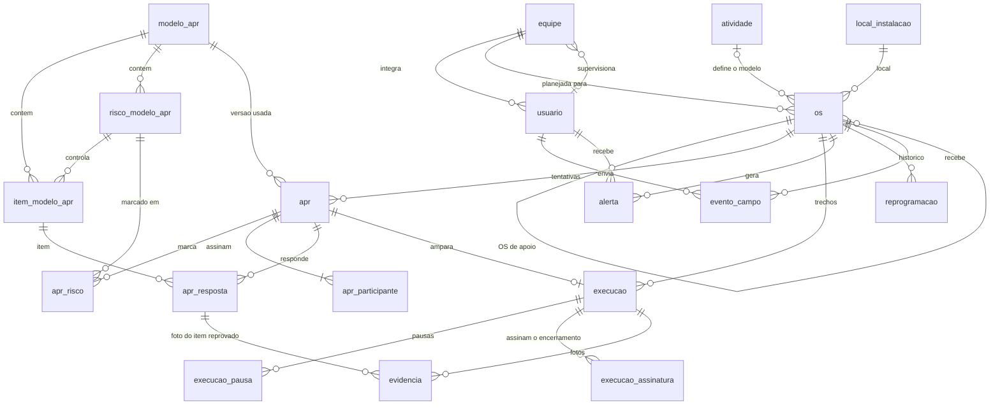

# Banco de dados

PostgreSQL (Supabase na hospedagem, Postgres comum no desenvolvimento). O schema é descrito em TypeScript com o [Drizzle ORM](https://orm.drizzle.team) em [`src/db/schema/`](../src/db/schema) e segue a [especificação](../../base/.design/especificacao.md): cada tabela e coluna vem de lá.

**O schema é a fonte de verdade.** As migrações em [`migrations/`](migrations) são geradas dele, não escritas à mão (exceto `0001_gatilhos.sql`, ver abaixo).

| Arquivo do schema | Tabelas |
|---|---|
| `plataforma.ts` | `tarefa` |
| `usuarios.ts` | `equipe`, `usuario` |
| `modelos-apr.ts` | `modelo_apr`, `risco_modelo_apr`, `item_modelo_apr`, `atividade` |
| `sap.ts` | `local_instalacao`, `os`, `importacao` |
| `apr.ts` | `apr`, `apr_participante`, `apr_risco`, `apr_resposta` |
| `execucao.ts` | `execucao`, `execucao_pausa`, `execucao_assinatura`, `evidencia` |
| `eventos.ts` | `evento_campo` |
| `impedimento.ts` | `alerta`, `reprogramacao` |
| `seed/` | não é schema: a carga inicial dos modelos de APR e das atividades (ver [Carga inicial](#carga-inicial)) |

## Como trabalhar

```bash
cd api
pnpm install
pnpm db:generate   # depois de mudar o schema: gera a próxima migração em db/migrations
pnpm db:check      # confere a consistência das migrações
pnpm db:test       # aplica as migrações num Postgres embutido (PGlite), roda os casos do schema e o da carga inicial
pnpm db:gerar-seed # relê base/apr-examples e regrava src/db/seed/modelos-apr.json
pnpm typecheck
```

Para mudar o banco: edite o schema, rode `pnpm db:generate --name=descricao` e `pnpm db:test`. Nunca edite uma migração já gerada nem o `meta/`; corrigir é uma migração nova. Para algo que o schema não descreve (gatilhos, funções), use `pnpm db:generate --custom --name=descricao` e escreva o SQL no arquivo criado.

## Migrações

Geradas pelo `drizzle-kit`, aplicadas em ordem, uma única vez cada, e registradas pelo migrador do Drizzle. Só para frente (não há `down`).

| Arquivo | Conteúdo |
|---|---|
| `0000_schema.sql` | as 21 tabelas, `CHECK`s, índices (inclusive parciais), chaves estrangeiras (inclusive a composta de `evidencia`) e RLS ligado; gerado do schema |
| `0002_os_cancelamento.sql` | `os.cancelada_em`, `cancelada_por` e `justificativa_cancelamento` (justificativa do cancelamento da OS manual), com `CHECK`; gerado do schema |
| `0001_gatilhos.sql` | o que o schema não descreve: `os.atualizada_em` automático e a imutabilidade de modelo publicado e de seus itens; SQL escrito à mão |

O Painel não tem tabela própria: lê as acima.

## Carga inicial

Os 8 modelos de APR e a tabela de atividades vêm das planilhas de [`base/apr-examples/`](../../base/apr-examples), em duas etapas:

1. [`gerar-modelos-apr.mjs`](../src/db/seed/gerar-modelos-apr.mjs) lê as planilhas e grava [`modelos-apr.json`](../src/db/seed/modelos-apr.json). O JSON é commitado: é o dado a revisar, e o diff mostra o que mudou quando uma planilha muda. As colunas variam de um arquivo para outro (A ou B, com ou sem a coluna NA), então a leitura se guia pelo texto dos cabeçalhos e pelas células mescladas (o risco é a célula mesclada da coluna "Riscos").
2. [`carregar.ts`](../src/db/seed/carregar.ts) grava o JSON no banco: cada modelo entra como rascunho e é publicado ao fim, na mesma transação. É segura para rodar a cada subida da `api`: um modelo só entra se o código ainda não existe em nenhuma versão, e uma atividade só entra se o código ainda não existe, então o que a Segurança do Trabalho editou fica. A conexão da `api` precisa de `casing: "snake_case"` no `drizzle()`, igual ao `drizzle.config.ts`.

O critério de bloqueio **não vem das planilhas**: a Segurança do Trabalho define por item, no editor, qual resposta é a correta e o que é eliminatório. O gerador só dá um ponto de partida (função `criterioProvisorio`, o único lugar a mudar): item de verificação eliminatório que bloqueia no "Não", com duas exceções (iluminação auxiliar só alerta; impedimento bloqueia no "Sim"), e medida preventiva só alerta, sem resposta que avise. Evidência em texto só para as condições psicológicas.

| Modelo | Versão | Verificação | Riscos | Medidas | Com NA |
|---|---|---|---|---|---|
| APR 01 | 4 (24/07/2026) | 11 | 10 | 32 | — |
| APR 02 | 4 (24/07/2026) | 11 | 11 | 22 | — |
| APR 03 | 4 (24/07/2026) | 11 | 11 | 37 | — |
| APR 04 | 3 (07/07/2026) | 10 | 10 | 31 | todos |
| APR 05 | 3 (07/07/2026) | 10 | 11 | 41 | todos |
| APR 06 | 3 (01/07/2026) | 12 | 2 | 21 | 1 (teste de explosividade) |
| APR 07 | 4 (24/07/2026) | 10 | 7 | 16 | — |
| APR 09 | 2 (24/07/2026) | 7 | 3 | 5 | — |

**Atividades:** 116 linhas, todas `provisorio`. Vêm da aba oculta "APR → atividades" (textos, a chave é o texto) e do campo "Plano de manutenção e operação (SAP)" das APR 01, 02, 03, 06 e 07 (a chave é o código; uma faixa como `8.7.2/ 8.7.3/ 8.7.4` vira uma linha por código; nomes sem código, como `CLB - Calibração PSV`, usam o texto). Só "Inspeção operacional em estação de gás natural" fica sem modelo (a planilha a coloca em "NÃO APLICÁVEL"). A APR 06 repete 27 códigos das listas das APR 01, 02 e 03; cada um fica com o primeiro modelo, e o gerador lista os repetidos (questão 3).

**O que as planilhas trazem e o banco não guarda:** o bloco "Instruções importantes para a atividade" da APR 07 (3 regras, como "Não usar o celular enquanto dirigir"; a APR 09 tem o título e nenhuma regra) e as colunas de função, nome e assinatura dos participantes (questão 60).

## Modelo



## O que o banco garante e o que fica na API

O banco recusa o que é sempre inválido, em qualquer cliente. As regras que dependem de outras linhas ou do estado da OS ficam na `api`.

**No banco**
- Valores permitidos de perfil, status, resultado, tipo de evento, tipo de alerta, etc. (`check`).
- Unicidade: matrícula, centro de trabalho, número da ordem SAP, versão de modelo, resposta por item, assinatura por participante.
- Exatamente um `responsavel` por APR, no máximo uma pausa aberta por execução, e uma APR amparando uma única execução (a cancelada não conta, porque cancelar por engano devolve a APR para uso).
- Execução encerrada exige fim e descrição; interrompida exige fim e motivo; "NA" exige observação; reprogramação exige justificativa; supervisor exige e-mail.
- Toda medida preventiva pertence a um risco, e item de verificação não tem risco.
- Foto de item só vale para um item que a APR respondeu; foto precisa de uma execução ou de uma APR; GPS vem completo ou não vem.
- Modelo publicado, seus riscos e seus itens são imutáveis (gatilho em `0001_gatilhos.sql`).
- `os.atualizada_em` é atualizado sozinho (gatilho), para servir de cursor do snapshot offline.
- O `evento_campo.id` vindo do cliente é chave primária: reenviar o mesmo evento é recusado e a `api` o trata como "já aplicado" (`on conflict (id) do nothing`).

**Na `api`**
- Cálculo de `os.status` e de `apr.resultado` (derivados no servidor; o banco só valida o valor).
- Só as medidas dos riscos que a equipe marcou na APR (`apr_risco`) precisam de resposta; o risco marcado deve ser do modelo da APR.
- Itens reprovados exigem observação e foto; modelo publicado precisa de ao menos um item eliminatório e de resposta bloqueante nos itens de verificação.
- A APR precisa ser `aprovada`, do dia, da própria OS e ainda não usada para amparar uma execução.
- `os.codigo_atividade` pode ser nulo: a OS entra mesmo sem atividade mapeada, e o técnico escolhe o modelo ao iniciar a APR.
- `atividade.modelo_apr_codigo` aponta para um código de modelo que tenha versão publicada. Não é chave estrangeira porque `modelo_apr.codigo` só é único junto com `versao`.
- Não existe índice único de "uma execução em andamento por OS", de propósito: duas pessoas podem executar a mesma OS offline, e as duas execuções são guardadas (vale a primeira encerrada, com alerta `execucao_duplicada`).
- Permissões por perfil. O banco tem RLS ligado e sem políticas: só a `api` acessa, e nenhum cliente recebe a chave do Supabase.

## Convenções

- Nomes de tabelas e colunas em português, sem acento, em `snake_case`.
- Tempos em `timestamptz` (UTC); o fuso `America/Sao_Paulo` é aplicado só na exibição.
- IDs de registros de campo (`apr`, `execucao`, `execucao_pausa`, `evidencia`, `evento_campo`) **não têm default**: nascem no cliente. Os demais têm `gen_random_uuid()`. `usuario.id` é o id do Supabase Auth e é informado pela `api`.
- Arquivos (fotos, assinaturas, PDFs, planilhas) ficam no Storage; o banco guarda só o caminho (`*_path`).

## Ainda não existe

- **Aplicar as migrações e a carga na subida da `api`:** a `api` vai chamar o migrador do Drizzle e, depois, `carregarDadosIniciais`, antes de abrir a porta. Falta confirmar se ele já trava a execução simultânea (duas instâncias subindo juntas) ou se é preciso uma trava de sessão do Postgres por cima.
- **Teste contra o Postgres real:** `pnpm db:test` roda em PGlite (Postgres compilado para WebAssembly), com cerca de 110 verificações (casos aceitos e recusados do schema e as da carga inicial). Ainda não foi rodado no Supabase nem num Postgres comum.
