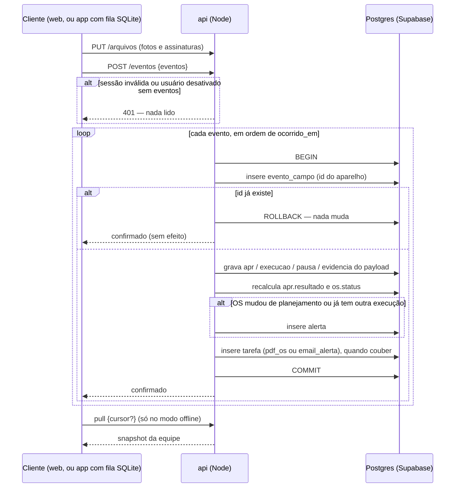
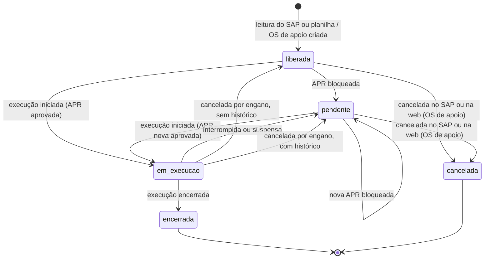
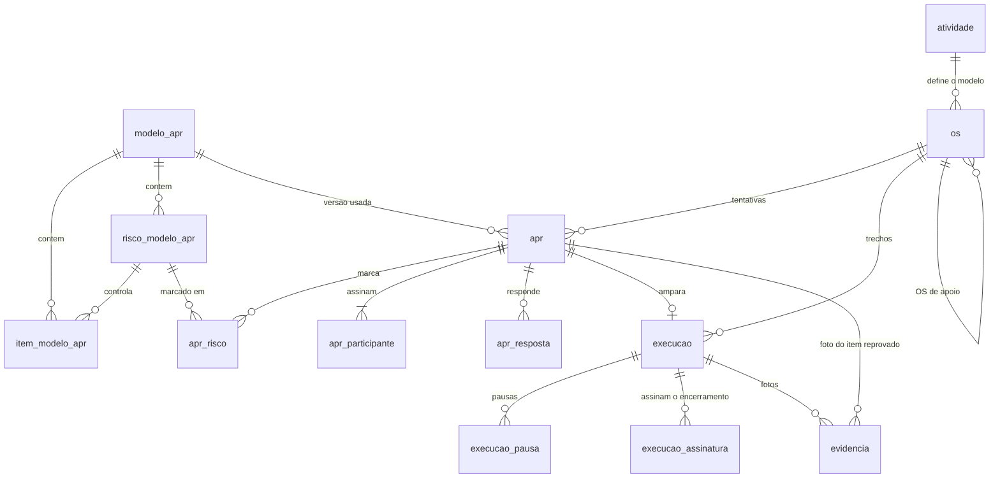
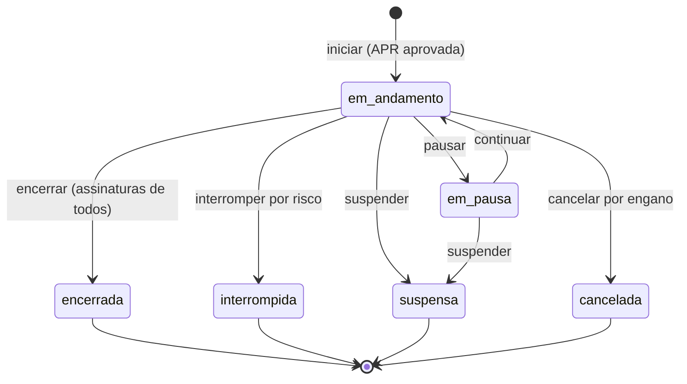

# APR e OS digitais — D.A.P.R.O.M

> Planeje a partir deste documento. Cada fatia abaixo traz o próprio formato — copie, não re-derive.
> Status: confirmado por Renan Felliphe, 2026-10-03; revisado em 2026-10-10 com a Reunião 2, as decisões do time (stack, API do SAP simulada, retomada da OS) e a recomendação adotada para todas as questões que estavam em aberto; revisado de novo em 2026-10-10 para corrigir um mal-entendido: o sistema é online, e o modo offline é um recurso adicional de contingência para o campo sem sinal, não a base da arquitetura. Web e app atendem todos os perfis.

## Situação

- Projeto: em construção — o repositório é um monorepo com as pastas `api`, `web` e `mobile`; hoje só o `web` tem código, e é a interface das telas com dados e estado simulados; além dele há esta especificação e o material de base; nenhum código de produção.
- Decisão: assumida pelo Desafio 4 ("tornar a APR e a OM 100% digitais, da criação à execução", mobile Android + web) e pelas Reuniões 1 e 2. Na Reunião 2 os mentores Iago Raich e Mario Stevan validaram o fluxo.
- Em andamento: copia do site de controle já existente (Lovable) a ideia de ler as OS do SAP e os filtros por equipe e status; o próprio site, o BI que a ES Gás está construindo e o SAP ficam fora e não são tocados. A interface em `web/` é a referência de layout e fluxo; seus dados e seu estado são simulados e serão trocados por chamadas à `api`.
- O que está em jogo: protótipo de maratona — errar custa refazer partes do protótipo, não dados de produção; a exceção é o contrato de eventos de campo (a idempotência de cada registro), que fica caro de mudar assim que houver aparelhos com fila offline pendente. O protótipo roda só com dados fictícios, nunca com dados reais da empresa.

## Problema

A OS (no SAP, "Ordem de Manutenção"/OM) é impressa, separada por equipe, preenchida à mão em campo com a APR grampeada e depois escaneada e anexada no SAP pelo Iago. Isso ocupa de 4 a 5 pessoas, consome impressora e tinta, e devolve documentos sujos, incompletos ou ilegíveis que dificultam auditoria. Pior: nada impede um gazista de começar o serviço sem a APR, ou com uma resposta negativa num item crítico. Os indicadores que gerência e diretoria acompanham (preventivas atrasadas com e sem justificativa, tempo gasto por atividade) dependem de alguém consolidar papel e planilha, e a demanda de clientes e ativos está crescendo.

Volume: ~390 OS encerradas no mês passado, variando de ~200 a 409 por mês (Reunião 1, relatado pelo Iago); o levantamento da mesma reunião cita ~900 ordens por mês somando programadas e corretivas. Horas-homem gastas na digitalização: não medidas — o relato é "4 a 5 pessoas".

## Sucesso

- Deu certo se: num piloto com uma equipe, 100% das OS encerradas têm uma APR aprovada, própria da OS, registrada antes do início da execução e nenhuma OS dessa equipe passa por impressão ou scanner; na demo, o caminho ler OS → APR → executar → PDF roda online, no app Android e no navegador, e a OS encerrada aparece no painel web na hora; como contingência, o mesmo caminho roda num Android em modo avião e chega ao painel quando o sinal volta.
- Sinal de que está dando errado: o fluxo online de APR e execução não está estável até o meio do prazo (sem ele não há o que demonstrar), ou o modo offline não envia a fila de forma confiável (sem isso não há demo do campo sem sinal), ou os técnicos do piloto voltam ao papel "porque é mais rápido" — sinal de que preencher uma APR por OS está longo demais.
- Revisão: próximo encontro presencial da maratona — Iago Raich e Mario Stevan.

## Escopo

Dentro: leitura das OS pela API do SAP (simulada no protótipo) ou por planilha; aplicação da APR e realização da OS, no app Android e na web, usados online no dia a dia (login, OS da equipe, APR respondida por inteiro e validada no fim, execução com pausa, suspensão e interrupção por risco, assinaturas, perfil e histórico); modo offline de contingência no app, para o campo sem sinal (cópia local dos dados da equipe, fila de eventos e sincronização); PDF da OS executada (página da APR e página da OS); alertas de bloqueio no painel e por e-mail; OS pendente retomada por qualquer pessoa da equipe, reprogramação opcional e OS de apoio; painel web com quadro por status, detalhe com o histórico de APRs, histórico por local e equipamento, criticidade, indicadores de preventivas e de tempo, e ciência do supervisor da equipe; tabela de atividade → modelo de APR; editor versionado de modelos; gestão de usuários, perfis e equipes; planilha de encerradas para baixa manual no SAP. Só há dois perfis, `tecnico` e `admin`; o supervisor é o técnico que a equipe aponta, não um perfil, e a Segurança do Trabalho não usa o sistema.

Fora: escrita no SAP por API — a baixa continua por planilha até o Iago confirmar o contrário ([pontos-a-validar.md](pontos-a-validar.md), questão 51). MFA/SSO e vínculo dispositivo–usuário — ver [Usuário e Equipe](#usuário-e-equipe). Push notification no celular — a OS nova aparece quando a lista é atualizada (e, no modo offline, na próxima sincronização). iOS — o desafio é para Android. Cadastro de equipamentos como entidade — o histórico usa o texto de equipamento que vem do SAP. Terceiros no app. Catálogo de serviço, escaneamento de OS e APR antigas, monitoramento do intervalo entre preventivas, chatbot de consulta e gamificação — ideias do time e sugestões dos mentores, depois do MVP. Substituir o BI ou o site Lovable — são de outra equipe. Cadastro de técnicos pelo supervisor na própria equipe, com liberação pelo admin (pronto na API), e tela de treinamento no primeiro login (ver [Cadastro pelo supervisor, liberação e treinamento](#cadastro-pelo-supervisor-liberação-e-treinamento)). Importação de OS pelo supervisor foi adiada: fica só com o admin ([pontos-a-validar.md](pontos-a-validar.md), questão 63).

Não muda: SAP (continua gerando, liberando e encerrando as ordens); site Lovable de controle; o conteúdo das APRs continua sendo da segurança do trabalho.

## Formato

O registro central é a OS lida do SAP; cada tentativa de executá-la é uma Execução amparada por exatamente uma APR própria, e a OS guarda o histórico de todas as APRs e execuções. O sistema é online: o app Android e a web falam com a `api` (Node), que é a única a falar com o Supabase (Postgres, Auth e Storage). Web e app servem a todos os perfis, e o que cada pessoa pode fazer depende do perfil, não da plataforma. Todo registro de campo (APR, execução, pausa, evidência, assinatura) chega à `api` como um evento idempotente, e esse é o único caminho de escrita: online, o cliente envia o evento na hora; sem sinal, o app guarda os eventos numa fila local e os envia quando o sinal volta. O modo offline é um recurso adicional, para a APR e a execução no campo sem sinal, e não muda o fluxo do sistema. A decisão de difícil volta é o contrato dos eventos (idempotência e divisão de posse dos dados): mudá-lo depois de haver aparelhos com fila offline pendente exige migrar dados em celulares que não controlamos. A alternativa mais pesada, um motor de replicação genérico com mesclagem campo a campo, só compensa se dois clientes passarem a editar o mesmo dado offline, e a Decisão-chave 2 impede exatamente isso.

## Decisões-chave

1. **Monorepo com três aplicações e um único ponto de acesso aos dados.** `api` (Node e TypeScript), `web` (Next.js, React e TypeScript) e `mobile` (React Native, Android, com SQLite local para o modo offline), cada uma com Dockerfile; `api` e `web` sobem no Coolify. O Supabase fornece Postgres, Auth e Storage, mas só a `api` fala com ele: nenhum cliente recebe a chave do Supabase, as tabelas ficam com RLS ligado e sem políticas e os buckets são privados. Assim a autorização vive em um lugar só e web e app conhecem uma única API. O PWA único voltaria a ganhar se o time não conseguir sustentar três codebases até a demo.
2. **Quem executa é dono da execução e quem planeja é dono do planejamento, em qualquer plataforma; a sincronização nunca descarta dado de campo.** Os registros de campo (APR, respostas, participantes, Execução, pausas, evidências e assinaturas) vêm dos eventos de quem aplica a APR e executa a OS, pelo app ou pela web; equipe, datas programadas, prioridade e criticidade são gravadas por quem planeja; o SAP, por leitura, grava os dados da ordem. Quando um evento de campo chega para uma OS que o planejamento mudou nesse meio-tempo (reatribuída, reprogramada, outra equipe já executou), ele é aplicado mesmo assim e gera um `alerta` para o supervisor — conflito vira alerta, nunca sobrescrita. Online, o intervalo para isso acontecer é curto; no modo offline, pode durar horas.
3. **Todo registro de campo nasce com ID gerado no cliente, e reenviar não tem efeito; o `status` da OS é derivado no servidor, nenhum cliente o grava direto.** Isso torna o envio seguro contra rede instável, reenvio e duplo toque, online ou pela fila offline. As transições ficam no diagrama de [Eventos e modo offline](#eventos-e-modo-offline).
4. **Uma APR vale para uma única OS e ampara uma única Execução; nenhuma Execução começa sem a APR aprovada, do dia, da própria OS; uma APR bloqueada é imutável.** A relação é 1:1, como o Iago e o Mario confirmaram (a mesma APR para várias OS foi descartada porque os riscos de cada atividade são diferentes). Toda nova tentativa, mesmo no mesmo local e na mesma hora, exige uma APR nova, e as respostas nunca são pré-preenchidas nem copiadas de outra APR. O registro das APRs bloqueadas fica para auditoria e para o indicador de atraso justificado.
5. **A APR é respondida por inteiro e só então validada; cada item do modelo define `resposta_bloqueante`, `tipo` e `evidencia`.** O técnico responde todos os itens, em qualquer ordem, e volta a corrigir enquanto não concluir; ao concluir, o resultado é `bloqueada` se qualquer item `eliminatorio` tiver a resposta bloqueante, e todos os itens reprovados são registrados, cada um com observação e, quando o item pede foto, ao menos 1 foto. O servidor recalcula o resultado a partir das respostas e da versão do modelo; o valor enviado pelo aparelho é só conferido.
6. **Um modelo de APR publicado é imutável; editar cria versão nova, e toda APR aponta para a versão exata que respondeu.** O modelo de uma OS sai da tabela `atividade` (chave da atividade no SAP → código do modelo), que o admin mantém, com o que a Segurança do Trabalho define; quando a OS não tem atividade mapeada, o técnico escolhe o modelo ao iniciar a APR, e a APR guarda a versão escolhida. APRs antigas e PDFs continuam reproduzíveis depois de uma revisão, e uma APR preenchida offline numa versão anterior é aceita com a versão que usou.
7. **O SAP é fonte de leitura e destino de planilha: a OS entra por um adaptador de leitura (API, simulada no protótipo) ou por planilha, a leitura insere ou atualiza por `numero_ordem` tocando só colunas de planejamento, e a saída é PDF mais planilha para baixa manual.** Nenhuma OS nasce à mão: a única criada no sistema é a OS de apoio, aberta a partir de um impedimento (Decisão-chave 8). Reler nunca reabre uma OS encerrada nem apaga execução de campo. Trocar a API simulada pela real muda só o endereço e as credenciais, porque o contrato é o mesmo.
8. **Uma tentativa que não conclui não trava a OS: ela fica `pendente` e qualquer pessoa da equipe a retoma com uma APR nova, sem esperar o supervisor.** O supervisor é avisado e acompanha, e pode reprogramar ou abrir uma OS de apoio, mas não autoriza a retomada. Quem executa é quem encerra, com todas as assinaturas dos participantes; nenhum usuário encerra a OS de outro e a OS pendente nunca é duplicada.

## Trabalho

| Fatia | Entrega | Status |
|---|---|---|
| [Plataforma](#plataforma) | monorepo, imagens, migrações, acesso ao Supabase, arquivos e tarefas | definida |
| [Usuário e Equipe](#usuário-e-equipe) | perfis, equipes, login pelo e-mail institucional (com login offline de contingência), assinatura do perfil | aberta — 4 suposições adotadas; 2 RFC fora da demo |
| [Integração SAP](#integração-sap) | OS entram pela API simulada ou por planilha; OS de apoio | aberta — 5 suposições adotadas |
| [Modelo de APR](#modelo-de-apr) | modelos versionados, atividade → modelo e os 8 modelos de `base/apr-examples/` | aberta — 4 suposições adotadas |
| [Eventos e modo offline](#eventos-e-modo-offline) | envio idempotente dos eventos de campo (online e pela fila offline) e cópia local da equipe para o campo sem sinal | definida |
| [APR](#apr) | checklist respondido por inteiro, evidência e validação | definida |
| [Execução](#execução) | execução com pausa, assinaturas, interrupção e PDF de 2 páginas | definida |
| [Impedimento](#impedimento) | OS pendente, alerta ao supervisor, reprogramação e OS de apoio | aberta — 3 suposições adotadas |
| [Painel](#painel) | quadro, histórico, ciência, indicadores e planilha para o SAP | aberta — 3 suposições adotadas |

Ordem: Plataforma → Usuário e Equipe → Integração SAP → Modelo de APR (só a carga inicial) → Eventos (o envio online) → APR → Execução → Impedimento → Painel → Modelo de APR (editor) → Modo offline. O fluxo online de APR e execução é a base e vem primeiro; o contrato de eventos precisa existir antes das telas de campo, porque elas o usam. O modo offline (fila local, cópia da equipe e login sem sinal) entra por último e é o maior risco de prazo do recurso adicional: ele só reaproveita o contrato de eventos. O editor de modelos fica depois do painel porque a carga inicial já destrava a demo.

Derivável do repositório, fica para o plano: textos de erro (`{erro: {codigo, mensagem}}` em pt-BR), ordenação de listas, máscaras de data e hora em pt-BR, layout das telas (a interface em `web/` é a referência), fuso `America/Sao_Paulo` para "dia" e hora exibida com os instantes guardados em UTC, paginação por `pagina` e `tamanho` — o primeiro CRUD (Usuário e Equipe) fixa a convenção e os demais seguem como ele.

Todas as questões que estavam abertas em [pontos-a-validar.md](pontos-a-validar.md) entram aqui com a solução recomendada; a seção [Suposições adotadas](#suposições-adotadas) diz quem as confirma. Nenhuma delas bloqueia a implementação.

### Plataforma

**Entrega** a estrutura do repositório, o acesso ao Supabase, as migrações, o armazenamento de arquivos e as tarefas em segundo plano que as demais fatias usam. **Status: definida.**

| Pasta | Conteúdo | Imagem |
|---|---|---|
| `api` | API REST em Node e TypeScript; schema em TypeScript com Drizzle (`src/db/schema`) e migrações SQL geradas em `db/migrations`; fixtures do SAP simulado em `fixtures/sap` | `Dockerfile`; aplicação do Coolify |
| `web` | aplicação Next.js (React e TypeScript) para todos os perfis: telas de campo (OS da equipe, APR, execução) e de gestão (quadro, alertas, importação, indicadores, modelos, usuários); o token do usuário fica em cookie `httpOnly`, fora do alcance do JavaScript | `Dockerfile`; aplicação do Coolify |
| `mobile` | app React Native para Android, câmera, captura de assinatura e SQLite local para o modo offline | `Dockerfile` de build que gera o APK; não é publicado no Coolify |
| raiz | `docker-compose.yml` para subir `api` e `web` no desenvolvimento; `README.md` com os comandos | — |

| Estado | O que deve acontecer | O que o usuário vê |
|---|---|---|
| Subir a `api` | aplica as migrações pendentes sob trava de sessão e só então abre a porta; migração que falha impede a subida | `GET /saude` responde `200` só depois |
| Requisição sem JWT válido | recusada antes de qualquer leitura | `401` |
| Perfil sem permissão para a rota | recusada | `403` |
| Cliente tenta falar com o Supabase direto | impossível: nenhum cliente tem a chave, RLS sem políticas, buckets privados | — |
| Envio de arquivo | gravado no bucket com o id gerado no cliente (app ou navegador); reenviar o mesmo id e conteúdo não tem efeito | `200` `{id}` |
| Leitura de arquivo | o back-end devolve uma URL assinada de 10 minutos, depois de checar o perfil | `200` `{url}` |
| Tarefa em segundo plano falha | nova tentativa com espera crescente (1, 5 e 15 minutos, no máximo 5 tentativas); depois fica `falhou` e aparece no painel | "PDF pendente" ou "E-mail não enviado" |

`GET /saude` → `200` `{versao, banco}`
`PUT /arquivos/{id}` `multipart: arquivo, tipo` → `200` `{id, caminho}`
`GET /arquivos/{id}/url` → `200` `{url}`

Buckets privados: `fotos`, `assinaturas`, `pdfs`, `importacoes`. Um processo do próprio back-end executa as tarefas, lendo `tarefa` sem disputar a mesma linha.

Tabela `tarefa`.

| Coluna | Tipo | Nulo | Referência | Nota |
|---|---|---|---|---|
| `tarefa.id` | uuid | não | | |
| `tarefa.tipo` | text | não | | `pdf_os` \| `email_alerta` \| `leitura_sap` |
| `tarefa.referencia_id` | uuid | sim | | `os.id`, `alerta.id` ou nulo (leitura agendada) |
| `tarefa.estado` | text | não | | `pendente` \| `em_andamento` \| `concluida` \| `falhou` |
| `tarefa.tentativas` | integer | não | | padrão 0 |
| `tarefa.proxima_em` | timestamptz | não | | |
| `tarefa.erro` | text | sim | | última mensagem |
| `tarefa.criada_em` | timestamptz | não | | |

Variáveis de ambiente da `api`: `DATABASE_URL`, `SUPABASE_URL`, `SUPABASE_SERVICE_ROLE_KEY`, `SUPABASE_JWT_SECRET`, `SAP_API_URL`, `SAP_API_TOKEN`, `SAP_SIMULADO` (`true` liga as rotas do simulador), `SAP_LEITURA_INTERVALO_MIN` (padrão 15), `SMTP_URL`, `EMAIL_REMETENTE`, `PAINEL_URL`. Do `web`: `API_URL`. Do app: o endereço da API no momento do build.

1. Banco, autenticação e arquivos — Supabase, na nuvem para a demo; o mesmo código funciona com o Supabase hospedado no Coolify, só trocando as variáveis.
2. PDF e e-mail — gerados pelo back-end Node (o Supabase não gera PDF): biblioteca de PDF declarativa para as 2 páginas e envio por SMTP configurável.
3. Dados — só fictícios no protótipo; a empresa precisa avalizar o armazenamento antes do piloto (LGPD).

- RFC: fila de tarefas em serviço próprio (Redis ou similar) — só compensa se o volume de PDFs passar do que um processo atende; a estimativa é de poucas centenas por mês. Não decidido.

### Usuário e Equipe

**Entrega** cadastro de usuários e equipes na web, com perfis, e login pelo e-mail institucional no app e na web. O login normal é online; no app, uma sessão já aberta no aparelho também entra sem sinal, como contingência do modo offline. **Status: aberta.**

| Estado | O que deve acontecer | O que o usuário vê |
|---|---|---|
| Admin cria usuário | usuário com e-mail institucional único (o login), matrícula única, perfil, equipe e senha inicial; no Supabase Auth a conta nasce com esse mesmo e-mail | `201` |
| Matrícula repetida | nada é gravado | `409` "Matrícula já cadastrada" |
| Primeiro login com senha inicial | entra, mas só consegue trocar a senha | tela "Defina sua senha" |
| Login com sinal (web ou app) | confere a senha na `api` e abre a sessão; no app, guarda também um hash salgado da senha e os dados da equipe para o modo offline | `200` |
| Modo offline: login no app sem sinal, já logou neste aparelho em até 7 dias | entra com a senha conferida contra o hash local | app abre na lista de OS |
| Modo offline: login no app sem sinal, passou de 7 dias ou nunca logou aqui | recusado | "Conecte-se para entrar" |
| Senha trocada na web enquanto o aparelho está offline | o aparelho aceita a antiga até o próximo login online; então a invalida | — |
| Esqueci a senha | só online: o admin redefine e a pessoa recebe nova senha inicial | "Procure o administrador" |
| Usuário desativado enquanto estava offline | a fila pendente ainda sobe na próxima sincronização; depois a sessão é revogada | "Acesso revogado" após enviar |
| Logout com fila pendente | recusado | "Há N registros não enviados" |
| Pessoa sem assinatura no perfil confirma uma assinatura | desenha na hora e a assinatura fica cadastrada no perfil | — |
| Refazer a assinatura do perfil | vale para as próximas assinaturas; as já feitas guardam a imagem que usaram | `200` |
| Dupla em campo | todos assinam no app ou no navegador de quem está logado, sem login próprio | lista de participantes vinda da equipe da OS |

`POST /auth/login` `{email, senha}` → `200` `{access_token, refresh_token, expira_em, usuario, senha_provisoria}`
`POST /auth/refresh` `{refresh_token}` → `200` `{access_token, expira_em}`
`POST /auth/trocar-senha` `{senha_atual, senha_nova}` → `200`
`GET /me` → `200` `{usuario, equipe}`
`PUT /me/assinatura` `{arquivo_id}` → `200`
`POST /usuarios` `{nome, matricula, email, perfil, equipe_id?, cargo?, registro_profissional?, senha_inicial}` → `201` `{id}`
`PATCH /usuarios/{id}` `{nome?, email?, perfil?, equipe_id?, cargo?, registro_profissional?, ativo?}` → `200` (trocar o e-mail troca também o login da conta no Supabase Auth; a matrícula não muda)
`POST /usuarios/{id}/redefinir-senha` → `200` `{senha_inicial}`

`DELETE /usuarios/{id}` → `200` (admin; remove o cadastro e a conta de acesso; `409` `usuario_com_historico` se a pessoa já tem APR, execução, assinatura, evento, alerta ou equipe sob sua supervisão, caso em que se desativa; `422` ao tentar remover a si mesmo)
`GET /usuarios` `?equipe_id&perfil&ativo&supervisor` → `200` `{usuarios[]}` (`supervisor=true`: quem supervisiona alguma equipe)
`POST /equipes` `{nome, centro_trabalho, supervisor_id?}` → `201` `{id}`
`PATCH /equipes/{id}` `{nome?, supervisor_id?}` → `200`
`GET /equipes` → `200` `{equipes[]}`

Tabelas `equipe`, `usuario`.

| Coluna | Tipo | Nulo | Referência | Nota |
|---|---|---|---|---|
| `equipe.id` | uuid | não | | |
| `equipe.nome` | text | não | | ex.: Serviços Especiais, Instrumentação, Atendimento Residencial |
| `equipe.centro_trabalho` | text | não | | código SAP (`SERV_ESP`); unique; usado pela leitura do SAP |
| `equipe.supervisor_id` | uuid | sim | `usuario.id` | supervisor da equipe: um técnico ativo (ver [Supervisão](#supervisão)); destinatário dos alertas; sem supervisor, os alertas vão aos admins ativos (ver [Impedimento](#impedimento)) |
| `usuario.id` | uuid | não | | = id do Supabase Auth |
| `usuario.nome` | text | não | | |
| `usuario.matricula` | text | não | | unique; identificação definitiva da pessoa na empresa (PDF e SAP); não é o login |
| `usuario.email` | text | não | | unique, sempre em minúsculas; e-mail institucional (`nome.sobrenome@empresa.com.br`): é o login, igual ao e-mail da conta no Supabase Auth, e o destino dos alertas |
| `usuario.cargo` | text | sim | | aparece sob a assinatura na OS impressa (`Técnico em Elétrica`, `Engenheiro Mecânico`) |
| `usuario.registro_profissional` | text | sim | | registro profissional impresso na OS (`CREA: ES-050003/D`) |
| `usuario.perfil` | text | não | | `tecnico` \| `admin`; o supervisor não é perfil (ver [Supervisão](#supervisão)) |
| `usuario.equipe_id` | uuid | sim | `equipe.id` | |
| `usuario.ativo` | boolean | não | | padrão true |
| `usuario.senha_provisoria` | boolean | não | | padrão true na criação e na redefinição |
| `usuario.assinatura_path` | text | sim | | imagem da rubrica ou assinatura por extenso, no bucket `assinaturas` |
| `usuario.assinatura_em` | timestamptz | sim | | |

Perfis e permissões. Só existem dois perfis, `tecnico` e `admin`. O supervisor não é um perfil: é o `tecnico` que alguma equipe aponta em `equipe.supervisor_id` (ver [Supervisão](#supervisão)), e a coluna "técnico que supervisiona" mostra o que ele ganha em cima do que o técnico já faz. A Segurança do Trabalho não é perfil e não usa o sistema: ela define o critério de bloqueio da APR e quem o cadastra no editor é o admin.

| Ação | `tecnico` | `tecnico` que supervisiona | `admin` |
|---|---|---|---|
| Aplicar APR e executar OS (app ou web, inclusive no modo offline) | sim | sim | não |
| OS da equipe, detalhe e histórico | própria equipe | própria equipe e as que supervisiona | todas |
| Quadro por status | — | própria equipe e as que supervisiona | todas |
| Ler o SAP, importar planilha e exportar | — | — | sim |
| Digitalizar OS em papel (câmera; em desenvolvimento) | — | — | sim |
| Criar OS de apoio | — | sim, para qualquer equipe, a partir de OS das equipes que supervisiona | sim |
| Reprogramar OS | — | equipes que supervisiona | sim |
| Dar ciência da execução | — | equipes que supervisiona | — |
| Cancelar OS de apoio | — | — | sim |
| Receber alertas | — | das equipes que supervisiona | de OS de equipe sem supervisor e `falha_importacao` |
| Criar, editar, publicar e excluir modelos, definir o critério de bloqueio e editar a tabela de atividades | — | — | sim |
| Usuários e equipes | — | — | sim |
| Indicadores | — | equipes que supervisiona | todas |

O perfil define o que a pessoa pode fazer; a plataforma não. Web e app aceitam qualquer perfil: o técnico pode usar a web e o supervisor e o admin podem usar o app. As telas de campo (OS da equipe, APR, execução, perfil) existem nos dois; quais telas de gestão o app oferece fica em aberto (questão 55). O admin é só gerenciamento da plataforma: não aplica APR nem executa OS. Quem aplica APR e executa é sempre um técnico, e todo supervisor também é técnico (questão 56).

O supervisor da equipe não se confunde com o `responsavel` que lidera a APR em campo, e que o modelo em papel chama de "Supervisor da Atividade".

### Supervisão

Supervisor é quem a equipe aponta em `equipe.supervisor_id`, e é sempre um técnico: faz tudo o que o técnico faz (aplica APR, executa OS, usa o modo offline) e mais a gestão da(s) equipe(s) que supervisiona. O admin muda a supervisão editando a equipe, escolhendo qualquer técnico ativo. Não existe o perfil `supervisor`.

- **O que a pessoa ganha:** as ações da coluna "técnico que supervisiona" da tabela acima, nas equipes que supervisiona: ver as OS e o quadro (além da própria equipe, se tiver uma), receber os alertas, reprogramar, abrir OS de apoio, dar ciência e ver os indicadores. Em outras equipes, não.
- **Ciência:** só de quem supervisiona a equipe da OS, e nunca de quem participou da execução (executou, preencheu a APR ou assinou como participante): `409` `ciencia_propria`. Outro supervisor ou a ausência de ciência resolve; a ciência não segura o PDF nem a exportação.
- **Telas:** o técnico que supervisiona entra no painel de gestão pelo menu do app ("Painel de supervisão") e volta ao app por "Minhas OS (campo)". O técnico sem equipe supervisionada só vê o menu de campo; o admin entra direto no painel de gestão da plataforma (usuários, equipes, importação, modelos, indicadores). `GET /me` devolve `equipes_supervisionadas`.
- **Sem supervisor:** os alertas da equipe vão aos admins ativos (ver [Impedimento](#impedimento)), que também reprogramam e abrem OS de apoio nesse caso.

### Cadastro pelo supervisor, liberação e treinamento

Decidido em 12/10/2026. **Pronto na API** (cadastro, estados de liberação, trava e treinamento); as telas da web acompanham.

1. **Cadastro pelo supervisor:** o supervisor cadastra só técnicos e só em equipes que supervisiona (`POST /usuarios`; perfil `admin`, equipe alheia ou sem equipe supervisionada é recusado com `403`, e a equipe é obrigatória). A senha provisória segue o fluxo do admin (a pessoa a troca no primeiro acesso). Matrícula e e-mail institucional têm as mesmas validações. O admin continua cadastrando qualquer perfil e equipe, e a conta dele nasce já liberada.
2. **Estados de liberação** (`usuario.liberacao`): `liberado` (acesso geral; é o de quem o admin cria e de todos os que já existiam), `pendente` (criado por supervisor, aguarda o admin) e `recusado` (o admin recusou, com motivo; a conta fica inativa e a sessão é revogada). O cadastro guarda `criado_por_id`, `criado_em`, `liberado_por_id`, `liberado_em` e `recusa_motivo`. A API devolve `liberacao`, `criado_por_id`, `criado_por_nome`, `criado_em`, `liberado_em` e `recusa_motivo` nos usuários e em `GET /me`; `criado_em` é nulo nas contas anteriores à migração `0010`.
3. **Trava do pendente:** o pendente pode entrar, trocar a senha provisória e fazer o Campo de treino (a API só guarda o estado: `GET /me`, `PUT /me/treinamento`, `POST /auth/trocar-senha`, `POST /auth/refresh`); todas as outras rotas respondem `403` com o código `aguardando_liberacao` ("Seu acesso aguarda a liberação de um administrador"). Ele não aparece como colega, membro de equipe nem na busca, e não entra no snapshot offline nem nos indicadores. O recusado não entra: no login é `403 acesso_recusado` (a mensagem traz o motivo); nas demais rotas, `401 acesso_revogado`.
4. **O que o admin faz:** `GET /usuarios?liberacao=pendente|recusado|liberado` devolve também o `total` (é como descobre os pendentes: não há alerta nem e-mail novos); `POST /usuarios/:id/liberar` e `POST /usuarios/:id/recusar` (corpo `{ "motivo" }`, obrigatório) valem só para `pendente` (senão `409`). Ele exclui o recusado pelo `DELETE` comum, o que libera e-mail e matrícula para um novo cadastro. Ativar ou desativar pelo `PATCH` só vale para quem já está liberado.
5. **O que o supervisor vê e faz:** em `GET /usuarios` e `GET /usuarios/:id` ele enxerga, além dos colegas liberados, os pendentes e recusados das equipes que supervisiona (a lista de pendentes e recusados só vem com o filtro `liberacao`), inclusive o motivo da recusa. Só nos pendentes que **ele** cadastrou, edita `nome`, `cargo` e `registro_profissional` (`PATCH`) e cancela o cadastro (`DELETE`, que apaga também a conta de acesso). Não mexe em e-mail, matrícula, equipe, perfil nem ativo, não mexe em quem já foi liberado nem no pendente de outro supervisor, e não redefine senha.
6. **Supervisor que deixa de supervisionar a equipe:** nada acontece automaticamente; os pendentes dele ficam para o admin tratar (o ex-supervisor perde o acesso a eles).
7. **Treinamento:** no primeiro login, só para técnicos, uma tela de treinamento com dados fictícios, que a pessoa pode pular ou fazer depois; fica acessível no menu. Quem aguarda liberação pode fazer o treino enquanto espera (a web roda o treino sozinha; a API só guarda o estado).
8. **Importação de OS pelo supervisor:** adiada; segue só do admin (questão 63 de [pontos-a-validar.md](pontos-a-validar.md)).

**Campo de treino (EM CONSTRUÇÃO).** Detalhamento do item 7, em desenvolvimento nesta entrega:

- **Boas-vindas:** no primeiro acesso do técnico (supervisor incluso, que é técnico), a tela "Bem-vindo ao Campo de Treino! Aqui tudo é de mentira…" oferece duas modalidades. **Direcionado**: tutorial com balões; o usuário avança com "Próximo" ou fazendo a tarefa indicada. **Livre**: a interface inteira liberada para testar, com os dados fictícios.
- **Saídas:** **Pular** grava o estado `pulado` e a tela não volta. **Fazer depois** some nesta sessão e volta no próximo login; o estado segue `nao_iniciado`.
- **Sempre acessível:** um link no menu do técnico abre o Campo de treino a qualquer hora, com "Recomeçar treino" para refazer.
- **Dados fictícios:** ficam na memória do servidor, por usuário, e a API real nunca é chamada em modo treino. Um selo "TREINO" fica visível o tempo todo.
- **Estado guardado:** `usuario.treinamento_estado` (`nao_iniciado`, `concluido` ou `pulado`) e `usuario.treinamento_em` (quando concluiu ou pulou; nulo se não iniciado). Quem já existia ao entrar a funcionalidade fica `pulado`; novos usuários nascem `nao_iniciado`. `GET /me` devolve `usuario.treinamento: {estado, em}`; `PUT /me/treinamento` com `{estado}` grava (`nao_iniciado` serve para refazer) e é idempotente. Só o estado vive na API real; o treino em si roda na web.
- **Quem:** só técnicos. Admin e a gestão do supervisor ficam sem treinamento por ora (o admin sempre aparece `nao_iniciado`, sem efeito).

1. Janela de login offline — 7 dias desde o último login online.
2. Funções de campo (gazista, instrumentista, eletricista) — ficam no texto da equipe e não viram perfil; perfil só controla acesso.
3. Login pelo e-mail institucional — todos os usuários são funcionários e têm e-mail corporativo; ele é o login e a conta no Supabase Auth usa o mesmo e-mail. A matrícula segue no cadastro como identificação definitiva (PDF, SAP). A senha inicial é definida pelo admin e trocada no primeiro acesso (questão 24).
4. Esqueci a senha — só online, pelo admin; a troca de senha na web não derruba o login offline já feito (questões 18 e 24).

- RFC: MFA ou SSO corporativo (pergunta aberta da Reunião 1) — bloqueia o uso real, não a demo. Não decidido.
- RFC: vínculo dispositivo–usuário (aparelho por colaborador ou compartilhado) — muda o login offline e a revogação. Não decidido.

### Integração SAP

**Entrega** OS no sistema a partir da API do SAP (simulada no protótipo) ou da planilha exportada (o PDF da OS e a digitalização da folha em papel pela câmera, só do admin, estão em desenvolvimento), e a OS de apoio, a única que nasce no sistema, aberta pelo supervisor da equipe ou pelo admin a partir de um impedimento. **Status: aberta.** A importação (API, planilha e digitalização) é só do admin; a do supervisor foi adiada (questão 63).

O contrato da API segue o que o SAP expõe; o simulador, que vive no próprio back-end e só está ativo com `SAP_SIMULADO=true`, devolve dados fictícios no mesmo formato, e o adaptador de leitura não sabe se fala com um ou com o outro.

`GET {SAP_API_URL}/ordens` `?alteradas_desde&pagina&tamanho` com `Authorization: Bearer` → `200` `{ordens: [{numero_ordem, numero_nota, tipo_ordem, tipo_atividade, codigo_atividade, titulo, descricao, centro_trabalho, local_instalacao: {codigo, endereco, plus_code, cliente}, equipamento, prioridade, data_inicio_prog, data_fim_prog, status_sap, solicitante, criado_por, criada_em}], proxima_pagina?}`
`GET {SAP_API_URL}/ordens/{numero_ordem}` → `200` a mesma ordem
`POST /sap-simulado/ordens` `{...ordem}` → `201` — só no simulador, para injetar OS na demonstração
`PATCH /sap-simulado/ordens/{numero_ordem}` `{status_sap}` → `200` — só no simulador, para demonstrar uma OS cancelada

`tipo_ordem` é `YBA1` (corretiva) ou `YBA2` (preventiva); `tipo_atividade` é o texto do SAP (`Z01-Manutenção Corretiva`); `codigo_atividade` é a chave que liga a OS a um modelo de APR (questão 58). As OS de exemplo mostram que ela não vem pronta: a corretiva 4023470 não tem plano de manutenção, e a preventiva 4019821 traz Plano `10573`, Item `10603` e o título `1.2 - Inspeção Funcional de Retificador`, que não aparece em nenhuma lista das APR (a APR 02 lista `8.1.2 - Inspeção Elétrica no Retificador`; a APR 03, `8.2.1 - Leitura Retificador`). O adaptador preenche `codigo_atividade` quando acha a atividade na tabela `atividade` e a deixa nula quando não acha; `plano_manutencao` e `item_manutencao` vêm do SAP e ficam guardados na OS. O simulador usa `codigo_atividade`.

| Estado | O que deve acontecer | O que o usuário vê |
|---|---|---|
| Leitura agendada (a cada `SAP_LEITURA_INTERVALO_MIN`) ou "Ler agora" | consulta a API desde a última leitura bem-sucedida e processa cada ordem como as linhas abaixo | `202` `{importacao_id}` |
| Ordem nova com status SAP liberada | cria a OS `liberada`, com a equipe resolvida pelo centro de trabalho, a atividade pelo código e o local pelo código do local de instalação (o local é criado se ainda não existe; é só assim que um local entra no sistema) | conta em `criadas` |
| Ordem nova com outro status no SAP | linha ignorada | `ignoradas`, motivo "Status SAP diferente de liberada" |
| Reler a mesma ordem | atualiza só as colunas de planejamento; nunca duplica (Decisão-chave 7) | conta em `atualizadas` |
| Ordem já `encerrada` ou `pendente` no app reaparece | planejamento atualizado; status e execução intocados | conta em `atualizadas` |
| Ordem cancelada ou encerrada no SAP, sem execução em andamento | a OS vira `cancelada` e deixa de aparecer para a equipe (no modo offline, ao sincronizar) | conta em `atualizadas` |
| Ordem cancelada no SAP com execução em andamento | a execução segue; `alerta` `conflito_planejamento` | alerta no painel |
| Ordem com reprogramação registrada no sistema e data diferente | linha ignorada, para não desfazer a reprogramação | `ignoradas`, motivo "Reprogramada no sistema" |
| Centro de trabalho sem equipe cadastrada | linha ignorada | `ignoradas`, com o motivo |
| Atividade da OS fora da tabela `atividade`, ou OS sem plano de manutenção | a OS entra normalmente, com `codigo_atividade` nulo; se havia um código, ele é cadastrado em `atividade` sem modelo, para o admin mapear com a Segurança do Trabalho; o técnico escolhe o modelo ao iniciar a APR | conta em `criadas`, com o aviso "Atividade sem modelo de APR" |
| Linha sem número de ordem | linha ignorada | `ignoradas` |
| API fora do ar, resposta inválida ou erro ao gravar | nenhuma OS é criada, alterada ou removida; a leitura seguinte retoma de onde parou | `importacao` com `erro` no histórico; `alerta` `falha_importacao` no sino de quem pediu a sincronização (na leitura agendada, dos admins ativos) |
| Planilha enviada no lugar da API | mesmo processamento, com o mesmo mapeamento de colunas | `201` `{importacao_id, criadas, atualizadas, ignoradas}` |
| Arquivo que não é o export esperado | nenhuma OS muda; ficam o arquivo e a `importacao` com `erro` no histórico | `422` "Colunas obrigatórias ausentes: …"; `alerta` `falha_importacao` para quem enviou |
| Qualquer outra falha da planilha (vazia, grande demais, não é .xlsx, erro ao gravar) | o mesmo: nenhuma OS muda, a tentativa fica no histórico com o erro | o erro na resposta e o `alerta` `falha_importacao` para quem enviou |
| Nova falha do mesmo método com o alerta anterior ainda não lido | o alerta é reaproveitado: passa a apontar para a falha mais recente e sobe para o topo, em vez de empilhar um por tentativa | um alerta só no sino |
| PDF de uma OS escolhido na Importação (em desenvolvimento) | nada é enviado nem gravado: o arquivo fica no navegador | prévia do PDF e o passo a passo que virá (leitura dos campos, conferência campo a campo, OS registrada) |
| Digitalização pela câmera, só o admin (em desenvolvimento) | abre a câmera traseira e captura a folha; nada é enviado nem gravado. Sem câmera (permissão negada, sem HTTPS), a foto pode vir do aparelho | a foto e o mesmo passo a passo, com a leitura do texto da folha |
| OS de apoio, aberta a partir de uma OS pendente | o supervisor da equipe da OS ou o admin escolhe a equipe, a atividade, as datas e o local, que precisa ser um dos já cadastrados; a OS nasce `liberada`, ligada à original (`os_origem_id`), com `origem` `apoio` e sem número SAP | `201` |
| Criar OS sem `os_origem_id`, ou com OS de origem, local ou equipe que não existem | nada é gravado: o sistema só cria OS de apoio | `422` |

`POST /sap/leituras` → `202` `{importacao_id}`
`POST /importacoes` `multipart: arquivo .xlsx` → `201` `{importacao_id, criadas, atualizadas, ignoradas: [{linha, motivo}]}`
`GET /importacoes` → `200` `{importacoes[]}`
`GET /importacoes/resumo` `?periodo=7d|30d|90d|12m` (padrão `30d`) → `200` `{periodo, agrupamento: dia|semana|mes, de, ate, totais, anterior, por_origem: {api: {..., leituras, leituras_com_erro}, planilha: {..., arquivos}}, serie: [{inicio, fim, api, planilha, leituras, falhas}], motivos_ignoradas: [{motivo, total}]}` — a aba Diagnóstico de OS da seção Indicadores e exportação: OS registradas (criadas) por dia, semana (de segunda a domingo) ou mês e por origem, leituras da API com e sem falha e os motivos das linhas ignoradas (agrupados pelo texto antes de ":", com os que passam de cinco somados em "Outros motivos"), pelo dia de São Paulo em que a leitura ou a planilha aconteceu, comparadas ao período anterior de mesmo tamanho
`GET /sap/sincronizacao` → `200` `{ultima_leitura_sem_erro_em, automatica, intervalo_min}` — estado da sincronização mostrado no cartão Sincronização da aba Importação
`POST /os` `{tipo, codigo_atividade?, titulo, descricao?, local_instalacao_id, equipe_id, data_inicio_prog, data_fim_prog?, prioridade?, equipamento?, os_origem_id}` → `201` `{id}` — só a OS de apoio: `os_origem_id` é obrigatório, e a OS nasce sem número da ordem
`GET /locais` `?codigo` → `200` `{locais[]}` — para escolher o local da OS de apoio e filtrar por trecho do código

Tabelas `os`, `local_instalacao`, `importacao`.

| Coluna | Tipo | Nulo | Referência | Nota |
|---|---|---|---|---|
| `os.id` | uuid | não | | |
| `os.numero_ordem` | text | sim | | ordem SAP (`4023470`); unique quando presente; só a OS de apoio, que ainda não existe no SAP, fica sem número (o banco exige o número em toda OS que não é de apoio) |
| `os.numero_nota` | text | sim | | nota SAP (`10006463`) |
| `os.tipo` | text | não | | `corretiva` (YBA1) \| `preventiva` (YBA2) |
| `os.tipo_atividade` | text | sim | | texto do SAP, ex.: `Z01-Manutenção Corretiva`; só exibição |
| `os.codigo_atividade` | text | sim | `atividade.codigo` | liga a OS ao modelo de APR (Decisão-chave 6); nulo quando a atividade não está mapeada, e o técnico escolhe o modelo |
| `os.titulo` | text | não | | ex.: `DCV Desobstrução de caixa de valvula` |
| `os.descricao` | text | sim | | instruções, materiais e ferramentas |
| `os.equipamento` | text | sim | | texto do SAP; chave do histórico |
| `os.local_instalacao_id` | uuid | não | `local_instalacao.id` | |
| `os.equipe_id` | uuid | não | `equipe.id` | planejamento (web) |
| `os.plano_manutencao` | text | sim | | plano de manutenção do SAP (`10573`), só nas preventivas; vem do PDF da OS |
| `os.item_manutencao` | text | sim | | item de manutenção do SAP (`10603`), só nas preventivas |
| `os.prioridade` | text | sim | | como vem do SAP (`Muito alto`) |
| `os.data_inicio_prog` | date | não | | planejamento (web) |
| `os.data_fim_prog` | date | sim | | planejamento (web) |
| `os.status` | text | não | | `liberada` \| `pendente` \| `em_execucao` \| `encerrada` \| `cancelada`; derivado no servidor (Decisão-chave 3) — ver [Eventos e modo offline](#eventos-e-modo-offline) |
| `os.data_ordem` | date | sim | | "Data da Ordem" (emissão), do cabeçalho da OS impressa |
| `os.criado_por_sap` | text | sim | | quem criou a ordem no SAP (`RFAVARO`, `IP1020251202`); aparece no PDF |
| `os.status_sap` | text | sim | | "Status do sistema" do SAP, uma lista de códigos (`LIB IMPR CAPC NOAP SCDM`); a api procura o `LIB` |
| `os.solicitante` | text | sim | | vem do SAP; geralmente vazio; aparece no PDF quando existe |
| `os.os_origem_id` | uuid | sim | `os.id` | a OS que a OS de apoio destrava; preenchido em toda OS de apoio e só nela (o banco confere: `origem` = `apoio` se e somente se há `os_origem_id`) |
| `os.origem` | text | não | | `sap` \| `planilha` \| `apoio`; `apoio` é a OS aberta pelo supervisor ou pelo admin a partir de um impedimento, a única sem origem no SAP |
| `os.pdf_path` | text | sim | | PDF da OS, no bucket `pdfs`; um por OS |
| `os.pdf_em` | timestamptz | sim | | |
| `os.ciencia_por` | uuid | sim | `usuario.id` | supervisor que deu ciência |
| `os.ciencia_em` | timestamptz | sim | | |
| `os.exportada_sap_em` | timestamptz | sim | | preenchida pela exportação do [Painel](#painel) |
| `os.cancelada_em` | timestamptz | sim | | quando a OS foi cancelada (no SAP, ou na web, no caso da OS de apoio) |
| `os.cancelada_por` | uuid | sim | `usuario.id` | quem cancelou; nulo quando foi o SAP |
| `os.justificativa_cancelamento` | text | sim | | obrigatória quando `cancelada_por` está preenchido (cancelamento da OS de apoio, ver [Impedimento](#impedimento)) |
| `os.atualizada_em` | timestamptz | não | | cursor do snapshot do modo offline |
| `local_instalacao.id` | uuid | não | | |
| `local_instalacao.codigo` | text | não | | unique; ex.: `VILA VELHA/REDE VILA VELHA` |
| `local_instalacao.endereco` | text | sim | | |
| `local_instalacao.plus_code` | text | sim | | |
| `local_instalacao.cliente` | text | sim | | ex.: Vale, Suzano |
| `local_instalacao.critico` | boolean | não | | padrão false; editado no [Painel](#painel) |
| `importacao.id` | uuid | não | | |
| `importacao.origem` | text | não | | `api` \| `planilha` |
| `importacao.arquivo` | text | sim | | caminho no bucket `importacoes`, só para planilha |
| `importacao.usuario_id` | uuid | sim | `usuario.id` | nulo na leitura agendada |
| `importacao.criadas` / `atualizadas` / `ignoradas` | integer | não | | |
| `importacao.detalhe_ignoradas` | jsonb | sim | | `[{linha ou numero_ordem, motivo}]` |
| `importacao.erro` | text | sim | | |
| `importacao.criada_em` | timestamptz | não | | |

Índices: `os(equipe_id, status)`, `os(local_instalacao_id)`, `os(atualizada_em)`, `os(equipamento)`.

1. Mapeamento de colunas da planilha — usar os campos do PDF da OS 4023470 (ordem, nota, tipo, centro de trabalho, local de instalação, equipamento, datas programadas, prioridade, endereço) até chegar a planilha de OS de 2025 que o Iago vai enviar; ajustar o mapeamento quando ela chegar (questões 43 e 54).
2. Só OS liberadas descem para o aparelho (questão 29); status SAP diferente de liberada fica de fora com o motivo registrado.
3. OS cancelada no SAP vira `cancelada` pela própria leitura; a OS de apoio, que não tem origem no SAP, é cancelada na web com justificativa (questão 5).
4. Reprogramação no sistema vence a data do SAP (questão 14).
5. OS do módulo MM (a APR 09, de almoxarifado) só entram se vierem na leitura; a APR 09 sem OS não bloqueia nada (questão 33).

### Modelo de APR

**Entrega** modelos de APR versionados, criados, editados e excluídos na web pelo administrador (`admin`), que cadastra o que a Segurança do Trabalho define (ela é dona do conteúdo e do critério de bloqueio, mas não usa o sistema), a tabela que liga cada atividade a um modelo, e os 8 modelos de `base/apr-examples/` como carga inicial. No painel, ficam na seção APR (abas Modelos e Atividades, como a seção Ordem de Serviço). O dashboard de APR, na seção Indicadores e exportação (`GET /aprs/resumo` `?periodo=7d|30d|90d|12m`, só do admin) mostra, pela data de conclusão, as APRs respondidas e bloqueadas com a comparação com o período anterior, os alertas registrados, as APRs de OS sem atividade ligada a um modelo, os itens que mais bloqueiam, os alertas mais registrados e as APRs por modelo e por equipe. **Status: aberta.**

| Estado | O que deve acontecer | O que o usuário vê |
|---|---|---|
| Carga inicial | APR 01–07 e 09 entram publicadas, na versão e na data que o próprio documento traz (`VERSÃO 04 DATA: 24/07/2026`), com itens de verificação, riscos, medidas preventivas e o bloco de contatos de emergência (PAE) | |
| Carga inicial da tabela de atividades | cada código de plano de manutenção listado no campo "Plano de manutenção e operação (SAP)" (APR 01, 02, 03, 06 e 07; uma faixa como `8.7.2/ 8.7.3` vira uma linha por código), e cada atividade da tabela dinâmica "APR → atividades" presente nos 8 arquivos, vira uma linha em `atividade`; a que aparece em mais de um modelo fica no primeiro, na ordem das APR | todas entram marcadas como provisórias; sem código do SAP, o texto é a chave |
| Admin edita um modelo publicado | cria rascunho da versão seguinte; a publicada não muda (Decisão-chave 6) | `201` |
| Publicar rascunho | vira a versão usada pelas APRs novas; a anterior fica só para leitura | `200` |
| Publicar sem nenhum item eliminatório | recusado | `422` "Modelo precisa de ao menos um item eliminatório" |
| Publicar com item de verificação sem resposta bloqueante | recusado | `422` "Todo item de verificação precisa de resposta bloqueante" |
| APR offline respondida na versão anterior chega | aceita, gravada com a versão que usou | |
| Admin liga um código de atividade a um modelo | as OS dessa atividade passam a usar o modelo; a leitura seguinte preenche `codigo_atividade` das OS que ainda estavam sem atividade mapeada | `200` |
| Admin troca o modelo de um código | vale para as APRs novas; as OS já abertas usam o modelo novo ao atualizar a lista (no modo offline, na próxima sincronização) | `200` |
| Cria um modelo novo | rascunho da versão escolhida (a revisão do documento; padrão 1), em branco ou copiado da versão em uso de outro modelo; só vale para as APRs depois de publicado | `201` |
| Exclui um modelo que nunca foi publicado | o rascunho é apagado e o código fica livre | `200` |
| Exclui um modelo já publicado | arquivado, não apagado: sai das listas, das APRs novas e da cópia offline, e o rascunho é descartado; as versões ficam, porque APRs, PDFs e a APR offline pendente apontam para elas (a que chegar ainda é aceita). As atividades dele vão para o substituto escolhido ou ficam sem modelo | `200` |
| Restaura um modelo excluído | volta às listas e às APRs novas; as atividades não voltam sozinhas | `200` |
| Liga atividade a um modelo excluído, cria versão dele ou o exclui de novo | recusado | `422` / `409` |

`POST /modelos-apr/{codigo}/versoes` `{titulo, pae?, itens: [{secao, grupo, ordem, texto, resposta_bloqueante, tipo, evidencia, permite_na}]}` → `201` `{id, versao}`
`POST /modelos-apr/{codigo}/versoes/{versao}/publicar` → `200` `{id, versao, publicado_em}`
`GET /modelos-apr` `?arquivados` → `200` `{modelos[]}`
`GET /modelos-apr/{codigo}` → `200` `{codigo, titulo, arquivado_em, versoes[]}`
`GET /modelos-apr/{codigo}/uso` → `200` `{atividades[], os_abertas: {total, recentes[]}, aprs: {total, bloqueadas, ultima_em}}` — só admin
`DELETE /modelos-apr/{codigo}` `?substituto` → `200` `{codigo, resultado: excluido | arquivado, atividades, substituto}`
`POST /modelos-apr/{codigo}/restaurar` → `200` `{codigo, versoes}`
`PUT /atividades/{codigo}` `{descricao, modelo_apr_codigo}` → `200`
`GET /atividades` `?sem_modelo&modelo` → `200` `{atividades[]}`

Tabelas `modelo_apr`, `risco_modelo_apr`, `item_modelo_apr`, `atividade`.

| Coluna | Tipo | Nulo | Referência | Nota |
|---|---|---|---|---|
| `modelo_apr.id` | uuid | não | | |
| `modelo_apr.codigo` | text | não | | `APR 01` … `APR 09`; unique com `versao` |
| `modelo_apr.versao` | integer | não | | começa no número da VERSÃO do documento; cada edição soma 1 |
| `modelo_apr.data_documento` | date | sim | | "DATA" do documento em papel |
| `modelo_apr.titulo` | text | não | | ex.: `ESPAÇO CONFINADO E/OU TRABALHO EM ALTURA` |
| `modelo_apr.pae` | jsonb | sim | | plano de atendimento a emergências, mostrado no app e na página 1 do PDF: `{titulo, subtitulo, fluxo, linhas: [{rotulo, celulas: [{coluna, texto}]}]}`, a grade de contatos da planilha (a posição de cada célula é a `coluna`, relativa ao rótulo) |
| `modelo_apr.publicado_em` | timestamptz | sim | | nulo = rascunho; publicado não aceita escrita |
| `modelo_apr.arquivado_em` | timestamptz | sim | | modelo excluído depois de publicado, em todas as versões do código; é a única coluna que a versão publicada aceita mudar, e rascunho não é arquivado |
| `risco_modelo_apr.id` | uuid | não | | |
| `risco_modelo_apr.modelo_apr_id` | uuid | não | `modelo_apr.id` | |
| `risco_modelo_apr.classificacao` | text | não | | "Classificação" da planilha das medidas preventivas (`Veicular`, `Ambiente de trabalho`) |
| `risco_modelo_apr.nome` | text | não | | "Riscos" da planilha (`Insolação`, `Áreas molhadas`); a equipe marca "( )" os que existem na atividade |
| `risco_modelo_apr.ordem` | integer | não | | ordem do risco no modelo; único por modelo |
| `item_modelo_apr.id` | uuid | não | | |
| `item_modelo_apr.modelo_apr_id` | uuid | não | `modelo_apr.id` | |
| `item_modelo_apr.secao` | text | não | | `verificacao` \| `medida_preventiva` |
| `item_modelo_apr.risco_id` | uuid | sim | `risco_modelo_apr.id` | o risco que a medida controla; obrigatório nas medidas preventivas e nulo nos itens de verificação |
| `item_modelo_apr.ordem` | integer | não | | ordem da pergunta na tela |
| `item_modelo_apr.texto` | text | não | | |
| `item_modelo_apr.resposta_bloqueante` | text | sim | | `sim` \| `nao` \| nulo (Decisão-chave 5) |
| `item_modelo_apr.tipo` | text | não | | `eliminatorio` \| `alerta` |
| `item_modelo_apr.evidencia` | text | não | | `foto` (padrão) \| `texto`; `texto` dispensa a foto obrigatória |
| `item_modelo_apr.permite_na` | boolean | não | | as APR 04 e 05 têm coluna NA (todos os itens); na APR 06, só o item do teste de explosividade (questão 61) |
| `atividade.codigo` | text | não | | código do plano de manutenção do SAP (`8.7.1`); PK |
| `atividade.descricao` | text | não | | ex.: `Drenagem Caixa de Válvula` |
| `atividade.modelo_apr_codigo` | text | sim | | modelo usado pelas OS dessa atividade |
| `atividade.provisorio` | boolean | não | | código inventado na carga inicial, à espera do código real do SAP |

1. Critério de bloqueio — quem define é a Segurança do Trabalho, **por item**, e o admin cadastra no editor de modelos o que ela definiu: quais perguntas existem, qual resposta é a correta e quais são eliminatórias (nem toda pergunta bloqueia no "Não"). A carga inicial não traz esse critério (as planilhas não o dizem) e usa só um ponto de partida, que o admin ajusta, conforme a Segurança, criando uma versão nova: todo item de verificação é `eliminatorio` e bloqueia no Não, exceto "O serviço requer uso de iluminação auxiliar?" (`alerta`, registra no Sim) e "Existe algum impedimento para executar a atividade?" (`eliminatorio`, bloqueia no Sim); toda medida preventiva é `alerta` sem resposta que avise. Os riscos da planilha são marcados pela equipe com "( )", e só as medidas dos riscos marcados são respondidas: nas duas APR 03 preenchidas dos exemplos, as medidas dos riscos sem marca ficam em branco. Por isso o risco é uma entidade do modelo (`risco_modelo_apr`) e a marcação fica em `apr_risco` (questão 59). O ponto de partida é provisório até a Segurança do Trabalho validar, via Iago.
2. Evidência por item — `texto` só para "Todos os participantes da atividade estão em boas condições psicológicas?" (e equivalentes), porque condição psicológica não se comprova com foto e a NR 01 dá ao trabalhador o direito de recusa; todos os demais são `foto`. O admin altera isso no editor, conforme a Segurança do Trabalho (questão 50).
3. Resposta "NA" — passa, exige observação, e só é oferecida nos itens com `permite_na` (questão 9): todos os itens das APR 04 e 05 (que têm a coluna) e o teste de explosividade da APR 06 (questão 61).
4. Tabela de atividades — editável pelo admin, com o que a Segurança do Trabalho define; o código real do SAP ainda não foi confirmado e o plano de manutenção está em revisão, então os códigos vão mudar (questões 3, 52 e 58). Toda a carga entra como `provisorio`; a chave é o código do plano quando existe e o texto quando não. Um modelo por OS: o que a APR 06 repete das listas das APR 01, 02 e 03 fica com a primeira.

### Eventos e modo offline

**Entrega** o envio idempotente dos eventos de campo, que é o único caminho de escrita do sistema e funciona do mesmo jeito no app e na web, e, por cima dele, o modo offline de contingência: a cópia local dos dados da equipe e a fila de eventos do app. **Status: definida.** O contrato dos eventos é a decisão de difícil volta (ver Formato).

Com sinal, a aplicação da APR e a realização da OS não passam por fila nem por sincronização: cada ação gera um evento que o cliente envia na hora para `POST /eventos`, e a tela já mostra o resultado calculado pela `api` (APR aprovada ou bloqueada, status da OS). A web envia o evento direto. O app o grava antes na fila local e o envia em seguida; se não houver sinal, o evento fica na fila e sobe depois. Tudo abaixo sobre fila, snapshot e sinal descreve esse modo de contingência.

| Estado | O que deve acontecer | O que o usuário vê |
|---|---|---|
| Ação de campo com sinal (app ou web) | o evento é enviado na hora; a `api` o aplica e devolve o resultado | a tela atualiza, sem espera de sincronização |
| Abrir o app com sinal | envia o que sobrou na fila (os arquivos primeiro, depois os eventos) e baixa o snapshot da equipe | indicador "Sincronizado hh:mm" |
| Ação de campo sem sinal | o evento fica na fila local; o app segue funcionando sobre a cópia local | "Sem conexão — N registros pendentes" |
| Botão "Sincronizar" sem sinal | nada sai; a fila fica intacta | "Sem conexão — N registros pendentes" |
| Envio cai no meio | o que chegou fica aplicado; o reenvio não tem efeito (Decisão-chave 3) | pendentes diminuem só pelo que foi confirmado |
| Mesmo evento enviado duas vezes | aplicado uma vez | confirmado nas duas |
| Evento cujo arquivo ainda não subiu | continua pendente | pendente |
| OS reatribuída ou reprogramada enquanto o técnico estava offline | execução de campo aplicada; `alerta` `conflito_planejamento` (Decisão-chave 2) | a OS aparece com o novo planejamento após a próxima sincronização |
| Duas pessoas executam a mesma OS offline | as duas Execuções são guardadas; vale a primeira encerrada; `alerta` `execucao_duplicada` | |
| OS removida do escopo da equipe | sai do celular na próxima sincronização, a menos que tenha execução local pendente | |
| Dados do snapshot de uma equipe | OS `liberada`, `pendente` e `em_execucao` da equipe, com o resumo das APRs e execuções de cada uma; as OS `encerrada` do próprio técnico nos últimos 60 dias (para o histórico do perfil); modelos publicados; tabela de atividades; locais dessas OS; usuários da equipe | |
| Snapshot em vez de cursor | o snapshot nunca apaga do aparelho uma OS com evento local pendente | |

`POST /eventos` `{eventos: [{id, tipo, os_id, payload, ocorrido_em}]}` → `200` `{confirmados: [id], alertas: [id], aprs?: [{id, resultado}], os?: [{id, status}]}` — o canal único de escrita de campo, usado por web e app; online, o cliente manda um evento por vez e usa `aprs` e `os` da resposta para mostrar o resultado
`POST /sync/pull` `{cursor?}` → `200` `{os[], aprs[], execucoes[], locais[], atividades[], modelos_apr[], usuarios[], cursor}` — só do modo offline: baixa a cópia local da equipe

No modo online, a lista de OS e o detalhe vêm de `GET /os` e `GET /os/{id}` (ver [Painel](#painel)); o técnico só vê a própria equipe.

Tipos de evento e o que cada `payload` leva:

| Tipo | Payload |
|---|---|
| `apr_concluida` | a APR completa: `os_id`, versão do modelo, participantes com função e assinatura, riscos marcados, respostas com observação, evidências, observação geral e `concluida_em`; o resultado enviado é só conferido |
| `execucao_iniciada` | `id`, `os_id`, `apr_id`, `numero_pessoas`, `inicio` |
| `pausa_iniciada` | `id`, `execucao_id`, `inicio`, `motivo?` |
| `pausa_encerrada` | `pausa_id`, `fim` |
| `execucao_encerrada` | `execucao_id`, `fim`, `descricao_atividade`, `dados_inspecao?`, evidências, assinaturas de todos os participantes |
| `execucao_interrompida` | `execucao_id`, `fim`, `motivo`, evidências |
| `execucao_suspensa` | `execucao_id`, `fim` |
| `execucao_cancelada` | `execucao_id` |

Fotos e assinaturas sobem ao Storage (`PUT /arquivos/{id}`) antes do evento que as referencia. No MVP o `pull` entrega o snapshot completo; o `cursor` continua no contrato, opcional, para a troca por pull incremental sem quebrar o app (questão 4).

Tabela `evento_campo`.

| Coluna | Tipo | Nulo | Referência | Nota |
|---|---|---|---|---|
| `evento_campo.id` | uuid | não | | gerado no aparelho; PK garante a idempotência |
| `evento_campo.usuario_id` | uuid | não | `usuario.id` | |
| `evento_campo.tipo` | text | não | | ver acima |
| `evento_campo.os_id` | uuid | sim | `os.id` | |
| `evento_campo.payload` | jsonb | não | | |
| `evento_campo.ocorrido_em` | timestamptz | não | | relógio do aparelho |
| `evento_campo.recebido_em` | timestamptz | não | | relógio do servidor |

O painel sinaliza quando `ocorrido_em` for posterior a `recebido_em` ou anterior ao último download da OS: relógio do aparelho errado (questão 17).

O `status` da OS é derivado, nesta ordem: `cancelada` se o SAP a cancelou (ou, na OS de apoio, se ela foi cancelada na web); `encerrada` se há Execução encerrada; `em_execucao` se há Execução em andamento (inclui em pausa); `pendente` se há APR bloqueada, ou Execução interrompida ou suspensa, e nenhuma Execução em andamento; `liberada` nos demais casos.

Alternativas consideradas: replicação genérica com mesclagem campo a campo — ganha se dois clientes (app e web, ou dois apps) editarem a mesma coluna offline, o que a Decisão-chave 2 proíbe.

1. Pull por snapshot no MVP e cursor depois — o contrato `POST /sync/pull` mantém o `cursor?` opcional (questão 4).
2. Relógio do aparelho — guardam-se `ocorrido_em` e `recebido_em`, e o painel sinaliza a diferença (questão 17). Online a diferença é de segundos; ela só importa de fato no modo offline.
3. Online primeiro — o app e a web usam o mesmo `POST /eventos` e a mesma resposta; o app só acrescenta a fila local antes do envio. Por isso o modo offline pode ser a última fatia sem alterar as telas de campo nem os contratos das demais fatias.

### APR

**Entrega** o checklist no app e na web, respondido por inteiro, com evidência por item reprovado e validação no fim, que aprova ou bloqueia uma OS. **Status: definida.**

| Estado | O que deve acontecer | O que o usuário vê |
|---|---|---|
| Iniciar APR | o técnico escolhe uma OS `liberada` ou `pendente` da equipe; o modelo é o publicado mais recente do `codigo_atividade` da OS (Decisão-chave 6); se a OS não tem atividade mapeada, o técnico escolhe o modelo entre os publicados | modelo e versão |
| OS com execução em andamento | recusado | "Esta OS já está em execução" |
| Escolher os participantes | a lista é a equipe da OS; o técnico logado é o `responsavel` por padrão e é sempre participante; marca quem está presente (de 1 pessoa em diante) | participantes da equipe |
| Marcar os riscos | o técnico marca os riscos que existem na atividade (a "( )" da planilha), agrupados por classificação; só as medidas desses riscos aparecem para resposta e só elas são exigidas | lista de riscos por classificação |
| Responder item | livre, em qualquer ordem, nos itens de verificação e nas medidas dos riscos marcados; dá para voltar e mudar até concluir; as respostas nunca vêm preenchidas | pergunta atual e lista numerada |
| Resposta bloqueante em item `eliminatorio` | não bloqueia na hora; exige observação e, se o item pede foto, ao menos 1 foto; o técnico segue respondendo | painel de evidência no item |
| Item de condição pessoal reprovado (`evidencia` = `texto`) | basta a justificativa em texto; a foto é opcional (direito de recusa) | "Justifique em texto" |
| Resposta bloqueante em item `alerta` | segue; o item fica marcado | aviso amarelo; aparece no PDF e no painel |
| "NA" em item sem `permite_na` | não é oferecido | — |
| "NA" em item com `permite_na` | passa, com observação obrigatória | campo de observação |
| Concluir e validar, sem item reprovado | APR `aprovada` | tela "APR aprovada" |
| Concluir e validar, com item reprovado | APR `bloqueada`, com **todos** os itens reprovados registrados, cada um com a sua evidência; a OS fica `pendente`; vira o evento `apr_concluida` (enviado na hora, ou pela fila no modo offline) | "Atividade impedida — supervisor será avisado" |
| Concluir com evidência faltando | recusado | "Falta evidência em N item(ns)" |
| APR aprovada | cada participante confirma a assinatura do perfil, no app ou no navegador de quem está logado | "Confirmar assinatura" |
| Assinaturas confirmadas | a execução é liberada | botão "Iniciar execução" |
| App ou página fechados no meio | rascunho local retomado (no app, no SQLite; na web, no navegador); nada é enviado até concluir | "Continuar APR" |
| APR aprovada de outro dia, ou já usada por uma Execução | não ampara execução nova | exige APR nova |
| Observação geral | texto opcional, vai ao PDF | campo "Observações" |
| Tentar mudar uma APR bloqueada | impossível (Decisão-chave 4) | só leitura |

`GET /os/{id}/aprs` → `200` `{aprs[]}` (histórico da OS, para a web)

Tabelas `apr`, `apr_participante`, `apr_risco`, `apr_resposta`. Todos os IDs nascem no cliente (app ou navegador).

| Coluna | Tipo | Nulo | Referência | Nota |
|---|---|---|---|---|
| `apr.id` | uuid | não | | |
| `apr.os_id` | uuid | não | `os.id` | uma APR, uma OS (Decisão-chave 4) |
| `apr.modelo_apr_id` | uuid | não | `modelo_apr.id` | versão exata (Decisão-chave 6) |
| `apr.preenchida_por` | uuid | não | `usuario.id` | |
| `apr.resultado` | text | não | | `aprovada` \| `bloqueada`; calculado no servidor |
| `apr.observacao_geral` | text | sim | | |
| `apr.concluida_em` | timestamptz | não | | também define o dia de validade |
| `apr_participante.apr_id` | uuid | não | `apr.id` | |
| `apr_participante.usuario_id` | uuid | não | `usuario.id` | |
| `apr_participante.funcao` | text | não | | `responsavel` \| `executor`; exatamente um `responsavel` (o que o papel chama de "Supervisor da Atividade"). Não confundir com o supervisor da equipe |
| `apr_participante.assinatura_path` | text | não | | cópia da assinatura do perfil no momento da confirmação |
| `apr_participante.assinada_em` | timestamptz | não | | |
| `apr_risco.apr_id` | uuid | não | `apr.id` | PK composta com `risco_id` |
| `apr_risco.risco_id` | uuid | não | `risco_modelo_apr.id` | risco que a equipe marcou "( )" nesta APR; deve ser do modelo da APR (a api confere) |
| `apr_resposta.apr_id` | uuid | não | `apr.id` | unique com `item_id` |
| `apr_resposta.item_id` | uuid | não | `item_modelo_apr.id` | unique com `apr_id` |
| `apr_resposta.resposta` | text | não | | `sim` \| `nao` \| `na` |
| `apr_resposta.observacao` | text | sim | | obrigatória no item reprovado e no `na` |
| `apr_resposta.respondida_em` | timestamptz | não | | |

Um item está **reprovado** quando o `tipo` é `eliminatorio` e a `resposta` é igual à `resposta_bloqueante`. As fotos do item reprovado ficam em `evidencia` (ver [Execução](#execução)), ligadas à APR e ao item.

1. Ninguém trabalha sozinho — vale como item do modelo ("A atividade será feita em dupla…"), não como regra do app: a APR exige o `responsavel`, e o Iago descreveu casos de uma pessoa só preenchendo (22:40).
2. Quem pode participar — só quem está na equipe da OS; participante de fora da equipe (apoio, terceiros) fica para depois (questão 10).
3. Validade — a APR vale para uma execução, no dia em que foi concluída (questão 8).

### Execução

**Entrega** o registro da execução em campo, com cronômetro, pausa, evidência, assinaturas, suspensão e interrupção, e o PDF de 2 páginas. **Status: definida.**

Uma Execução é um trecho de trabalho amparado por uma APR. Uma atividade de vários dias, ou que troca de executor, tem várias Execuções, e cada retomada começa com uma APR nova.

| Estado | O que deve acontecer | O que o usuário vê |
|---|---|---|
| Iniciar sem APR aprovada do dia, da própria OS e ainda não usada | recusado (Decisão-chave 4) | "Preencha a APR antes de iniciar" |
| Iniciar | informa o número de pessoas (padrão: os participantes da APR); grava o início com a hora do dispositivo; a OS fica `em_execucao` | cronômetro rodando |
| Pausar | abre uma pausa, com motivo opcional (almoço, descanso, outro); a pausa não entra no tempo líquido | "Em pausa" |
| Continuar | fecha a pausa; só vale na mesma Execução, no mesmo dia e pelo mesmo usuário | cronômetro rodando |
| Continuar noutro dia, ou por outra pessoa | não existe: a Execução anterior é suspensa e é preciso uma APR nova | "Faça uma APR nova para retomar" |
| Execução esquecida em andamento de outro dia | o app exige suspendê-la, informando a hora real do fim, antes de iniciar outra; o painel destaca execuções abertas há mais de 12 h; nada é encerrado sozinho | "Suspender a execução de ontem" |
| Suspender (fim do expediente) | Execução `suspensa`; a OS fica `pendente`; sem alerta | "OS pendente — retome com APR nova" |
| Interromper por risco | motivo e ao menos 1 foto obrigatórios; Execução `interrompida`; a OS fica `pendente`; `alerta` `bloqueio` | "Atividade interrompida — supervisor será avisado" |
| Cancelar por engano | só até 10 minutos depois do início, sem foto nem pausa; a Execução fica `cancelada` e a APR volta a poder ser usada no mesmo dia; a OS volta ao status anterior | "Execução cancelada" |
| Encerrar sem descrição, sem foto ou sem a assinatura de todos os participantes | recusado | "Descrição, foto e assinaturas de todos são obrigatórias" |
| Encerrar | grava descrição da atividade, fim, fotos e as assinaturas de todos os participantes da APR; a OS fica `encerrada` (aguardando envio) | "Encerrada (aguardando envio)" |
| Evento de encerramento chega ao servidor | cria a tarefa `pdf_os`; o PDF é gerado e guardado no Storage | link do PDF na OS, no app e na web |
| Falha ao gerar o PDF | a OS continua `encerrada`; nova tentativa automática (ver [Plataforma](#plataforma)) | "PDF pendente" no painel |
| Supervisor dá ciência | o PDF é gerado de novo, agora com a ciência | "Ciente em dd/mm hh:mm" |

`GET /os/{id}/pdf` → `200` `application/pdf`

O PDF segue o papel atual: **página 1, a APR** (cabeçalho com ordem, instalação ou local, data, hora e descrição do serviço; participantes com função, nome, matrícula e assinatura; todos os itens com a resposta, destacando os alertas e as observações; observação geral; o bloco de contatos de emergência do modelo; o código, a versão e a data do documento) e **página 2, a OS** (cabeçalho da ordem com o número, a data de emissão e o registro digital; centro de trabalho, tipo de atividade, status e criador; local de instalação e equipamento; nota de manutenção; planejamento com prioridade e criticidade; execução com início, fim, tempo total, pausas, tempo líquido, número de pessoas e descrição; assinaturas de **todos** os executantes, do responsável da manutenção, a ciência do supervisor e o solicitante, quando existir; fotos com data, hora e posição). Em atividades de vários dias, a página 1 é a APR da Execução que encerrou, o tempo líquido soma os trechos, e a página 2 lista as datas dos trechos anteriores.

Tabelas `execucao`, `execucao_pausa`, `execucao_assinatura`, `evidencia`.

| Coluna | Tipo | Nulo | Referência | Nota |
|---|---|---|---|---|
| `execucao.id` | uuid | não | | nasce no aparelho |
| `execucao.os_id` | uuid | não | `os.id` | |
| `execucao.apr_id` | uuid | não | `apr.id` | único entre as execuções não canceladas (cancelar por engano devolve a APR); precisa estar `aprovada` |
| `execucao.executor_id` | uuid | não | `usuario.id` | quem estava logado |
| `execucao.numero_pessoas` | integer | não | | informado ao iniciar |
| `execucao.inicio` | timestamptz | não | | |
| `execucao.fim` | timestamptz | sim | | |
| `execucao.resultado` | text | sim | | `encerrada` \| `interrompida` \| `suspensa` \| `cancelada`; nulo = em andamento |
| `execucao.descricao_atividade` | text | sim | | obrigatória se `encerrada` |
| `execucao.motivo` | text | sim | | obrigatório se `interrompida` |
| `execucao.dados_inspecao` | jsonb | sim | | leituras e conformidades do formulário de inspeção da OS preventiva (horímetro, tensões, "Conforme / Não conforme" por componente); a estrutura do formulário está em aberto (questão 57) |
| `execucao_pausa.id` | uuid | não | | nasce no aparelho |
| `execucao_pausa.execucao_id` | uuid | não | `execucao.id` | |
| `execucao_pausa.inicio` | timestamptz | não | | |
| `execucao_pausa.fim` | timestamptz | sim | | nulo = pausa aberta |
| `execucao_pausa.motivo` | text | sim | | `almoco` \| `descanso` \| `outro` |
| `execucao_assinatura.execucao_id` | uuid | não | `execucao.id` | PK composta com `usuario_id` |
| `execucao_assinatura.usuario_id` | uuid | não | `usuario.id` | um por participante da APR |
| `execucao_assinatura.assinatura_path` | text | não | | cópia da assinatura do perfil |
| `execucao_assinatura.assinada_em` | timestamptz | não | | |
| `evidencia.id` | uuid | não | | nasce no aparelho |
| `evidencia.execucao_id` | uuid | sim | `execucao.id` | uma das duas referências é obrigatória |
| `evidencia.apr_id` | uuid | sim | `apr.id` | foto do item reprovado |
| `evidencia.item_id` | uuid | sim | `item_modelo_apr.id` | obrigatório quando `apr_id` está preenchido |
| `evidencia.foto_path` | text | não | | bucket `fotos` |
| `evidencia.capturada_em` | timestamptz | não | | |
| `evidencia.latitude` / `longitude` | numeric | sim | | quando o GPS estiver disponível |

O tempo líquido é o tempo entre `inicio` e `fim` menos a soma das pausas; os indicadores de tempo do [Painel](#painel) usam esse valor.

Alternativas consideradas: gerar o PDF no aparelho — ganha se o técnico precisar entregar o PDF ao cliente ainda em campo, sem sinal.

1. Pausa — o motivo é opcional, escolhido numa lista curta, e o tempo de pausa alimenta os indicadores (questão 53).
2. Assinatura — todos os participantes da APR assinam o encerramento, e o PDF lista todos; as 3 vagas do papel não limitam o sistema (questões 11 e 47).
3. Execução esquecida — o painel destaca, e ninguém a encerra por outro usuário (questão 7).

### Impedimento

**Entrega** o aviso ao supervisor quando a APR bloqueia ou a execução é interrompida, e as ações dele: reprogramar ou abrir OS de apoio. **Status: aberta.**

| Estado | O que deve acontecer | O que o usuário vê |
|---|---|---|
| APR bloqueada ou interrupção chega ao servidor | OS `pendente`; `alerta` `bloqueio` para o supervisor da equipe, no painel e por e-mail (tarefa `email_alerta`) | e-mail com nº da OS, local, técnico, itens reprovados, observações e links das fotos |
| Suspensão chega ao servidor | OS `pendente`; sem alerta e sem e-mail | — |
| Supervisor sem e-mail | só o alerta no painel | |
| Equipe sem supervisor cadastrado | um `alerta` para cada admin ativo | alerta no painel dos admins |
| Nova tentativa na OS pendente | qualquer pessoa da equipe inicia uma APR nova, a qualquer hora; não depende de reprogramação nem de autorização (Decisão-chave 8) | OS na lista, "Pendente" |
| Supervisor da equipe ou admin reprograma | nova data ou nova equipe, com justificativa; o status não muda; fica em `reprogramacao` | `200` |
| Reprogramar sem justificativa | recusado | `422` "Justificativa obrigatória" |
| Precisa de outra equipe antes (caixa de válvula cheia d'água → civil drena) | supervisor da equipe ou admin cria OS de apoio para qualquer equipe, ligada à original; a original continua `pendente` | `201` |
| OS de apoio encerrada | a original continua `pendente`; `alerta` `apoio_encerrado` para o supervisor da original | alerta no painel |
| OS pendente passa da data programada | conta como atrasada **justificada** | ver [Painel](#painel) |
| Supervisor ou admin abre o alerta no painel | o painel marca como lido sozinho, sem botão (`lido_em` preenchido) | some dos não lidos e baixa o contador do sino |
| Cancelar OS de apoio | só o admin, com justificativa, só com a OS `liberada` ou `pendente`; a OS vira `cancelada` | `200` |
| Cancelar OS de apoio em outro status | recusado | `409` `status_invalido_para_cancelar` |
| Cancelar OS que não é de apoio | recusado: a OS do SAP é cancelada pelo SAP, na leitura | `422` `os_nao_apoio` "Só OS de apoio pode ser cancelada pelo sistema" |

`POST /os/{id}/reprogramar` `{data_inicio_prog, equipe_id?, justificativa}` → `200` `{id, status}`
`POST /os/{id}/cancelar` `{justificativa}` → `200` — só OS de apoio
`GET /alertas` `?lido&equipe_id` → `200` `{alertas[]}`
`PATCH /alertas/{id}` `{lido: true}` → `200`
OS de apoio usa `POST /os` com `os_origem_id` ([Integração SAP](#integração-sap)).

Tabela `alerta`.

| Coluna | Tipo | Nulo | Referência | Nota |
|---|---|---|---|---|
| `alerta.id` | uuid | não | | |
| `alerta.tipo` | text | não | | `bloqueio` \| `conflito_planejamento` \| `execucao_duplicada` \| `apoio_encerrado` \| `falha_importacao` |
| `alerta.os_id` | uuid | sim | `os.id` | obrigatório em todo tipo, menos `falha_importacao` |
| `alerta.importacao_id` | uuid | sim | `importacao.id` | só em `falha_importacao` (o banco exige um ou outro, conforme o tipo) |
| `alerta.destinatario_id` | uuid | não | `usuario.id` | supervisor da equipe; sem supervisor, um alerta por admin ativo. Na `falha_importacao`, quem iniciou a importação (na leitura agendada, cada admin ativo) |
| `alerta.detalhe` | text | não | | |
| `alerta.email_enviado_em` | timestamptz | sim | | |
| `alerta.lido_em` | timestamptz | sim | | |
| `alerta.criado_em` | timestamptz | não | | |

Tabela `reprogramacao`: `id`, `os_id` → `os.id`, `usuario_id` → `usuario.id`, `data_anterior`, `data_nova`, `equipe_anterior_id`, `equipe_nova_id`, `justificativa` (text, not null), `criada_em`. É o histórico das justificativas que o indicador e a auditoria leem.

1. Destinatários — só o supervisor da equipe da OS; se a equipe não tiver supervisor, os admins ativos. A Segurança do Trabalho não usa o sistema e não recebe alerta; a cópia para o SESMT fica de fora até alguém pedir.
2. E-mail — só para `bloqueio`; `apoio_encerrado`, `conflito_planejamento` e `execucao_duplicada` ficam no painel (questão 20).
3. Solicitante — a justificativa da interrupção vai ao supervisor; o campo `os.solicitante`, quando preenchido, só aparece no PDF (questão 27).

### Painel

**Entrega** a visão web de gestão: quadro por status, detalhe com o histórico de APRs, histórico por local e equipamento, criticidade, ciência, indicadores e planilha para o SAP. **Status: aberta.**

| Estado | O que deve acontecer | O que o usuário vê |
|---|---|---|
| Abrir o painel | quadro com colunas `liberada`, `pendente`, `em_execucao`, `encerrada`; filtros por equipe, tipo, criticidade e período; ordenado por prioridade (padrão) ou por data limite (`?ordem=data_limite`) | |
| Supervisor | vê só a própria equipe e as que supervisiona; o admin vê todas | |
| Buscar por nº da ordem | detalhe: dados SAP, **todas as APRs** (bloqueadas e aprovada, com participantes, itens reprovados e evidências), execuções e pausas, tempos, fotos, PDF, alertas, reprogramações e linha do tempo | |
| Dar ciência | o supervisor da equipe aprova a OS encerrada com "Ciente", desde que não tenha participado da execução; grava `ciencia_por` e `ciencia_em`; não segura o PDF nem a exportação | "Ciente em dd/mm hh:mm" |
| Histórico de um local ou equipamento | execuções encerradas, da mais recente para a mais antiga ("última calibração do manômetro X") | |
| Marcar local como crítico | `local_instalacao.critico` = true; OS desse local aparecem no filtro "Crítica", com o selo "Crítico", e desempatam a ordem do quadro | `200` |
| Indicador mensal de preventivas | encerradas, atrasadas justificadas (`pendente`, ou com reprogramação, após a data) e atrasadas sem justificativa (`liberada` após a data, sem reprogramação); o atraso conta a partir de `data_fim_prog` quando existe, senão de `data_inicio_prog` | |
| Indicador de tempo | por equipe, técnico e OS: tempo líquido médio, pausa média e proporção de pausa, só de Execuções `encerrada` | |
| Execução aberta há mais de 12 h | destacada no quadro | "Execução aberta há N h" |
| Exportar para o SAP | planilha com 3 abas: `Encerradas` (OS `encerrada` ainda não exportadas), `Sem ordem SAP` (OS de apoio, que o Iago cria no SAP depois) e `Impedimentos` (OS `pendente`, com o motivo); marca `exportada_sap_em` nas encerradas | download `.xlsx` |
| Exportar de novo sem OS novas | planilha vazia | "Nenhuma OS nova para exportar" |
| Falha de importação (sincronização ou planilha) | nenhuma OS muda; nada fica preso na tela | alerta "Falha na importação" no sino, com o método e o motivo |

Colunas da aba `Encerradas`: `numero_ordem`, `data_inicio`, `hora_inicio`, `data_fim`, `hora_fim`, `tempo_liquido_min`, `pausa_min`, `numero_pessoas`, `executantes` (matrículas), `descricao_atividade`, `link_pdf`, `ciencia_supervisor`.

`GET /os` `?equipe_id&tipo&critica&periodo&status` → `200` `{os[]}`
`GET /os/{id}` → `200` `{os, aprs[], execucoes[], alertas[], reprogramacoes[]}`
`POST /os/{id}/ciencia` → `200` `{ciencia_em}`
`GET /indicadores?mes=2026-09&equipe_id?` → `200` `{encerradas, atrasadas_justificadas, atrasadas_sem_justificativa, por_equipe[]}`
`GET /indicadores/tempo?mes=2026-09&equipe_id?&usuario_id?` → `200` `{tempo_liquido_medio_min, pausa_media_min, proporcao_pausa, por_equipe[], por_usuario[]}`

No painel, os indicadores ficam na seção Indicadores e exportação, em quatro dashboards com o mesmo filtro: `?periodo=` (os últimos 7 dias, 30 dias, 13 semanas ou 12 meses, ou um mês fechado `AAAA-MM`, que é o indicador mensal; o período anterior de mesmo tamanho serve de comparação) e `?equipe_id=` (o supervisor só vê as equipes do próprio escopo, a dele e as que supervisiona; pedir outra é `403`). Geral (`GET /indicadores/geral`): a carteira de OS de agora, o resumo do período e as pendências (baixa no SAP, ciência, execução aberta há mais de 12 h, atividades sem modelo). Equipes e usuários (`GET /indicadores/equipes`): por equipe e por técnico (preventivas, execuções e tempo, APRs e bloqueios, interrupções) e, só para o admin, o estado do cadastro. OS (`GET /indicadores/os`): carteira, programadas e encerradas por tipo e por faixa, preventivas, tempo, interrupções por risco, reprogramações e locais; só para o admin, a entrada de OS (`GET /importacoes/resumo`) e a planilha de baixa no SAP. APR (`GET /aprs/resumo`).
`GET /historico?local_instalacao_id&equipamento?` → `200` `{execucoes[]}`
`POST /exportacoes/sap` → `200` `.xlsx`
`PATCH /locais/{id}` `{critico}` → `200`

1. Criticidade inicial — marcar como críticos os locais que são ponto de recebimento (PR), ERP, ERS, autorizações e clientes Vale e Suzano (Reunião 1); a prioridade do SAP aparece ao lado, sem ser recalculada.
2. Ciência do supervisor — botão na web depois do encerramento, dado pelo supervisor da equipe (questão 49).
3. Planilha de baixa — as colunas acima valem até o Iago mostrar a planilha de saída que o SAP espera (questões 12, 13, 40 e 51).

## Suposições adotadas

Para cada questão que estava em aberto em [pontos-a-validar.md](pontos-a-validar.md), vale a solução recomendada, e a implementação segue em frente. A coluna da direita diz quem confirma; se a resposta for outra, o ajuste fica restrito ao que está citado.

| Questão | Solução adotada | Confirma |
|---|---|---|
| 3 | um modelo de APR por OS, vindo da atividade | Mario |
| 4 | snapshot no `pull`; `cursor` fica opcional | time |
| 5 | status do SAP vira `cancelada`; a OS de apoio se cancela na web | Iago |
| 6 | `execucao_cancelada`, só sem foto nem pausa e em até 10 minutos | time |
| 7 | painel destaca execução aberta há mais de 12 h; nada se encerra sozinho | time |
| 8 | a APR vale para uma execução, no dia em que foi concluída | Iago e Mario |
| 9 | NA passa com observação, só onde `permite_na` | Mario |
| 10 | técnico logado é sempre participante; só da equipe da OS | Iago e Mario |
| 12 | aba `Sem ordem SAP` na planilha de baixa | Iago |
| 13 | aba `Impedimentos` na planilha de baixa | Iago |
| 14 | reprogramação no sistema vence a data do SAP | time |
| 16 | foto comprimida a ~1600 px e qualidade 70% (~300 KB); de 1 a 10 fotos por execução; apagada do aparelho depois do envio confirmado | time |
| 17 | guardam-se `ocorrido_em` e `recebido_em`; o painel sinaliza a diferença | time |
| 18 | senha trocada na web vale no aparelho após o próximo login online; redefinição só online | time |
| 20 | e-mail só para `bloqueio` | Iago |
| 21 e 22 | supervisor da equipe e admin reprogramam e criam OS de apoio; apoio para qualquer equipe | Iago |
| 24 | login pelo e-mail institucional (substitui a matrícula, decisão de 11/10) e senha inicial trocada no primeiro acesso | time |
| 25 | PDF gerado fora da sincronização, por tarefa | time |
| 26 | considerar ~390 OS por mês, com folga para ~900 | Iago |
| 27 | `os.solicitante` opcional, só no PDF | Iago |
| 28 | observação geral na APR e bloco de contatos (PAE) no modelo e no PDF | Mario |
| 29 | só OS liberadas no SAP descem para o aparelho | Iago |
| 33 | OS do módulo MM entram só se vierem na leitura | Iago |
| 35 | o risco de fagulha fica como item do modelo ("equipamentos elétricos adequados para atmosfera com gás") | Mario |
| 36 | terceiros fora do app | Iago |
| 38 | assinatura desenhada do perfil vale; confirmar para auditoria | Iago |
| 39 | atraso conta a partir de `data_fim_prog`, senão de `data_inicio_prog` | time |
| 40 e 51 | planilha de baixa com as colunas da aba `Encerradas`; o encerramento não atualiza o SAP por API | Iago |
| 41 | aparelhos do piloto definidos antes do piloto | time |
| 43 e 54 | adaptador de leitura da API, com simulador no mesmo contrato e fixtures a partir do PDF de exemplo, trocadas pela planilha de 2025 quando chegar | Iago |
| 44 | perfil com assinatura e as OS encerradas do próprio técnico (60 dias) | time |
| 45 | catálogo, escaneamento, intervalo das preventivas, chatbot e gamificação ficam fora do MVP | time |
| 46 | evidência é foto ou texto, por item; anexo em PDF fica para depois | time |
| 47 | o PDF lista todos os participantes | Iago |
| 48 | sem vínculo automático entre OS pendente e a OS nova do mês | Iago |
| 49 | ciência por botão na web, depois do encerramento | Iago |
| 50 | `evidencia` no item do modelo, definida pela Segurança do Trabalho e cadastrada pelo admin | Mario |
| 52 e 58 | tabela `atividade` editável; OS sem atividade mapeada entra mesmo assim e o técnico escolhe o modelo | Iago |
| 53 | motivo da pausa opcional, em lista curta | time e Iago |
| 57 | `execucao.dados_inspecao` guarda o formulário de inspeção das preventivas como JSON; a estrutura por atividade vem depois | Iago |
| 59 | só as medidas dos riscos marcados são respondidas | Mario |
| 60 | participante é `responsavel` ou `executor`; a função de trabalho das APR 04, 05 e 09 fica fora do MVP | Mario |
| 61 | o item de espaço confinado da APR 06 passa a aceitar "NA" | Mario |
| 62 | um início e um fim por execução; horário individual por executante fica fora do MVP | Iago |
| 55 | o app oferece as telas de campo e o `web` oferece as de campo e as de gestão; quais telas de gestão entram no app fica para depois da demo | time |
| 56 | só o `tecnico` aplica APR e executa OS, inclusive o que supervisiona (supervisor não é perfil); o admin não executa | Iago |

## Protótipo

A interface em `web/` (migrada do protótipo HTML original, que ficou no histórico do git) é a referência de layout e fluxo. Ela ainda difere desta especificação em:

- falta a ação "Suspender (fim do expediente)" e o cancelamento por engano na tela de execução;
- o motivo da pausa não é pedido;
- as versões dos modelos aparecem como v3 e v4 em vez de seguir o documento em papel, e a tabela de atividades usa exemplos em vez dos códigos reais do plano de manutenção;
- o texto "Ninguém trabalha sozinho" na tela de nova APR não vale como regra (Decisão-chave 4 e item 1 da fatia APR).

## Fontes

- [README.md](../../README.md) — o problema e o objetivo do Desafio 4.
- [Transcricao_Reuniao1.md](../reunioes/Transcricao_Reuniao1.md) — decisões, volumes, fluxo SAP, regras da APR, criticidade e indicadores.
- [Transcrição_Reuniao2.docx](../reunioes/Transcrição_Reuniao2.docx) — APR 1:1, validação no fim, OS pendente, cronômetro e pausa, assinaturas, PDF em 2 páginas, modelo por atividade, API do SAP, sugestões dos mentores.
- [DesignDoc.md](../../DesignDoc.md) — definições, telas, funcionalidades e correções do time, incluindo a stack.
- [pontos-a-validar.md](pontos-a-validar.md) — as questões com as recomendações aqui adotadas.
- `base/apr-examples/` (8 arquivos .xlsx) — estrutura dos modelos: itens de verificação, riscos, medidas preventivas, PAE, versão e data do documento, campo "Plano de manutenção e operação (SAP)" e tabela dinâmica das atividades por APR.
- `base/os-examples/Exemplos_de_OS1.pdf` — OS 4023470 com APR 03 preenchida: campos da OS e layout do papel que o PDF reproduz.
- https://esgasplanomanutencao.lovable.app/controle — site de controle existente que importa o relatório do SAP.
