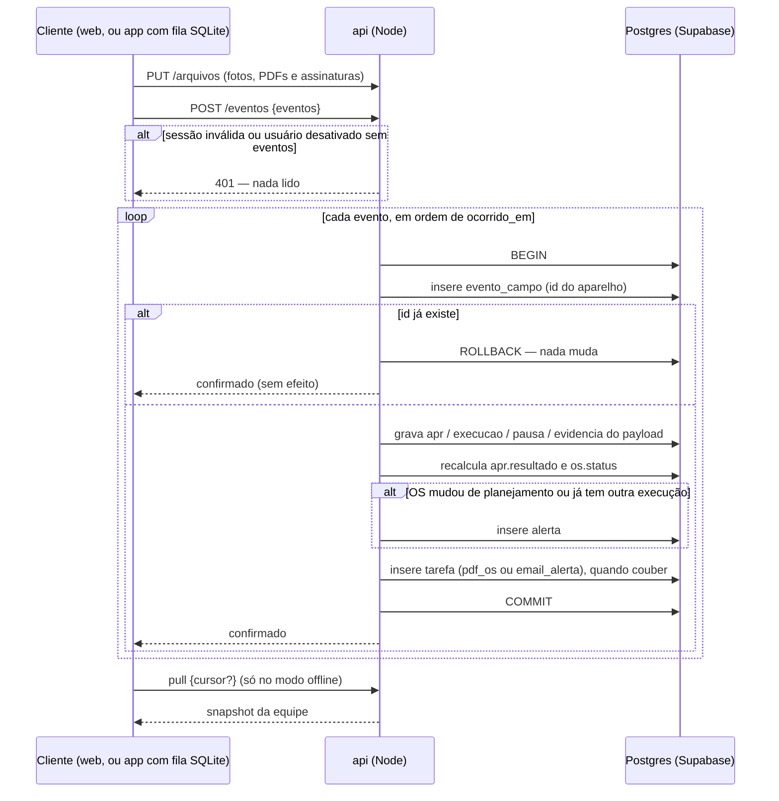
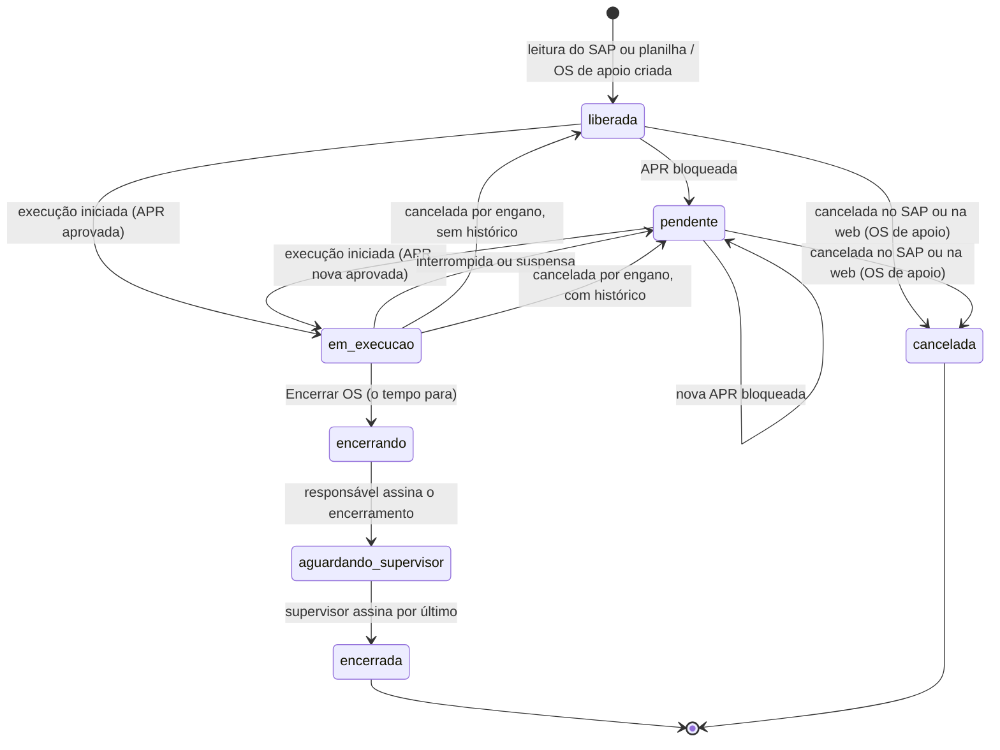
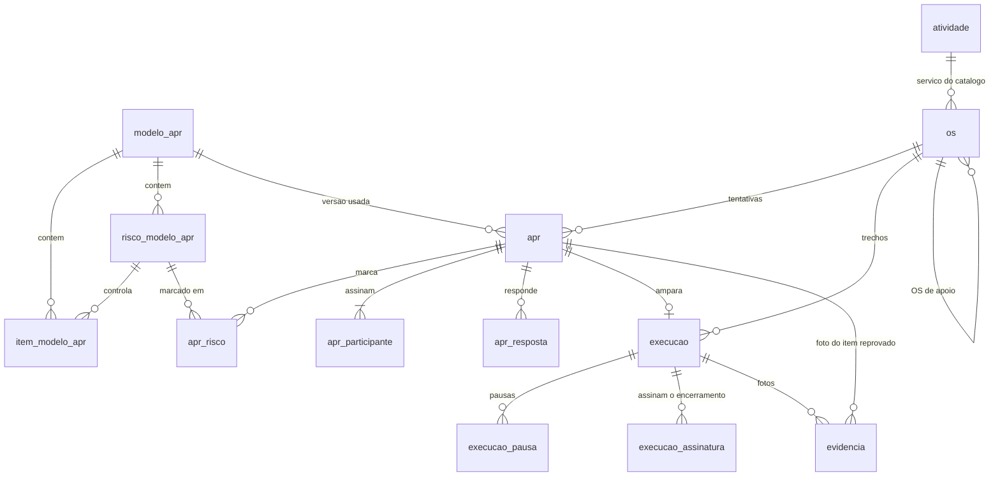

# APR e OS digitais — SYNQ OS

> Planeje a partir deste documento. Cada fatia abaixo traz o próprio formato — copie, não re-derive.
> Status: confirmado por Renan Felliphe, 2026-10-03; revisado em 2026-10-10 com a Reunião 2, as decisões do time (stack, API do SAP simulada, retomada da OS) e a recomendação adotada para todas as questões que estavam em aberto; revisado de novo em 2026-10-10 para corrigir um mal-entendido: o sistema é online, e o modo offline é um recurso adicional de contingência para o campo sem sinal, não a base da arquitetura. Web e app atendem todos os perfis. Revisado em 2026-10-14: o modelo de cada APR passa a ser escolhido pelo técnico, com a recomendação do sistema, e a ligação atividade → modelo sai (questão 58).

## Situação

- Projeto: em construção — o repositório é um monorepo com as pastas `api`, `web` e `mobile`; hoje só o `web` tem código, e é a interface das telas com dados e estado simulados; além dele há esta especificação e o material de base; nenhum código de produção.
- Decisão: assumida pelo Desafio 4 ("tornar a APR e a OM 100% digitais, da criação à execução", mobile Android + web) e pelas Reuniões 1 e 2. Na Reunião 2 os mentores Iago Raich e Mario Stevan validaram o fluxo.
- Em andamento: copia do site de controle já existente (Lovable) a ideia de ler as OS do SAP e os filtros por equipe e status; o próprio site, o BI que a ES Gás está construindo e o SAP ficam fora e não são tocados. A interface em `web/` é a referência de layout e fluxo; seus dados e seu estado são simulados e serão trocados por chamadas à `api`.
- O que está em jogo: protótipo de maratona — errar custa refazer partes do protótipo, não dados de produção; a exceção é o contrato de eventos de campo (a idempotência de cada registro), que fica caro de mudar assim que houver aparelhos com fila offline pendente. O protótipo roda só com dados fictícios, nunca com dados reais da empresa.

## Problema

A OS (no SAP, "Ordem de Manutenção"/OM) é impressa, separada por equipe, preenchida à mão em campo com a APR grampeada e depois escaneada e anexada no SAP pelo Iago. Isso ocupa de 4 a 5 pessoas, consome impressora e tinta, e devolve documentos sujos, incompletos ou ilegíveis que dificultam auditoria. Pior: nada impede um gazista de começar o serviço sem a APR, ou com uma resposta negativa num item crítico. Os indicadores que gerência e diretoria acompanham (preventivas atrasadas com e sem justificativa, tempo gasto por atividade) dependem de alguém consolidar papel e planilha, e a demanda de clientes e ativos está crescendo.

Volume: ~390 OS encerradas no mês passado, variando de ~200 a 409 por mês (Reunião 1, relatado pelo Iago); o levantamento da mesma reunião cita ~900 ordens por mês somando programadas e corretivas. Horas-homem gastas na digitalização: não medidas — o relato é "4 a 5 pessoas".

## Sucesso

- Deu certo se: num piloto com uma equipe, 100% das OS encerradas têm uma APR aprovada, própria da OS, registrada antes do início da execução e nenhuma OS dessa equipe passa por impressão ou scanner; na demo, o caminho ler OS → APR → executar → PDF roda online, no app Android e no navegador, e a OS encerrada aparece no painel web na hora; como contingência, o mesmo caminho roda num Android em modo avião e chega ao painel quando o sinal volta.
- Sinal de que está dando errado: o fluxo online de APR e execução não está estável até o meio do prazo (sem ele não há o que demonstrar), ou o modo offline não envia a fila de forma confiável (sem isso não há demo do campo sem sinal), ou os técnicos do piloto voltam ao papel "porque é mais rápido" — sinal de que preencher uma APR por OS está longo demais.
- Revisão: próximo encontro presencial da maratona — Iago Raich e Mario Stevan.

## Escopo

Dentro: leitura das OS pela API do SAP (simulada no protótipo) ou por arquivo (a planilha exportada ou o PDF da OS impresso pelo SAP); aplicação da APR e realização da OS, no app Android e na web, usados online no dia a dia (login, OS da equipe, APR respondida por inteiro e validada no fim, execução com pausa e suspensão com motivo, localização, interrupção por risco, assinaturas, encerramento em dois passos, perfil e histórico); modo offline de contingência no app, para o campo sem sinal (cópia local dos dados da equipe, fila de eventos e sincronização); PDF da OS executada (a APR e a folha da OS do SAP, como o papel) e relatório da execução à parte, para o supervisor e o admin; alertas de bloqueio no painel e por e-mail; OS pendente retomada por qualquer pessoa da equipe, reprogramação opcional e OS de apoio; painel web com quadro por status, detalhe com o histórico de APRs, histórico por local e equipamento, criticidade, indicadores de preventivas e de tempo, e a assinatura final do supervisor da equipe, que conclui a OS; escolha do modelo de APR pelo técnico, com a recomendação do sistema; editor versionado de modelos, com a orientação de cada um para essa escolha; gestão de usuários, perfis e equipes; planilha de encerradas para baixa manual no SAP. Só há dois perfis, `tecnico` e `admin`; o supervisor é o técnico que a equipe aponta, não um perfil, e a Segurança do Trabalho não usa o sistema.

Fora: escrita no SAP por API — a baixa continua por planilha até o Iago confirmar o contrário ([pontos-a-validar.md](pontos-a-validar.md), questão 51). MFA/SSO e vínculo dispositivo–usuário — ver [Usuário e Equipe](#usuário-e-equipe). Push notification no celular — a OS nova aparece quando a lista é atualizada (e, no modo offline, na próxima sincronização). iOS — o desafio é para Android. Cadastro de equipamentos como entidade — o histórico usa o texto de equipamento que vem do SAP. Terceiros no app. Escaneamento de OS e APR antigas e chatbot de consulta — ideias do time e sugestões dos mentores, depois do MVP (o catálogo de serviço, a evidência em PDF, o intervalo entre ciclos das preventivas e a gamificação, que também eram ideias para depois, foram feitos em 13/10/2026: ver [Catálogo de serviço](#catálogo-de-serviço), [Execução](#execução), [Ciclo das preventivas](#ciclo-das-preventivas) e [Gamificação](#gamificação)). Baixa de material consumido na execução — o catálogo diz o que cada serviço prevê, não o que foi gasto. Substituir o BI ou o site Lovable — são de outra equipe. Cadastro de técnicos pelo supervisor na própria equipe, com liberação pelo admin (pronto na API), e tela de treinamento no primeiro login (ver [Cadastro pelo supervisor, liberação e treinamento](#cadastro-pelo-supervisor-liberação-e-treinamento)). Importação de OS pelo supervisor foi adiada: fica só com o admin ([pontos-a-validar.md](pontos-a-validar.md), questão 63).

Não muda: SAP (continua gerando, liberando e encerrando as ordens); site Lovable de controle; o conteúdo das APRs continua sendo da segurança do trabalho.

## Formato

O registro central é a OS lida do SAP; cada tentativa de executá-la é uma Execução amparada por exatamente uma APR própria, e a OS guarda o histórico de todas as APRs e execuções. O sistema é online: o app Android e a web falam com a `api` (Node), que é a única a falar com o Supabase (Postgres, Auth e Storage). Web e app servem a todos os perfis, e o que cada pessoa pode fazer depende do perfil, não da plataforma. Todo registro de campo (APR, execução, pausa, evidência, assinatura) chega à `api` como um evento idempotente, e esse é o único caminho de escrita: online, o cliente envia o evento na hora; sem sinal, o app guarda os eventos numa fila local e os envia quando o sinal volta. O modo offline é um recurso adicional, para a APR e a execução no campo sem sinal, e não muda o fluxo do sistema. A decisão de difícil volta é o contrato dos eventos (idempotência e divisão de posse dos dados): mudá-lo depois de haver aparelhos com fila offline pendente exige migrar dados em celulares que não controlamos. A alternativa mais pesada, um motor de replicação genérico com mesclagem campo a campo, só compensa se dois clientes passarem a editar o mesmo dado offline, e a Decisão-chave 2 impede exatamente isso.

## Decisões-chave

1. **Monorepo com três aplicações e um único ponto de acesso aos dados.** `api` (Node e TypeScript), `web` (Next.js, React e TypeScript) e `mobile` (React Native, Android, com SQLite local para o modo offline), cada uma com Dockerfile; `api` e `web` sobem no Coolify. O Supabase fornece Postgres, Auth e Storage, mas só a `api` fala com ele: nenhum cliente recebe a chave do Supabase, as tabelas ficam com RLS ligado e sem políticas e os buckets são privados. Assim a autorização vive em um lugar só e web e app conhecem uma única API. O PWA único voltaria a ganhar se o time não conseguir sustentar três codebases até a demo.
2. **Quem executa é dono da execução e quem planeja é dono do planejamento, em qualquer plataforma; a sincronização nunca descarta dado de campo.** Os registros de campo (APR, respostas, participantes, Execução, pausas, evidências e assinaturas) vêm dos eventos de quem aplica a APR e executa a OS, pelo app ou pela web; equipe, datas programadas, prioridade e criticidade são gravadas por quem planeja; o SAP, por leitura, grava os dados da ordem. Quando um evento de campo chega para uma OS que o planejamento mudou nesse meio-tempo (reatribuída, reprogramada, outra equipe já executou), ele é aplicado mesmo assim e gera um `alerta` para o supervisor — conflito vira alerta, nunca sobrescrita. Online, o intervalo para isso acontecer é curto; no modo offline, pode durar horas.
3. **Todo registro de campo nasce com ID gerado no cliente, e reenviar não tem efeito; o `status` da OS é derivado no servidor, nenhum cliente o grava direto.** Isso torna o envio seguro contra rede instável, reenvio e duplo toque, online ou pela fila offline. As transições ficam no diagrama de [Eventos e modo offline](#eventos-e-modo-offline).
4. **Uma APR vale para uma única OS e ampara uma única Execução; nenhuma Execução começa sem a APR aprovada, do dia, da própria OS; uma APR bloqueada é imutável.** A relação é 1:1, como o Iago e o Mario confirmaram (a mesma APR para várias OS foi descartada porque os riscos de cada atividade são diferentes). Toda nova tentativa, mesmo no mesmo local e na mesma hora, exige uma APR nova, e as respostas nunca são pré-preenchidas nem copiadas de outra APR. O registro das APRs bloqueadas fica para auditoria e para o indicador de atraso justificado.
5. **A APR é respondida por inteiro e só então validada; cada item do modelo define `resposta_bloqueante`, `tipo` e `evidencia`.** O técnico responde todos os itens, em qualquer ordem, e volta a corrigir enquanto não concluir; ao concluir, o resultado é `bloqueada` se qualquer item `eliminatorio` tiver a resposta bloqueante, e todos os itens reprovados são registrados, cada um com observação e, quando o item pede foto, ao menos 1 foto. O servidor recalcula o resultado a partir das respostas e da versão do modelo; o valor enviado pelo aparelho é só conferido. **O técnico não sabe quais itens são eliminatórios**: o modelo que ele recebe (`GET /modelos-apr/{codigo}/versoes/{versao}` e a cópia offline) vem sem `tipo`, `resposta_bloqueante` e `evidencia`, o checklist trata todas as perguntas do mesmo jeito e nada pede evidência durante as respostas; se soubesse, bastaria responder "certo" nesses itens para fazer o serviço. Quem avalia é o servidor, em `POST /aprs/avaliar`, chamado ao concluir com a APR inteira (menos as fotos): confere tudo o que o registro confere (OS da equipe, participantes com assinatura, respostas completas, "NA" com observação) antes de dizer o resultado, para que a recusa nunca revele o que reprova, e devolve `aprovada` ou `bloqueada` e, se bloqueada, os itens reprovados com a evidência que cada um pede. A aprovada não é gravada ali (é registrada pelo `apr_concluida`, sem assinaturas, e cada participante assina depois). A bloqueada vale na hora: é registrada já na validação, pelo canal dos eventos (OS `pendente`, alerta e e-mail ao supervisor), porque descobrir o que reprova precisa deixar registro; descartar o rascunho e refazer a APR não a apaga, e a nova é outra APR. Só então o técnico fica sabendo quais itens reprovaram; as respostas ficam travadas e falta a evidência de cada item, que chega no `apr_concluida` da mesma APR. Só o admin, que edita o modelo, vê e define `tipo`, `resposta_bloqueante` e `evidencia`; os rankings e o detalhe da OS também escondem isso dos demais perfis (o técnico vê apenas o que reprovou).
6. **Um modelo de APR publicado é imutável; editar cria versão nova, e toda APR aponta para a versão exata que respondeu.** Quem escolhe o modelo de cada APR é o técnico, entre os modelos publicados; o sistema só orienta: mostra a descrição de cada modelo e recomenda o que mais combina com a OS, pela leitura do título e das descrições, mas nunca aplica a recomendação sozinho. Não há atribuição automática: as preventivas têm nome padrão, mas as corretivas não têm código padronizado, e o mesmo serviço pode pedir APRs diferentes conforme a situação no local (remover marimbondo com ou sem trabalho em altura), como o Iago explicou em 14/10/2026 (questão 58). A atividade da OS (`codigo_atividade`) é só o serviço do catálogo. A APR guarda a versão escolhida. APRs antigas e PDFs continuam reproduzíveis depois de uma revisão, e uma APR preenchida offline numa versão anterior é aceita com a versão que usou.
7. **O SAP é fonte de leitura e destino de planilha: a OS entra por um adaptador de leitura (API, simulada no protótipo) ou por planilha, a leitura insere ou atualiza por `numero_ordem` tocando só colunas de planejamento, e a saída é PDF mais planilha para baixa manual.** Nenhuma OS nasce à mão: a única criada no sistema é a OS de apoio, aberta a partir de um impedimento (Decisão-chave 8). Reler nunca reabre uma OS encerrada nem apaga execução de campo. Trocar a API simulada pela real muda só o endereço e as credenciais, porque o contrato é o mesmo.
8. **Uma tentativa que não conclui não trava a OS: ela fica `pendente` e qualquer pessoa da equipe a retoma com uma APR nova, sem esperar o supervisor.** O supervisor é avisado e acompanha, e pode reprogramar ou abrir uma OS de apoio, mas não autoriza a retomada. Quem executa é quem encerra, com todas as assinaturas dos participantes; nenhum usuário encerra a OS de outro e a OS pendente nunca é duplicada.

## Trabalho

| Fatia | Entrega | Status |
|---|---|---|
| [Plataforma](#plataforma) | monorepo, imagens, migrações, acesso ao Supabase, arquivos e tarefas | definida |
| [Usuário e Equipe](#usuário-e-equipe) | perfis, equipes, login pelo e-mail institucional (com login offline de contingência), assinatura do perfil | aberta — 4 suposições adotadas; 2 RFC fora da demo |
| [Integração SAP](#integração-sap) | OS entram pela API simulada ou por planilha; OS de apoio | aberta — 5 suposições adotadas |
| [Modelo de APR](#modelo-de-apr) | modelos versionados, a orientação para o técnico escolher o modelo e os 8 modelos de `base/apr-examples/` | aberta — 4 suposições adotadas |
| [Eventos e modo offline](#eventos-e-modo-offline) | envio idempotente dos eventos de campo (online e pela fila offline) e cópia local da equipe para o campo sem sinal | definida |
| [APR](#apr) | checklist respondido por inteiro, evidência e validação | definida |
| [Execução](#execução) | execução com pausa e suspensão com motivo, localização, encerramento em dois passos, assinaturas, interrupção, relatório da execução e PDF da OS | definida |
| [Impedimento](#impedimento) | OS pendente, alerta ao supervisor, reprogramação e OS de apoio | aberta — 3 suposições adotadas |
| [Painel](#painel) | quadro, histórico, assinatura final do supervisor, indicadores e planilha para o SAP | aberta — 3 suposições adotadas |
| [Catálogo de serviço](#catálogo-de-serviço) | materiais, ferramentas e EPIs de cada serviço (atividade), mostrados no detalhe da OS | feita em 13/10/2026 — a lista real depende da ES Gás (questão 65) |
| [Ciclo das preventivas](#ciclo-das-preventivas) | intervalo entre ciclos de cada plano de manutenção, contagem até o próximo ciclo e alertas de ciclo próximo e vencido (sem criar OS) | feita em 13/10/2026 — onde o SAP guarda o ciclo depende do Iago (questão 66) |
| [Gamificação](#gamificação) | pontos por tarefa, patentes e ranking por temporada, conquistas e anonimato, calculados no servidor | feita em 13/10/2026 — os limites das patentes se revisam no fim da primeira temporada real |

Ordem: Plataforma → Usuário e Equipe → Integração SAP → Modelo de APR (só a carga inicial) → Eventos (o envio online) → APR → Execução → Impedimento → Painel → Modelo de APR (editor) → Modo offline. O fluxo online de APR e execução é a base e vem primeiro; o contrato de eventos precisa existir antes das telas de campo, porque elas o usam. O modo offline (fila local, cópia da equipe e login sem sinal) entra por último e é o maior risco de prazo do recurso adicional: ele só reaproveita o contrato de eventos. O editor de modelos fica depois do painel porque a carga inicial já destrava a demo.

Derivável do repositório, fica para o plano: textos de erro (`{erro: {codigo, mensagem}}` em pt-BR), ordenação de listas, máscaras de data e hora em pt-BR, layout das telas (a interface em `web/` é a referência), fuso `America/Sao_Paulo` para "dia" e hora exibida com os instantes guardados em UTC, paginação por `pagina` e `tamanho` — o primeiro CRUD (Usuário e Equipe) fixa a convenção e os demais seguem como ele.

Todas as questões que estavam abertas em [pontos-a-validar.md](pontos-a-validar.md) entram aqui com a solução recomendada; a seção [Suposições adotadas](#suposições-adotadas) diz quem as confirma. Nenhuma delas bloqueia a implementação.

### Plataforma

**Entrega** a estrutura do repositório, o acesso ao Supabase, as migrações, o armazenamento de arquivos e as tarefas em segundo plano que as demais fatias usam. **Status: definida.**

| Pasta | Conteúdo | Imagem |
|---|---|---|
| `api` | API REST em Node e TypeScript; schema em TypeScript com Drizzle (`src/db/schema`) e migrações SQL geradas em `db/migrations`; fixtures do SAP simulado em `fixtures/sap` | `Dockerfile`; aplicação do Coolify |
| `web` | aplicação Next.js (React e TypeScript) para todos os perfis: telas de campo (OS da equipe, APR, execução) e de gestão (quadro, alertas, importação, indicadores, modelos, usuários); o token do usuário fica em cookie `httpOnly`, fora do alcance do JavaScript | `Dockerfile`; aplicação do Coolify |
| `mobile` | app React Native para Android, câmera, captura de assinatura e SQLite local para o modo offline | `Dockerfile` de build que gera o APK; não é publicado no Coolify |
| raiz | `docker-compose.yml` para subir `api` e `web` no desenvolvimento; `README.md` com os comandos | — |

| Estado | O que deve acontecer | O que o usuário vê |
|---|---|---|
| Subir a `api` | aplica as migrações pendentes sob trava de sessão e só então abre a porta; migração que falha impede a subida | `GET /saude` responde `200` só depois |
| Requisição sem JWT válido | recusada antes de qualquer leitura | `401` |
| Perfil sem permissão para a rota | recusada | `403` |
| Cliente tenta falar com o Supabase direto | impossível: nenhum cliente tem a chave, RLS sem políticas, buckets privados | — |
| Envio de arquivo | gravado no bucket com o id gerado no cliente (app ou navegador); reenviar o mesmo id e conteúdo não tem efeito | `200` `{id}` |
| Leitura de arquivo | o back-end devolve uma URL assinada de 10 minutos, depois de checar o perfil | `200` `{url}` |
| Tarefa em segundo plano falha | nova tentativa com espera crescente (1, 5 e 15 minutos, no máximo 5 tentativas); depois fica `falhou` e aparece no painel | "PDF pendente" ou "E-mail não enviado" |

`GET /saude` → `200` `{versao, banco}`
`PUT /arquivos/{id}` `multipart: arquivo, tipo` → `200` `{id, caminho}` — `tipo`: `foto` (imagem, até 10 MB), `assinatura` (imagem, até 1 MB) ou `pdf` (documento de evidência, até 10 MB, conferido pelo conteúdo: precisa começar como um PDF)
`GET /arquivos/{id}/url` → `200` `{url}`

Buckets privados: `fotos`, `assinaturas`, `pdfs` (o PDF gerado de cada OS), `importacoes` e `documentos` (os PDFs anexados como evidência). Um processo do próprio back-end executa as tarefas, lendo `tarefa` sem disputar a mesma linha.

Tabela `tarefa`.

| Coluna | Tipo | Nulo | Referência | Nota |
|---|---|---|---|---|
| `tarefa.id` | uuid | não | | |
| `tarefa.tipo` | text | não | | `pdf_os` \| `email_alerta` \| `leitura_sap` \| `leitura_rh` \| `conferencia_rh` |
| `tarefa.referencia_id` | uuid | sim | | `os.id`, `alerta.id`, `importacao.id`, `leitura_rh.id`, `usuario.id` (`conferencia_rh`) ou nulo (leitura agendada do SAP) |
| `tarefa.estado` | text | não | | `pendente` \| `em_andamento` \| `concluida` \| `falhou` |
| `tarefa.tentativas` | integer | não | | padrão 0 |
| `tarefa.proxima_em` | timestamptz | não | | |
| `tarefa.erro` | text | sim | | última mensagem |
| `tarefa.criada_em` | timestamptz | não | | |

Variáveis de ambiente da `api`: `DATABASE_URL`, `SUPABASE_URL`, `SUPABASE_SERVICE_ROLE_KEY`, `SUPABASE_JWT_SECRET`, `SAP_API_URL`, `SAP_API_TOKEN`, `SAP_SIMULADO` (`true` liga as rotas do simulador), `SAP_LEITURA_INTERVALO_MIN` (padrão 15), `RH_SIMULADO` (`true` liga o registro de funcionários simulado em `/rh-simulado`), `RH_API_URL`, `RH_API_TOKEN` (o que o SYNQ OS usa para ler o registro), `RH_AVISO_TOKEN` (o que o registro usa para avisar o SYNQ OS), `RH_AVISO_URL` (para onde o simulador manda os avisos; só ele a usa) e `RH_LEITURA_HORA` (hora, em São Paulo, da leitura diária; padrão 3), `SMTP_URL`, `EMAIL_REMETENTE`, `PAINEL_URL`. Com `RH_SIMULADO=true`, endereços e tokens do RH têm padrão, como no SAP; no `docker-compose.yml` o simulador do RH vem ligado. Do `web`: `API_URL`. Do app: o endereço da API no momento do build.

1. Banco, autenticação e arquivos — Supabase, na nuvem para a demo; o mesmo código funciona com o Supabase hospedado no Coolify, só trocando as variáveis.
2. PDF e e-mail — gerados pelo back-end Node (o Supabase não gera PDF): biblioteca de PDF declarativa para o PDF da OS e o relatório da execução, e envio por SMTP configurável.
3. Dados — só fictícios no protótipo; a empresa precisa avalizar o armazenamento antes do piloto (LGPD).

- RFC: fila de tarefas em serviço próprio (Redis ou similar) — só compensa se o volume de PDFs passar do que um processo atende; a estimativa é de poucas centenas por mês. Não decidido.

### Usuário e Equipe

**Entrega** cadastro de usuários e equipes na web, com perfis, e login pelo e-mail institucional no app e na web. O login normal é online; no app, uma sessão já aberta no aparelho também entra sem sinal, como contingência do modo offline. **Status: aberta.**

| Estado | O que deve acontecer | O que o usuário vê |
|---|---|---|
| Admin cria usuário | só de quem está no registro de funcionários ([Registro de funcionários](#registro-de-funcionários)): informa matrícula e e-mail institucional, e nome, cargo e registro profissional vêm do registro; escolhe perfil e equipe (a do setor já vem sugerida) e define a senha inicial; no Supabase Auth a conta nasce com esse mesmo e-mail | `201` |
| Matrícula fora do registro, e-mail que não é o dela, funcionário afastado ou desligado, registro fora do ar | nada é gravado | `404` `funcionario_nao_encontrado`, `422` `email_nao_confere`, `409` `funcionario_afastado` ou `funcionario_desligado`, `503` `registro_indisponivel` |
| Matrícula repetida | nada é gravado | `409` "Matrícula já cadastrada" |
| Primeiro login com senha inicial | entra, mas só consegue trocar a senha | tela "Defina sua senha" |
| Login com sinal (web ou app) | confere a senha na `api` e abre a sessão; no app, guarda também um hash salgado da senha e os dados da equipe para o modo offline | `200` |
| Modo offline: login no app sem sinal, já logou neste aparelho em até 7 dias | entra com a senha conferida contra o hash local | app abre na lista de OS |
| Modo offline: login no app sem sinal, passou de 7 dias ou nunca logou aqui | recusado | "Conecte-se para entrar" |
| Senha trocada na web enquanto o aparelho está offline | o aparelho aceita a antiga até o próximo login online; então a invalida | — |
| Esqueci a senha | só online: o admin redefine e a pessoa recebe nova senha inicial | "Procure o administrador" |
| Usuário desativado enquanto estava offline | a fila pendente ainda sobe na próxima sincronização; depois a sessão é revogada | "Acesso revogado" após enviar |
| Logout com fila pendente | recusado | "Há N registros não enviados" |
| Pessoa sem assinatura no perfil confirma uma assinatura | desenha na hora e a assinatura fica cadastrada no perfil | — |
| Refazer a assinatura do perfil | vale para as próximas assinaturas; as já feitas guardam a imagem que usaram | `200` |
| Dupla em campo | cada participante assina a APR na própria conta, só no começo (no offline, a assinatura presencial no aparelho do responsável) | lista de participantes vinda da equipe da OS |

`POST /auth/login` `{email, senha}` → `200` `{access_token, refresh_token, expira_em, usuario, senha_provisoria}`
`POST /auth/refresh` `{refresh_token}` → `200` `{access_token, expira_em}`
`POST /auth/trocar-senha` `{senha_atual, senha_nova}` → `200`
`GET /me` → `200` `{usuario, equipe}`
`GET /me/aprs-para-assinar` → `200` `{aprs: [{apr_id, os_id, numero_ordem, titulo, local_codigo, concluida_em, preenchida_por, preenchida_por_nome, funcao}]}` — as APRs aprovadas de hoje que esperam a assinatura de quem pergunta
`PUT /me/assinatura` `{arquivo_id}` → `200`
`POST /usuarios` `{matricula, email, perfil?, equipe_id?, senha_inicial}` → `201` `{id}` (a `api` consulta o registro de funcionários e grava o nome, o cargo e o registro profissional de lá; sem `equipe_id`, o admin cadastra na equipe do setor, e `null` cadastra sem equipe)
`PATCH /usuarios/{id}` `{perfil?, equipe_id?, ativo?}` → `200` (só o admin; nome, e-mail, cargo e registro profissional não se editam: vêm do registro; reativar consulta o registro e é `409` `funcionario_desligado` ou `funcionario_afastado` se ele não disser que a pessoa está ativa; a matrícula não muda)
`POST /usuarios/{id}/atualizar-do-registro` → `200` `{situacao_registro, atualizado, desativado, recusado}` (só o admin; copia do registro o nome, o e-mail, o cargo e o registro profissional, e trocar o e-mail troca também o login da conta no Supabase Auth; se o registro diz que a pessoa foi desligada, a conta é desativada)
`POST /usuarios/{id}/redefinir-senha` → `200` `{senha_inicial}`

`DELETE /usuarios/{id}` → `200` (admin; remove o cadastro e a conta de acesso; `409` `usuario_com_historico` se a pessoa já tem APR, execução, assinatura, evento, alerta ou equipe sob sua supervisão, caso em que se desativa; `422` ao tentar remover a si mesmo)
`GET /usuarios` `?equipe_id&perfil&ativo&supervisor&minha_supervisao` → `200` `{usuarios[]}` (`supervisor=true`: quem supervisiona alguma equipe; `minha_supervisao=true`, para o supervisor: os cadastros das equipes dele em qualquer situação de liberação, sem ele mesmo, com `liberacao` filtrando dentro disso e a paginação feita na `api`)

`DELETE /equipes/{id}` → `200` (admin; `409` `equipe_com_historico` se há usuário ou OS ligados à equipe)

`DELETE /atividades/{codigo}` → `200` (admin; `409` `atividade_com_os` se alguma OS usa a atividade)

`POST /auth/sair` → `200` (derruba as sessões da conta: o `refresh_token` deixa de renovar; vale em qualquer situação da conta)

`GET /auditoria` `?entidade&entidade_id&ator_id&busca&de&ate` → `200` `{registros[], pagina, tamanho, total}` (só admin; do mais novo ao mais antigo). Cada registro: `{id, em, ator_id, ator_nome, acao, entidade, entidade_id, alvo, resumo, detalhes}` (`ator_id` é nulo quando quem agiu foi o registro de funcionários, com `ator_nome` "Registro de funcionários"). A trilha registra, depois que a ação deu certo: cadastro, edição, ativação/desativação, liberação, recusa, redefinição de senha e exclusão de usuário; criação, edição e exclusão de equipe e de atividade; criação de versão, publicação, descarte de rascunho, exclusão e restauração de modelo de APR; leitura imediata do SAP e do registro de funcionários (`rh.leitura`), o que o registro de funcionários faz sozinho com uma conta (atualizar dados, desativar, recusar, situação mudou, conferência que não pôde desativar o último admin), importação de planilha, OS de apoio (abrir, reprogramar, cancelar), ciência, marcação de local crítico e a exportação para o SAP. Só cresce (um gatilho do banco recusa alterar ou apagar) e não guarda chave estrangeira, para continuar legível depois que a conta ou o cadastro forem removidos. Nunca guarda senha. Salvar o rascunho de um modelo não entra (só criar a versão e publicar); eventos de campo continuam em `evento_campo`.
`POST /equipes` `{nome, centro_trabalho, supervisor_id?}` → `201` `{id}`
`PATCH /equipes/{id}` `{nome?, supervisor_id?}` → `200`
`GET /equipes` → `200` `{equipes[]}`

Tabelas `equipe`, `usuario`.

| Coluna | Tipo | Nulo | Referência | Nota |
|---|---|---|---|---|
| `equipe.id` | uuid | não | | |
| `equipe.nome` | text | não | | ex.: Serviços Especiais, Instrumentação, Atendimento Residencial |
| `equipe.centro_trabalho` | text | não | | código SAP (`SERV_ESP`); unique; usado pela leitura do SAP |
| `equipe.supervisor_id` | uuid | sim | `usuario.id` | supervisor da equipe: um técnico ativo (ver [Supervisão](#supervisão)); destinatário dos alertas; sem supervisor, os alertas vão aos admins ativos (ver [Impedimento](#impedimento)) |
| `usuario.id` | uuid | não | | = id do Supabase Auth |
| `usuario.nome` | text | não | | |
| `usuario.matricula` | text | não | | unique; identificação definitiva da pessoa na empresa (PDF e SAP); não é o login |
| `usuario.email` | text | não | | unique, sempre em minúsculas; e-mail institucional (`nome.sobrenome@empresa.com.br`): é o login, igual ao e-mail da conta no Supabase Auth, e o destino dos alertas |
| `usuario.cargo` | text | sim | | aparece sob a assinatura na OS impressa (`Técnico em Elétrica`, `Engenheiro Mecânico`) |
| `usuario.registro_profissional` | text | sim | | registro profissional impresso na OS (`CREA: ES-050003/D`) |
| `usuario.perfil` | text | não | | `tecnico` \| `admin`; o supervisor não é perfil (ver [Supervisão](#supervisão)) |
| `usuario.equipe_id` | uuid | sim | `equipe.id` | |
| `usuario.ativo` | boolean | não | | padrão true |
| `usuario.senha_provisoria` | boolean | não | | padrão true na criação e na redefinição |
| `usuario.assinatura_path` | text | sim | | imagem da rubrica ou assinatura por extenso, no bucket `assinaturas` |
| `usuario.assinatura_em` | timestamptz | sim | | |
| `usuario.situacao_registro` | text | sim | | o que o registro de funcionários diz da pessoa na última conferência: `ativo` \| `afastado` \| `desligado` \| `fora_do_registro`; nulo até a primeira |
| `usuario.registro_conferido_em` | timestamptz | sim | | quando a pessoa foi conferida com o registro |

Perfis e permissões. Só existem dois perfis, `tecnico` e `admin`. O supervisor não é um perfil: é o `tecnico` que alguma equipe aponta em `equipe.supervisor_id` (ver [Supervisão](#supervisão)), e a coluna "técnico que supervisiona" mostra o que ele ganha em cima do que o técnico já faz. A Segurança do Trabalho não é perfil e não usa o sistema: ela define o critério de bloqueio da APR e quem o cadastra no editor é o admin.

| Ação | `tecnico` | `tecnico` que supervisiona | `admin` |
|---|---|---|---|
| Aplicar APR e executar OS (app ou web, inclusive no modo offline) | sim | sim | não |
| OS da equipe, detalhe e histórico | própria equipe | própria equipe e as que supervisiona | todas |
| Quadro por status | — | própria equipe e as que supervisiona | todas |
| Ler o SAP, importar planilha ou PDF da OS e exportar | — | — | sim |
| Digitalizar OS em papel (câmera; em desenvolvimento) | — | — | sim |
| Criar OS de apoio | — | sim, para qualquer equipe, a partir de OS das equipes que supervisiona | sim |
| Reprogramar OS | — | equipes que supervisiona | sim |
| Assinar a OS por último (assinatura final do supervisor, antes a ciência) | — | equipes que supervisiona | — |
| Ver o relatório da execução (`GET /os/{id}/relatorio-execucao`) | — | equipes que supervisiona | sim |
| Cancelar OS de apoio | — | — | sim |
| Receber alertas | — | das equipes que supervisiona | de OS de equipe sem supervisor e `falha_importacao` |
| Criar, editar, publicar e excluir modelos, definir o critério de bloqueio, escrever a orientação de cada modelo e editar a tabela de atividades | — | — | sim |
| Usuários e equipes | — | — | sim |
| Indicadores | — | equipes que supervisiona | todas |

O perfil define o que a pessoa pode fazer; a plataforma não. Web e app aceitam qualquer perfil: o técnico pode usar a web e o supervisor e o admin podem usar o app. As telas de campo (OS da equipe, APR, execução, perfil) existem nos dois; quais telas de gestão o app oferece fica em aberto (questão 55). O admin é só gerenciamento da plataforma: não aplica APR nem executa OS. Quem aplica APR e executa é sempre um técnico, e todo supervisor também é técnico (questão 56).

O supervisor da equipe não se confunde com o `responsavel` que lidera a APR em campo, e que o modelo em papel chama de "Supervisor da Atividade".

### Supervisão

Supervisor é quem a equipe aponta em `equipe.supervisor_id`, e é sempre um técnico: faz tudo o que o técnico faz (aplica APR, executa OS, usa o modo offline) e mais a gestão da(s) equipe(s) que supervisiona. O admin muda a supervisão editando a equipe, escolhendo qualquer técnico ativo. Não existe o perfil `supervisor`.

- **O que a pessoa ganha:** as ações da coluna "técnico que supervisiona" da tabela acima, nas equipes que supervisiona: ver as OS e o quadro (além da própria equipe, se tiver uma), receber os alertas, reprogramar, abrir OS de apoio, assinar as OS por último e ver os indicadores. Em outras equipes, não.
- **Assinatura final (a antiga ciência):** só de quem supervisiona a equipe da OS (ou do representante que está no comando), na OS `aguardando_supervisor`; é ela que conclui a OS e libera o PDF e a exportação. Quem participou do serviço também pode assinar: o bloqueio `ciencia_propria` não existe mais (Reunião 3).
- **Telas:** o técnico que supervisiona entra no painel de gestão pelo menu do app ("Painel de supervisão") e volta ao app por "Minhas OS (campo)". O técnico sem equipe supervisionada só vê o menu de campo; o admin entra direto no painel de gestão da plataforma (usuários, equipes, importação, modelos, indicadores). `GET /me` devolve `equipes_supervisionadas`.
- **Sem supervisor:** os alertas da equipe vão aos admins ativos (ver [Impedimento](#impedimento)), que também reprogramam e abrem OS de apoio nesse caso.

### Cadastro pelo supervisor, liberação e treinamento

Decidido em 12/10/2026. **Pronto na API** (cadastro, estados de liberação, trava e treinamento); as telas da web acompanham.

1. **Cadastro pelo supervisor:** o supervisor cadastra só técnicos, e só quem é de um setor cuja equipe ele supervisiona (`POST /usuarios` com a matrícula e o e-mail; perfil `admin` é recusado com `403`, e quem é de outro setor, ou de setor sem equipe dele, com `403` `fora_da_supervisao`). A equipe é sempre a do setor da pessoa, no registro de funcionários. A senha provisória segue o fluxo do admin (a pessoa a troca no primeiro acesso). Matrícula e e-mail institucional têm as mesmas validações. O admin continua cadastrando qualquer perfil e equipe, e a conta dele nasce já liberada.
2. **Estados de liberação** (`usuario.liberacao`): `liberado` (acesso geral; é o de quem o admin cria e de todos os que já existiam), `pendente` (criado por supervisor, aguarda o admin) e `recusado` (o admin recusou, com motivo; a conta fica inativa e a sessão é revogada). O cadastro guarda `criado_por_id`, `criado_em`, `liberado_por_id`, `liberado_em` e `recusa_motivo`. A API devolve `liberacao`, `criado_por_id`, `criado_por_nome`, `criado_em`, `liberado_em` e `recusa_motivo` nos usuários e em `GET /me`; `criado_em` é nulo nas contas anteriores à migração `0010`.
3. **Trava do pendente:** o pendente pode entrar, trocar a senha provisória e fazer o Campo de treino (a API só guarda o estado: `GET /me`, `PUT /me/treinamento`, `POST /auth/trocar-senha`, `POST /auth/refresh`); todas as outras rotas respondem `403` com o código `aguardando_liberacao` ("Seu acesso aguarda a liberação de um administrador"). Ele não aparece como colega, membro de equipe nem na busca, e não entra no snapshot offline nem nos indicadores. O recusado não entra: no login é `403 acesso_recusado` (a mensagem traz o motivo); nas demais rotas, `401 acesso_revogado`.
4. **O que o admin faz:** `GET /usuarios?liberacao=pendente|recusado|liberado` devolve também o `total` (é como descobre os pendentes: não há alerta nem e-mail novos); `POST /usuarios/:id/liberar` e `POST /usuarios/:id/recusar` (corpo `{ "motivo" }`, obrigatório) valem só para `pendente` (senão `409`). Ele exclui o recusado pelo `DELETE` comum, o que libera e-mail e matrícula para um novo cadastro. Ativar ou desativar pelo `PATCH` só vale para quem já está liberado.
5. **O que o supervisor vê e faz:** em `GET /usuarios` e `GET /usuarios/:id` ele enxerga, além dos colegas liberados, os pendentes e recusados das equipes que supervisiona (a lista de pendentes e recusados só vem com o filtro `liberacao`), inclusive o motivo da recusa. Só nos pendentes que **ele** cadastrou, cancela o cadastro (`DELETE`, que apaga também a conta de acesso). Ele não edita ninguém: nome, cargo e registro profissional vêm do registro de funcionários (`PATCH` é `403`). Não mexe em quem já foi liberado nem no pendente de outro supervisor, e não redefine senha.
6. **Supervisor que deixa de supervisionar a equipe:** nada acontece automaticamente; os pendentes dele ficam para o admin tratar (o ex-supervisor perde o acesso a eles).
7. **Treinamento:** no primeiro login, só para técnicos, uma tela de treinamento com dados fictícios, que a pessoa pode pular ou fazer depois; fica acessível no menu. Quem aguarda liberação pode fazer o treino enquanto espera (a web roda o treino sozinha; a API só guarda o estado).
8. **Importação de OS pelo supervisor:** adiada; segue só do admin (questão 63 de [pontos-a-validar.md](pontos-a-validar.md)).

**Campo de treino (EM CONSTRUÇÃO).** Detalhamento do item 7, em desenvolvimento nesta entrega:

- **Boas-vindas:** no primeiro acesso do técnico (supervisor incluso, que é técnico), a tela "Bem-vindo ao Campo de Treino! Aqui tudo é de mentira…" oferece duas modalidades. **Direcionado**: tutorial com balões; o usuário avança com "Próximo" ou fazendo a tarefa indicada. **Livre**: a interface inteira liberada para testar, com os dados fictícios.
- **Saídas:** **Pular** grava o estado `pulado` e a tela não volta. **Fazer depois** some nesta sessão e volta no próximo login; o estado segue `nao_iniciado`.
- **Sempre acessível:** um link no menu do técnico abre o Campo de treino a qualquer hora, com "Recomeçar treino" para refazer.
- **Dados fictícios:** ficam na memória do servidor, por usuário, e a API real nunca é chamada em modo treino. Um selo "TREINO" fica visível o tempo todo.
- **Estado guardado:** `usuario.treinamento_estado` (`nao_iniciado`, `concluido` ou `pulado`) e `usuario.treinamento_em` (quando concluiu ou pulou; nulo se não iniciado). Quem já existia ao entrar a funcionalidade fica `pulado`; novos usuários nascem `nao_iniciado`. `GET /me` devolve `usuario.treinamento: {estado, em}`; `PUT /me/treinamento` com `{estado}` grava (`nao_iniciado` serve para refazer) e é idempotente. Só o estado vive na API real; o treino em si roda na web.
- **Quem:** só técnicos. Admin e a gestão do supervisor ficam sem treinamento por ora (o admin sempre aparece `nao_iniciado`, sem efeito).

1. Janela de login offline — 7 dias desde o último login online.
2. Funções de campo (gazista, instrumentista, eletricista) — ficam no texto da equipe e não viram perfil; perfil só controla acesso.
3. Login pelo e-mail institucional — todos os usuários são funcionários e têm e-mail corporativo; ele é o login e a conta no Supabase Auth usa o mesmo e-mail. A matrícula segue no cadastro como identificação definitiva (PDF, SAP). A senha inicial é definida pelo admin e trocada no primeiro acesso (questão 24).
4. Esqueci a senha — só online, pelo admin; a troca de senha na web não derruba o login offline já feito (questões 18 e 24).

- RFC: MFA ou SSO corporativo (pergunta aberta da Reunião 1) — bloqueia o uso real, não a demo. Não decidido.
- RFC: vínculo dispositivo–usuário (aparelho por colaborador ou compartilhado) — muda o login offline e a revogação. Não decidido.

### Registro de funcionários

Decidido e implementado em 14/10/2026 (desenho completo em [apifuncionarios.md](../../apifuncionarios.md)). **Status: pronta com o simulador.** A empresa não forneceu a API de RH, então o SYNQ OS traz uma versão simulada, do mesmo jeito que faz com o SAP, e a fala com ela por um cliente HTTP de endereço e token configuráveis.

1. **Só funcionário da empresa vira usuário.** O cadastro informa a matrícula e o e-mail institucional; a `api` consulta o registro e copia o nome, o cargo e o registro profissional, que deixam de ser digitados ou editados no SYNQ OS. O SYNQ OS decide só o perfil, a equipe, a liberação, se a conta está ativa e a senha.
2. **O automático só tira acesso; quem dá acesso é uma pessoa.** Afastado só grava a situação; desligado ou fora do registro desativa a conta liberada e recusa a pendente (motivo "Desligado no registro de funcionários"); a conferência nunca desativa o último admin ativo; readmitido não reativa sozinho (o admin reativa, e só se o registro disser que a pessoa está ativa).
3. **O desligamento vale em tempo real:** o registro avisa o SYNQ OS (`POST /rh/avisos`, só com a lista de matrículas a conferir) e uma tarefa `conferencia_rh` consulta o registro e age pelo que ele responde, então um aviso falso não desativa ninguém. Uma leitura completa, uma por dia a partir de `RH_LEITURA_HORA`, atualiza os dados e pega os desligamentos cujo aviso não chegou. Se uma leitura fosse desativar mais da metade dos usuários ativos, não aplica nada e termina com erro (proteção contra registro vazio ou mal configurado).
4. **Com o registro fora do ar, o cadastro para** (`503`): é melhor recusar do que deixar entrar alguém que não foi conferido.

`GET /rh/funcionarios/{matricula}` `?email=` → `200` `{funcionario: {matricula, nome, cargo, centro_trabalho, setor, registro_profissional, situacao}, equipe_sugerida, conta_existente}` — admin e supervisor; a prévia da primeira etapa do cadastro, com as mesmas recusas do `POST /usuarios`
`POST /rh/avisos` `{matriculas[]}` → `202` `{enfileiradas}` — só o registro, com `Authorization: Bearer {RH_AVISO_TOKEN}`; matrícula sem conta é ignorada
`POST /rh/leituras` → `202` `{leitura_id}` — admin; o "Ler agora"
`GET /rh/sincronizacao` → `200` `{ultima_leitura, configurado, leitura_hora}` — admin; `ultima_leitura`: `{id, origem, iniciada_em, concluida_em, conferidos, atualizados, desativados, erro, situacao}`, com `situacao` `concluida`, `falhou`, `tentando_de_novo` ou `em_andamento`

O que o SYNQ OS lê do registro (o contrato do registro simulado), com `Authorization: Bearer {RH_API_TOKEN}`: `GET {RH_API_URL}/funcionarios/{matricula}` → `200` o funcionário ou `404`, e `GET {RH_API_URL}/funcionarios` `?pagina&tamanho` → `200` `{funcionarios[], proxima_pagina?}`. Funcionário: `{matricula, nome, email, cargo, centro_trabalho, setor, registro_profissional, situacao, data_admissao, data_nascimento, telefone, gestor_matricula, lotacao}`, com `situacao` `ativo`, `afastado` ou `desligado`. Sem CPF.

**Simulador** (só com `RH_SIMULADO=true`, em `/rh-simulado`; os dados ficam na tabela `funcionario_simulado`, no banco do SYNQ OS, e não na memória): o contrato acima, e a gestão, que exige o admin logado e serve à tela `/simulador/funcionarios` da web:
`GET /rh-simulado/gestao/funcionarios` `?busca&pagina&tamanho` (com `conta_no_synq_os` de cada um e o contador por situação), `GET /rh-simulado/gestao/catalogo`, `POST /rh-simulado/gestao/funcionarios`, `POST /rh-simulado/gestao/funcionarios/aleatorios` `{lotes: [{quantidade, centro_trabalho?, cargo?, situacao?}]}` (no máximo 200 por envio), `PATCH` e `DELETE /rh-simulado/gestao/funcionarios/{matricula}` (a matrícula não muda; quem tem conta no SYNQ OS é desligado, não excluído) e `POST /rh-simulado/gestao/funcionarios/em-massa` `{matriculas[] ou todos_da_busca, acao: excluir|mudar_setor|mudar_situacao, valor?}` → `{afetados, recusados}`. Quando um funcionário passa a desligado, o simulador avisa o SYNQ OS. Carga inicial: um funcionário para cada usuário existente, mais uns 30 sem conta (modo local e demonstração); no banco publicado, `pnpm rh:carga-inicial`, que precisa rodar antes de a conferência ser ligada.

Tabelas `funcionario_simulado` (matrícula, nome, e-mail, cargo, centro de trabalho, setor, registro profissional, situação, datas de admissão e de nascimento, telefone, gestor, lotação) e `leitura_rh` (`id`, `origem` `agendada` \| `manual`, `usuario_id`, `dia` — único por dia nas leituras agendadas —, `iniciada_em`, `concluida_em`, `conferidos`, `atualizados`, `desativados`, `erro`). Na web, a tela de usuários mostra o selo "Desligado no registro" (ou "Afastado") e o cartão "Registro de funcionários" com o "Ler agora".

### Integração SAP

**Entrega** OS no sistema a partir da API do SAP (simulada no protótipo), da planilha exportada ou do PDF da OS impresso pelo SAP, conferido campo a campo antes de registrar (a digitalização da folha em papel pela câmera, só do admin, está em desenvolvimento), e a OS de apoio, a única que nasce no sistema, aberta pelo supervisor da equipe ou pelo admin a partir de um impedimento. **Status: aberta.** A importação (API, planilha, PDF e digitalização) é só do admin; a do supervisor foi adiada (questão 63).

O contrato da API segue o que o SAP expõe; o simulador, que vive no próprio back-end e só está ativo com `SAP_SIMULADO=true`, devolve dados fictícios no mesmo formato, e o adaptador de leitura não sabe se fala com um ou com o outro. As ordens do simulador ficam na tabela `ordem_sap_simulada`, no banco do SYNQ OS (e não na memória), e as 11 ordens de `fixtures/sap/ordens.json` entram na primeira subida, com a tabela vazia; a carga de demonstração grava ali também as OS que cria (com `LIB` nas ativas e sem ele nas encerradas e canceladas).

`GET {SAP_API_URL}/ordens` `?alteradas_desde&pagina&tamanho` com `Authorization: Bearer` → `200` `{ordens: [{numero_ordem, numero_nota, tipo_ordem, tipo_atividade, codigo_atividade, titulo, descricao, centro_trabalho, local_instalacao: {codigo, endereco, plus_code, cliente}, equipamento, prioridade, data_inicio_prog, data_fim_prog, status_sap, solicitante, criado_por, criada_em}], proxima_pagina?}`
`GET {SAP_API_URL}/ordens/{numero_ordem}` → `200` a mesma ordem
O contrato do simulador é só leitura. O que cria e muda ordens é a gestão do simulador, com o admin logado (serve à tela `/simulador/ordens` da web; ver [apiSAP.md](../../apiSAP.md)):
`GET /sap-simulado/gestao/ordens` `?busca&tipo&centro_trabalho&no_synq_os&pagina&tamanho` → `200` `{ordens[], total, pagina, tamanho, contagem, total_geral}` — cada ordem traz `no_synq_os` (`{situacao, motivo?}`: `nao_lida`, `ignorada` com o motivo da leitura, ou o status da OS no SYNQ OS) e `alterada_depois_da_leitura`
`GET /sap-simulado/gestao/catalogo` → centros de trabalho, locais, atividades do SYNQ OS (`{codigo, descricao}`), serviços, status prontos e o próximo número livre
`POST /sap-simulado/gestao/ordens` → `201` `{ordem}` (manual; `409` `ordem_duplicada`)
`POST /sap-simulado/gestao/ordens/aleatorias` `{lotes: [{quantidade, tipo?, centro_trabalho?, status?, atividade?}], dias?}` → `201` `{criadas}` (no máximo 200 por envio; `atividade`: `cadastrada`, sorteada entre as do SYNQ OS, `nova`, um código que o SYNQ OS não conhece e que a leitura cadastra, ou `qualquer`; `cadastrada` sem nenhuma atividade no SYNQ OS é `422` `sem_atividade_cadastrada`)
`PATCH /sap-simulado/gestao/ordens/{numero_ordem}` → `200` `{ordem}` (o número não muda)
`DELETE /sap-simulado/gestao/ordens/{numero_ordem}` → `200` (`409` `ordem_no_synq_os` se o SYNQ OS já tem a OS: no SAP uma ordem não é apagada, é encerrada)
`POST /sap-simulado/gestao/ordens/em-massa` `{numeros[] ou todos_da_busca (com os filtros), acao: mudar_status|mudar_centro|reprogramar|excluir, valor?, dias?, data?}` → `{afetadas, recusadas}`

`tipo_ordem` é `YBA1` (corretiva) ou `YBA2` (preventiva); `tipo_atividade` é o texto do SAP (`Z01-Manutenção Corretiva`); `codigo_atividade` é a atividade do plano de manutenção, o serviço do catálogo (a lista de materiais); ela não escolhe o modelo de APR, que o técnico escolhe a cada APR (Decisão-chave 6 e questão 58). As OS de exemplo mostram que ela não vem pronta: a corretiva 4023470 não tem plano de manutenção, e a preventiva 4019821 traz Plano `10573`, Item `10603` e o título `1.2 - Inspeção Funcional de Retificador`, que não aparece em nenhuma lista das APR (a APR 02 lista `8.1.2 - Inspeção Elétrica no Retificador`; a APR 03, `8.2.1 - Leitura Retificador`). O adaptador grava em `codigo_atividade` o código que a ordem traz (o código que a tabela `atividade` ainda não tem é cadastrado nela) e o deixa nulo quando a ordem não traz nenhum; `plano_manutencao` e `item_manutencao` vêm do SAP e ficam guardados na OS. O simulador usa `codigo_atividade`.

| Estado | O que deve acontecer | O que o usuário vê |
|---|---|---|
| Leitura agendada (a cada `SAP_LEITURA_INTERVALO_MIN`) ou "Ler agora" | consulta a API desde a última leitura bem-sucedida e processa cada ordem como as linhas abaixo | `202` `{importacao_id}` |
| Ordem nova com status SAP liberada | cria a OS `liberada`, com a equipe resolvida pelo centro de trabalho, a atividade pelo código e o local pelo código do local de instalação (o local é criado se ainda não existe; é só assim que um local entra no sistema) | conta em `criadas` |
| Ordem nova com outro status no SAP | linha ignorada | `ignoradas`, motivo "Status SAP diferente de liberada" |
| Reler a mesma ordem | atualiza só as colunas de planejamento; nunca duplica (Decisão-chave 7) | conta em `atualizadas` |
| Ordem já `encerrada` ou `pendente` no app reaparece | planejamento atualizado; status e execução intocados | conta em `atualizadas` |
| Ordem cancelada ou encerrada no SAP, sem execução em andamento | a OS vira `cancelada` e deixa de aparecer para a equipe (no modo offline, ao sincronizar) | conta em `atualizadas` |
| Ordem cancelada no SAP com execução em andamento | a execução segue; `alerta` `conflito_planejamento` | alerta no painel |
| Ordem com reprogramação registrada no sistema e data diferente | linha ignorada, para não desfazer a reprogramação | `ignoradas`, motivo "Reprogramada no sistema" |
| Centro de trabalho sem equipe cadastrada | linha ignorada | `ignoradas`, com o motivo |
| Atividade da OS fora da tabela `atividade`, ou OS sem plano de manutenção | a OS entra normalmente. O código novo é cadastrado em `atividade`, com o título da ordem como descrição (o admin monta a lista de materiais depois), e vai para a OS; sem código, `codigo_atividade` fica nulo, e a OS ganha a atividade que uma leitura seguinte trouxer. A atividade não decide o modelo: o técnico o escolhe a cada APR | conta em `criadas` |
| Linha sem número de ordem | linha ignorada | `ignoradas` |
| API fora do ar, resposta inválida ou erro ao gravar | nenhuma OS é criada, alterada ou removida; a leitura seguinte retoma de onde parou | `importacao` com `erro` no histórico; `alerta` `falha_importacao` no sino de quem pediu a sincronização (na leitura agendada, dos admins ativos) |
| Planilha enviada no lugar da API | mesmo processamento, com o mesmo mapeamento de colunas | `201` `{importacao_id, criadas, atualizadas, ignoradas}` |
| Arquivo que não é o export esperado | nenhuma OS muda; ficam o arquivo e a `importacao` com `erro` no histórico | `422` "Colunas obrigatórias ausentes: …"; `alerta` `falha_importacao` para quem enviou |
| Qualquer outra falha da planilha (vazia, grande demais, não é .xlsx, erro ao gravar) | o mesmo: nenhuma OS muda, a tentativa fica no histórico com o erro | o erro na resposta e o `alerta` `falha_importacao` para quem enviou |
| Nova falha do mesmo método com o alerta anterior ainda não lido | o alerta é reaproveitado: passa a apontar para a falha mais recente e sobe para o topo, em vez de empilhar um por tentativa | um alerta só no sino |
| PDF da OS escolhido na Importação | a `api` lê o texto do PDF: cada folha vai para a OS do número no cabeçalho ("Ordem de Manutenção"), a folha sem número continua a anterior, e os campos saem dos rótulos impressos ("Centro de trabalho principal da ordem", "Local de Instalação", "Data de inicio programada"…), no mesmo contrato da API; o tipo vem do tipo de atividade (Z01 corretiva, Z02 preventiva) e, sem status impresso, a OS vale como liberada; nada é gravado | cada OS lida, ao lado do PDF: os campos para conferir e corrigir, os obrigatórios que faltaram, o que foi deduzido, se a OS já existe, a equipe do centro de trabalho e a atividade que casou com o título |
| Registrar o PDF conferido | o PDF vai de novo com as OS escolhidas e conferidas; a `api` relê o PDF e recusa a OS cujo número não está nele (o número vem sempre do documento); depois, o mesmo processamento da planilha, com `origem` `pdf`, exceto que o PDF nunca cancela uma OS (é a foto de quando foi impresso): status sem `LIB` vira ignorada; o PDF fica no bucket `importacoes` | `201` `{importacao_id, criadas, atualizadas, ignoradas, avisos}` |
| PDF sem texto (folha digitalizada, como os exemplos em `base/os-examples`), sem número de ordem, protegido ou que não é PDF | nada é gravado | `422` com o motivo (`pdf_sem_texto`, `pdf_sem_ordem`, `pdf_protegido`, `pdf_invalido`); a folha digitalizada fica para a Digitalização |
| Falha ao registrar o PDF (ordem que não está nele, erro ao gravar) | nenhuma OS muda; o PDF e a `importacao` com `erro` ficam no histórico | o erro na resposta e o `alerta` `falha_importacao` para quem enviou |
| Digitalização pela câmera, só o admin (em desenvolvimento) | abre a câmera traseira e captura a folha; nada é enviado nem gravado. Sem câmera (permissão negada, sem HTTPS), a foto pode vir do aparelho | a foto e o mesmo passo a passo, com a leitura do texto da folha |
| OS de apoio, aberta a partir de uma OS pendente | o supervisor da equipe da OS ou o admin escolhe a equipe, a atividade, as datas e o local, que precisa ser um dos já cadastrados; a OS nasce `liberada`, ligada à original (`os_origem_id`), com `origem` `apoio` e sem número SAP | `201` |
| Criar OS sem `os_origem_id`, ou com OS de origem, local ou equipe que não existem | nada é gravado: o sistema só cria OS de apoio | `422` |

`POST /sap/leituras` → `202` `{importacao_id}`
`POST /importacoes` `multipart: arquivo .xlsx` → `201` `{importacao_id, criadas, atualizadas, ignoradas: [{linha, motivo}]}`
`POST /importacoes/pdf/leitura` `multipart: arquivo .pdf` → `200` `{arquivo, paginas, paginas_sem_ordem, ordens: [{paginas, ordem: {...OrdemSap}, faltando, observacoes, existente: {id, status, origem}?, equipe: {id, nome}?, atividade: {codigo, descricao} | null}]}` — só lê; nada é gravado (`atividade` é a cadastrada que casou com o título)
`POST /importacoes/pdf` `multipart: arquivo .pdf, ordens (JSON: [OrdemSap])` → `201` `{importacao_id, criadas, atualizadas, ignoradas: [{numero_ordem, motivo}], avisos}`
`GET /importacoes` → `200` `{importacoes[]}`
`GET /importacoes/resumo` `?periodo=7d|30d|90d|12m` (padrão `30d`) → `200` `{periodo, agrupamento: dia|semana|mes, de, ate, totais, anterior, por_origem: {api: {..., leituras, leituras_com_erro}, planilha: {..., arquivos}}, serie: [{inicio, fim, api, planilha, leituras, falhas}], motivos_ignoradas: [{motivo, total}]}` — a aba Diagnóstico de OS da seção Indicadores e exportação: OS registradas (criadas) por dia, semana (de segunda a domingo) ou mês e por origem, leituras da API com e sem falha e os motivos das linhas ignoradas (agrupados pelo texto antes de ":", com os que passam de cinco somados em "Outros motivos"), pelo dia de São Paulo em que a leitura ou o arquivo aconteceu, comparadas ao período anterior de mesmo tamanho; `planilha` é o método Importação (arquivo) e soma a planilha e o PDF da OS
`GET /sap/sincronizacao` → `200` `{ultima_leitura_sem_erro_em, automatica, intervalo_min}` — estado da sincronização mostrado no cartão Sincronização da aba Importação
`POST /os` `{tipo, codigo_atividade?, titulo, descricao?, local_instalacao_id, equipe_id, data_inicio_prog, data_fim_prog?, prioridade?, equipamento?, os_origem_id}` → `201` `{id}` — só a OS de apoio: `os_origem_id` é obrigatório, e a OS nasce sem número da ordem
`GET /locais` `?codigo` → `200` `{locais[]}` — para escolher o local da OS de apoio e filtrar por trecho do código

Tabelas `os`, `local_instalacao`, `importacao`.

| Coluna | Tipo | Nulo | Referência | Nota |
|---|---|---|---|---|
| `os.id` | uuid | não | | |
| `os.numero_ordem` | text | sim | | ordem SAP (`4023470`); unique quando presente; só a OS de apoio, que ainda não existe no SAP, fica sem número (o banco exige o número em toda OS que não é de apoio) |
| `os.numero_nota` | text | sim | | nota SAP (`10006463`) |
| `os.tipo` | text | não | | `corretiva` (YBA1) \| `preventiva` (YBA2) |
| `os.tipo_atividade` | text | sim | | texto do SAP, ex.: `Z01-Manutenção Corretiva`; só exibição |
| `os.codigo_atividade` | text | sim | `atividade.codigo` | o serviço do catálogo (a lista de materiais); nulo quando a ordem não traz atividade. Não escolhe o modelo de APR (Decisão-chave 6) |
| `os.titulo` | text | não | | ex.: `DCV Desobstrução de caixa de valvula` |
| `os.descricao` | text | sim | | instruções, materiais e ferramentas |
| `os.equipamento` | text | sim | | texto do SAP; chave do histórico |
| `os.local_instalacao_id` | uuid | não | `local_instalacao.id` | |
| `os.equipe_id` | uuid | não | `equipe.id` | planejamento (web) |
| `os.plano_manutencao` | text | sim | | plano de manutenção do SAP (`10573`), só nas preventivas; vem do PDF da OS |
| `os.item_manutencao` | text | sim | | item de manutenção do SAP (`10603`), só nas preventivas |
| `os.prioridade` | text | sim | | como vem do SAP (`Muito alto`) |
| `os.data_inicio_prog` | date | não | | planejamento (web) |
| `os.data_fim_prog` | date | sim | | planejamento (web) |
| `os.status` | text | não | | `liberada` \| `pendente` \| `em_execucao` \| `encerrando` \| `aguardando_supervisor` \| `encerrada` \| `cancelada` \| `devolvida`; derivado no servidor (Decisão-chave 3), salvo `cancelada` e `devolvida`, que ficam — ver [Eventos e modo offline](#eventos-e-modo-offline) |
| `os.data_ordem` | date | sim | | "Data da Ordem" (emissão), do cabeçalho da OS impressa |
| `os.criado_por_sap` | text | sim | | quem criou a ordem no SAP (`RFAVARO`, `IP1020251202`); aparece no PDF |
| `os.status_sap` | text | sim | | "Status do sistema" do SAP, uma lista de códigos (`LIB IMPR CAPC NOAP SCDM`); a api procura o `LIB` |
| `os.solicitante` | text | sim | | vem do SAP; geralmente vazio; aparece no PDF quando existe |
| `os.os_origem_id` | uuid | sim | `os.id` | a OS que a OS de apoio destrava; preenchido em toda OS de apoio e só nela (o banco confere: `origem` = `apoio` se e somente se há `os_origem_id`) |
| `os.origem` | text | não | | `sap` \| `planilha` \| `pdf` \| `apoio`; `apoio` é a OS aberta pelo supervisor ou pelo admin a partir de um impedimento, a única sem origem no SAP |
| `os.pdf_path` | text | sim | | PDF da OS, no bucket `pdfs`; um por OS |
| `os.pdf_em` | timestamptz | sim | | |
| `os.ciencia_por` | uuid | sim | `usuario.id` | supervisor que assinou por último (a assinatura final, antes chamada ciência); com `ciencia_em` nulo, a OS ainda não está concluída |
| `os.ciencia_em` | timestamptz | sim | | |
| `os.exportada_sap_em` | timestamptz | sim | | preenchida pela exportação do [Painel](#painel) |
| `os.cancelada_em` | timestamptz | sim | | quando a OS foi cancelada (no SAP, ou na web, no caso da OS de apoio) |
| `os.cancelada_por` | uuid | sim | `usuario.id` | quem cancelou; nulo quando foi o SAP |
| `os.justificativa_cancelamento` | text | sim | | obrigatória quando `cancelada_por` está preenchido (cancelamento da OS de apoio, ver [Impedimento](#impedimento)) |
| `os.responsavel_id` | uuid | sim | `usuario.id` | atribuição individual: a pessoa para quem o supervisor da equipe reservou a OS; só ela inicia a APR e a execução. Nulo = a OS é da equipe toda. A leitura do SAP não mexe nele |
| `os.reservada_por` | uuid | sim | `usuario.id` | o supervisor que reservou; preenchido junto com `responsavel_id` e `reservada_em` (o banco confere) |
| `os.reservada_em` | timestamptz | sim | | |
| `os.devolvida_em` | timestamptz | sim | | quando o supervisor devolveu a OS ao SAP (status `devolvida`) |
| `os.devolvida_por` | uuid | sim | `usuario.id` | o supervisor da equipe que devolveu |
| `os.justificativa_devolucao` | text | sim | | obrigatória quando `devolvida_por` está preenchido: o apêndice da OS, que vai na aba `Devolvidas` da planilha de baixa |
| `os.devolucao_exportada_em` | timestamptz | sim | | preenchida pela exportação do [Painel](#painel); nula enquanto a devolução não saiu na planilha |
| `os.atualizada_em` | timestamptz | não | | cursor do snapshot do modo offline |
| `local_instalacao.id` | uuid | não | | |
| `local_instalacao.codigo` | text | não | | unique; ex.: `VILA VELHA/REDE VILA VELHA` |
| `local_instalacao.endereco` | text | sim | | |
| `local_instalacao.plus_code` | text | sim | | |
| `local_instalacao.cliente` | text | sim | | ex.: Vale, Suzano |
| `local_instalacao.critico` | boolean | não | | padrão false; editado no [Painel](#painel) |
| `importacao.id` | uuid | não | | |
| `importacao.origem` | text | não | | `api` \| `planilha` \| `pdf` |
| `importacao.arquivo` | text | sim | | caminho no bucket `importacoes`, só nos arquivos (planilha ou PDF) |
| `importacao.usuario_id` | uuid | sim | `usuario.id` | nulo na leitura agendada |
| `importacao.criadas` / `atualizadas` / `ignoradas` | integer | não | | |
| `importacao.detalhe_ignoradas` | jsonb | sim | | `[{linha ou numero_ordem, motivo}]` |
| `importacao.erro` | text | sim | | |
| `importacao.criada_em` | timestamptz | não | | |

Índices: `os(equipe_id, status)`, `os(local_instalacao_id)`, `os(atualizada_em)`, `os(equipamento)`.

1. Mapeamento de colunas da planilha — usar os campos do PDF da OS 4023470 (ordem, nota, tipo, centro de trabalho, local de instalação, equipamento, datas programadas, prioridade, endereço) até chegar a planilha de OS de 2025 que o Iago vai enviar; ajustar o mapeamento quando ela chegar (questões 43 e 54). O PDF da OS é lido pelos rótulos impressos no formulário do SAP (o das OS 4019821 e 4023470); o mapeamento rótulo → campo fica em `api/src/dominio/importacao-pdf.ts` e é o ponto de ajuste se o formulário mudar.
2. Só OS liberadas descem para o aparelho (questão 29); status SAP diferente de liberada fica de fora com o motivo registrado.
3. OS cancelada no SAP vira `cancelada` pela própria leitura; a OS de apoio, que não tem origem no SAP, é cancelada na web com justificativa (questão 5).
4. Reprogramação no sistema vence a data do SAP (questão 14).
5. OS do módulo MM (a APR 09, de almoxarifado) só entram se vierem na leitura; a APR 09 sem OS não bloqueia nada (questão 33).

### Modelo de APR

**Entrega** modelos de APR versionados, criados, editados e excluídos na web pelo administrador (`admin`), que cadastra o que a Segurança do Trabalho define (ela é dona do conteúdo e do critério de bloqueio, mas não usa o sistema), a orientação de cada modelo para o técnico escolher (descrição, exemplos e palavras-chave), a tabela de atividades (o serviço que a OS traz do SAP) e os 8 modelos de `base/apr-examples/` como carga inicial. Não há ligação entre atividade e modelo: o técnico escolhe o modelo a cada APR, e o sistema só recomenda (Decisão-chave 6). No painel, ficam na seção APR (abas Modelos e Atividades, como a seção Ordem de Serviço). O dashboard de APR, na seção Indicadores e exportação (`GET /aprs/resumo` `?periodo=7d|30d|90d|12m`, só do admin) mostra, pela data de conclusão, as APRs respondidas e bloqueadas com a comparação com o período anterior, os alertas registrados, os itens que mais bloqueiam, os alertas mais registrados e as APRs por modelo e por equipe. **Status: aberta.**

| Estado | O que deve acontecer | O que o usuário vê |
|---|---|---|
| Carga inicial | APR 01–07 e 09 entram publicadas, na versão e na data que o próprio documento traz (`VERSÃO 04 DATA: 24/07/2026`), com itens de verificação, riscos, medidas preventivas e o bloco de contatos de emergência (PAE) | |
| Carga inicial da tabela de atividades | cada código de plano de manutenção listado no campo "Plano de manutenção e operação (SAP)" (APR 01, 02, 03, 06 e 07; uma faixa como `8.7.2/ 8.7.3` vira uma linha por código), e cada atividade da tabela dinâmica "APR → atividades" presente nos 8 arquivos, vira uma linha em `atividade`; a que aparece em mais de uma planilha entra uma vez. A atividade não guarda modelo | todas entram marcadas como provisórias; sem código do SAP, o texto é a chave |
| Carga inicial da orientação | a orientação dos 8 modelos (descrição, exemplos e palavras-chave), escrita a partir dos títulos e das listas de atividades das planilhas; só entra a de um código que ainda não tem orientação, então a que o admin editou fica | |
| Admin edita um modelo publicado | cria rascunho da versão seguinte; a publicada não muda (Decisão-chave 6) | `201` |
| Publicar rascunho | vira a versão usada pelas APRs novas; a anterior fica só para leitura | `200` |
| Publicar sem nenhum item eliminatório | recusado | `422` "Modelo precisa de ao menos um item eliminatório" |
| Publicar com item de verificação sem resposta bloqueante | recusado | `422` "Todo item de verificação precisa de resposta bloqueante" |
| APR offline respondida na versão anterior chega | aceita, gravada com a versão que usou | |
| Admin edita a orientação de um modelo | descrição dos serviços que ele atende, exemplos e palavras-chave; vale na hora para todas as versões, sem publicar versão nova (no modo offline, na próxima sincronização); entra na auditoria (`modelo_apr.orientacao`) | `200` |
| Recomendar um modelo para a OS | procura as palavras-chave de cada modelo no título da OS (peso 3), na descrição do serviço do catálogo (peso 2) e na descrição da OS (peso 1); cada palavra conta uma vez, pelo campo onde mais pesa; a comparação é sem acento nem maiúsculas, e a palavra-chave com 4 letras ou mais vale também como começo de palavra ("calibr" acha "calibração"), as curtas só inteiras ("PSV", "tê"); recomenda o modelo de maior soma, e nunca a aplica sozinha | o recomendado e, em cada modelo, o que ele achou na OS |
| Empate no topo, ou nenhuma palavra achada | nenhum modelo é recomendado | o técnico escolhe pela descrição |
| Cria um modelo novo | rascunho da versão escolhida (a revisão do documento; padrão 1), em branco ou copiado da versão em uso de outro modelo; só vale para as APRs depois de publicado | `201` |
| Exclui um modelo que nunca foi publicado | o rascunho e a orientação são apagados e o código fica livre | `200` |
| Exclui um modelo já publicado | arquivado, não apagado: sai das listas, das APRs novas e da cópia offline, e o rascunho é descartado; as versões ficam, porque APRs, PDFs e a APR offline pendente apontam para elas (a que chegar ainda é aceita). A orientação fica guardada | `200` |
| Restaura um modelo excluído | volta às listas e à escolha das APRs novas, com a orientação que tinha | `200` |
| Cria versão de um modelo excluído ou o exclui de novo | recusado | `422` / `409` |

`POST /modelos-apr/{codigo}/versoes` `{titulo, pae?, itens: [{secao, grupo, ordem, texto, resposta_bloqueante, tipo, evidencia, permite_na}]}` → `201` `{id, versao}`
`POST /modelos-apr/{codigo}/versoes/{versao}/publicar` → `200` `{id, versao, publicado_em}`
`GET /modelos-apr` `?arquivados` → `200` `{modelos[]}`
`GET /modelos-apr/{codigo}` → `200` `{codigo, titulo, arquivado_em, orientacao: {codigo, descricao, exemplos, palavras_chave, atualizada_em}, versoes[]}` — a orientação vem vazia enquanto ninguém a escreveu
`PUT /modelos-apr/{codigo}/orientacao` `{descricao, exemplos[], palavras_chave[]}` → `200` a orientação gravada — só admin; vale na hora para todas as versões, sem publicar; até 20 exemplos e 80 palavras-chave (as vazias e as repetidas são descartadas); auditoria `modelo_apr.orientacao`
`GET /modelos-apr/{codigo}/uso` → `200` `{codigo, aprs: {total, bloqueadas, ultima_em}}` — só admin; nenhuma OS fica presa a um modelo
`DELETE /modelos-apr/{codigo}` → `200` `{codigo, resultado: excluido | arquivado}` — o `excluido` apaga também a orientação; o `arquivado` a guarda para a restauração
`POST /modelos-apr/{codigo}/restaurar` → `200` `{codigo, versoes}`
`PUT /atividades/{codigo}` `{descricao, provisorio?}` → `200`
`GET /atividades` `?busca` → `200` `{atividades[]}`

Tabelas `modelo_apr`, `risco_modelo_apr`, `item_modelo_apr`, `orientacao_modelo_apr`, `atividade`.

| Coluna | Tipo | Nulo | Referência | Nota |
|---|---|---|---|---|
| `modelo_apr.id` | uuid | não | | |
| `modelo_apr.codigo` | text | não | | `APR 01` … `APR 09`; unique com `versao` |
| `modelo_apr.versao` | integer | não | | começa no número da VERSÃO do documento; cada edição soma 1 |
| `modelo_apr.data_documento` | date | sim | | "DATA" do documento em papel |
| `modelo_apr.titulo` | text | não | | ex.: `ESPAÇO CONFINADO E/OU TRABALHO EM ALTURA` |
| `modelo_apr.participantes_com_assinatura` | boolean | não | | padrão `true`; a folha de participantes do modelo tem a coluna "Assinatura" (APR 04, 05 e 06); `false` nos demais, em que as assinaturas da APR só aparecem no relatório da execução |
| `modelo_apr.pae` | jsonb | sim | | plano de atendimento a emergências, mostrado no app e na página 1 do PDF: `{titulo, subtitulo, fluxo, linhas: [{rotulo, celulas: [{coluna, texto}]}]}`, a grade de contatos da planilha (a posição de cada célula é a `coluna`, relativa ao rótulo) |
| `modelo_apr.publicado_em` | timestamptz | sim | | nulo = rascunho; publicado não aceita escrita |
| `modelo_apr.arquivado_em` | timestamptz | sim | | modelo excluído depois de publicado, em todas as versões do código; é a única coluna que a versão publicada aceita mudar, e rascunho não é arquivado |
| `risco_modelo_apr.id` | uuid | não | | |
| `risco_modelo_apr.modelo_apr_id` | uuid | não | `modelo_apr.id` | |
| `risco_modelo_apr.classificacao` | text | não | | "Classificação" da planilha das medidas preventivas (`Veicular`, `Ambiente de trabalho`) |
| `risco_modelo_apr.nome` | text | não | | "Riscos" da planilha (`Insolação`, `Áreas molhadas`); a equipe marca "( )" os que existem na atividade |
| `risco_modelo_apr.ordem` | integer | não | | ordem do risco no modelo; único por modelo |
| `item_modelo_apr.id` | uuid | não | | |
| `item_modelo_apr.modelo_apr_id` | uuid | não | `modelo_apr.id` | |
| `item_modelo_apr.secao` | text | não | | `verificacao` \| `medida_preventiva` |
| `item_modelo_apr.risco_id` | uuid | sim | `risco_modelo_apr.id` | o risco que a medida controla; obrigatório nas medidas preventivas e nulo nos itens de verificação |
| `item_modelo_apr.ordem` | integer | não | | ordem da pergunta na tela |
| `item_modelo_apr.texto` | text | não | | |
| `item_modelo_apr.resposta_bloqueante` | text | sim | | `sim` \| `nao` \| nulo (Decisão-chave 5) |
| `item_modelo_apr.tipo` | text | não | | `eliminatorio` \| `alerta` |
| `item_modelo_apr.evidencia` | text | não | | `foto` (padrão) \| `texto` \| `pdf`; `texto` dispensa o arquivo obrigatório e `pdf` pede um documento em vez da foto |
| `item_modelo_apr.permite_na` | boolean | não | | as APR 04 e 05 têm coluna NA (todos os itens); na APR 06, só o item do teste de explosividade (questão 61) |
| `orientacao_modelo_apr.codigo` | text | não | | código do modelo (`APR 01`); PK; uma linha por código, fora do versionamento (mudar a orientação não cria versão); não é chave estrangeira porque o código do modelo só é único junto com a versão |
| `orientacao_modelo_apr.descricao` | text | não | | os serviços que o modelo atende, mostrados ao técnico na escolha; padrão vazio |
| `orientacao_modelo_apr.exemplos` | text[] | não | | exemplos de serviço, vistos na tela do modelo (não aparecem na janela de escolha do técnico); padrão vazio |
| `orientacao_modelo_apr.palavras_chave` | text[] | não | | com que o sistema lê a OS para recomendar o modelo; a escolha do modelo (`GET /os/{id}/modelos-apr` e a cópia offline) não as mostra: o técnico vê só o que foi achado na OS |
| `orientacao_modelo_apr.atualizada_em` | timestamptz | não | | |
| `atividade.codigo` | text | não | | código do plano de manutenção do SAP (`8.7.1`); PK |
| `atividade.descricao` | text | não | | ex.: `Drenagem Caixa de Válvula` |
| `atividade.provisorio` | boolean | não | | código inventado na carga inicial, à espera do código real do SAP |

A migração `0021_modelo_escolhido_pelo_tecnico` criou `orientacao_modelo_apr` (com RLS ligado) e tirou a coluna `atividade.modelo_apr_codigo` e o índice `atividade_sem_modelo_idx`: a tabela `atividade` continua, como o serviço do catálogo que a OS traz em `codigo_atividade`.

1. Critério de bloqueio — quem define é a Segurança do Trabalho, **por item**, e o admin cadastra no editor de modelos o que ela definiu: quais perguntas existem, qual resposta é a correta e quais são eliminatórias (nem toda pergunta bloqueia no "Não"). A carga inicial não traz esse critério (as planilhas não o dizem) e usa só um ponto de partida, que o admin ajusta, conforme a Segurança, criando uma versão nova: todo item de verificação é `eliminatorio` e bloqueia no Não, exceto "O serviço requer uso de iluminação auxiliar?" (`alerta`, registra no Sim) e "Existe algum impedimento para executar a atividade?" (`eliminatorio`, bloqueia no Sim); toda medida preventiva é `alerta` sem resposta que avise. Os riscos da planilha são marcados pela equipe com "( )", e só as medidas dos riscos marcados são respondidas: nas duas APR 03 preenchidas dos exemplos, as medidas dos riscos sem marca ficam em branco. Por isso o risco é uma entidade do modelo (`risco_modelo_apr`) e a marcação fica em `apr_risco` (questão 59). O ponto de partida é provisório até a Segurança do Trabalho validar, via Iago.
2. Evidência por item — `texto` só para "Todos os participantes da atividade estão em boas condições psicológicas?" (e equivalentes), porque condição psicológica não se comprova com foto e a NR 01 dá ao trabalhador o direito de recusa; todos os demais são `foto`. O admin altera isso no editor, conforme a Segurança do Trabalho (questão 50), e pode pedir um documento em PDF (`pdf`) onde a prova é um papel: um certificado de calibração vencido, um laudo. Foto e PDF a mais são sempre aceitos (questão 46).
3. Resposta "NA" — passa, exige observação, e só é oferecida nos itens com `permite_na` (questão 9): todos os itens das APR 04 e 05 (que têm a coluna) e o teste de explosividade da APR 06 (questão 61).
4. Tabela de atividades — editável pelo admin; é o serviço que a OS traz (a lista de materiais do [Catálogo de serviço](#catálogo-de-serviço)) e não escolhe o modelo de APR. O código real do SAP ainda não foi confirmado e o plano de manutenção está em revisão, então os códigos vão mudar (questões 3, 52 e 58). Toda a carga entra como `provisorio`; a chave é o código do plano quando existe e o texto quando não. O que a APR 06 repete das listas das APR 01, 02 e 03 entra uma vez.
5. Escolha do modelo — o técnico escolhe a cada APR, entre os modelos publicados, e o sistema só recomenda (questão 58, respondida pelo Iago em 14/10/2026): as preventivas têm nome padrão, mas as corretivas não têm código padronizado, e o mesmo serviço pode pedir APRs diferentes conforme a situação no local. Isso substitui a regra anterior, em que o modelo vinha da atividade da OS e o técnico só escolhia quando a atividade não tinha modelo. A orientação inicial dos 8 modelos é só o ponto de partida: o admin a ajusta na tela do modelo, com o que a Segurança do Trabalho indicar.

### Catálogo de serviço

**Entrega** o catálogo de materiais, ferramentas e EPIs e a lista do que cada serviço usa, com a quantidade prevista por execução, mostrada ao técnico no detalhe da OS (o que levar para o campo). O serviço é a atividade do plano de manutenção (`atividade`), que a OS traz do SAP: a OS chega ao serviço pelo `codigo_atividade`. O serviço não escolhe o modelo de APR (Decisão-chave 6), mas a descrição dele entra na recomendação do modelo. No painel, fica na seção Catálogo (abas Serviços e Materiais, em `/app/catalogo`), aberta a todos os perfis; só o admin edita. **Status: feita em 13/10/2026.** A lista real de cada serviço depende da ES Gás (questão 65); o modo local e a demonstração trazem uma carga fictícia (`api/src/db/seed/catalogo-demo.ts`).

| Estado | O que deve acontecer | O que o usuário vê |
|---|---|---|
| Admin cadastra um material | entra no catálogo, ativo; código do SAP opcional | `201` |
| Mesmo código do SAP, ou a mesma descrição na mesma unidade | recusado | `409` `material_duplicado` |
| Admin define a lista de um serviço | a lista enviada substitui a anterior, na ordem enviada; quantidade vazia = conforme a necessidade | `200` |
| Material repetido, inexistente ou quantidade não positiva na lista | recusado; nada muda | `422` |
| Material desativado | sai das escolhas de novos serviços; continua nos que já o listam (sinalizado) | "Desativado" |
| Excluir material em uso | recusado: tirar dos serviços ou desativar | `409` `material_em_uso` |
| Excluir a atividade | apaga a lista dela; os materiais ficam | |
| Técnico abre a OS com atividade | vê a lista do serviço, agrupada em materiais, ferramentas e EPIs, só para consulta | "Materiais recomendados" |
| Técnico revisa a APR | vê o mesmo cartão, só para leitura; não há resposta, foto nem bloqueio por material (ver [materiais-recomendados.md](../../materiais-recomendados.md)) | "Materiais recomendados" |
| OS sem atividade, ou serviço sem lista | aviso, e valem as instruções do SAP | "Esta OS não tem serviço do catálogo" |
| Técnico ou supervisor tenta editar | recusado | `403` |
| Modo offline | o snapshot leva a lista de cada atividade (`atividades[].materiais`) | |

`GET /catalogo/materiais` `?busca&categoria&ativo&pagina&tamanho` → `200` `{materiais: [{id, codigo, descricao, unidade, categoria, ativo, criado_em, servicos_total}], pagina, tamanho, total}`
`POST /catalogo/materiais` `{codigo?, descricao, unidade, categoria}` → `201` — só admin
`PUT /catalogo/materiais/{id}` `{codigo?, descricao, unidade, categoria, ativo?}` → `200` — só admin
`DELETE /catalogo/materiais/{id}` → `200` — só admin
`GET /catalogo/servicos` `?busca&sem_materiais&material_id&pagina&tamanho` → `200` `{servicos: [{codigo, descricao, provisorio, materiais: [{material_id, codigo, descricao, unidade, categoria, ativo, quantidade, observacao, ordem}]}], pagina, tamanho, total}`
`GET /catalogo/servicos/{codigo}` → `200` o serviço com a lista
`PUT /catalogo/servicos/{codigo}` `{materiais: [{material_id, quantidade?, observacao?}]}` → `200` — só admin; troca a lista inteira
`GET /os/{id}` passa a trazer `servico: {codigo, descricao, materiais[]} | null`

Tabelas `material` e `atividade_material`.

| Coluna | Tipo | Nulo | Referência | Nota |
|---|---|---|---|---|
| `material.id` | uuid | não | | |
| `material.codigo` | text | sim | | código do material no SAP; unique |
| `material.descricao` | text | não | | |
| `material.unidade` | text | não | | `un`, `par`, `m`, `kg`, `L`… |
| `material.categoria` | text | não | | `material` (padrão) \| `ferramenta` \| `epi` |
| `material.ativo` | boolean | não | | desativado não entra em novos serviços |
| `material.criado_em` | timestamptz | não | | |
| `atividade_material.atividade_codigo` | text | não | `atividade.codigo` | PK composta com `material_id`; apagar a atividade apaga a lista |
| `atividade_material.material_id` | uuid | não | `material.id` | material em uso não é apagado |
| `atividade_material.quantidade` | numeric(12,3) | sim | | por execução, na unidade do material; nula = conforme a necessidade; maior que zero |
| `atividade_material.observacao` | text | sim | | ex.: "só se houver vazamento" |
| `atividade_material.ordem` | integer | não | | ordem na lista; única por serviço |

A trilha de auditoria registra `material.criar`, `material.editar`, `material.desativar`, `material.ativar`, `material.excluir` e `atividade.materiais` (a troca da lista, com o antes e o depois).

1. Serviço = atividade — não há tabela de serviço à parte: a atividade já é o que a OS traz do SAP (ela não escolhe o modelo de APR: o técnico o escolhe a cada APR). O código e a descrição continuam sendo editados em APR › Atividades.
2. Previsto, não consumido — o catálogo diz o que levar; a baixa do material gasto no SAP fica fora (ver Escopo).
3. Sem lista ainda — a ES Gás precisa passar o que cada serviço usa; até lá, o detalhe da OS avisa e valem as instruções do SAP (questão 65).

### Ciclo das preventivas

**Entrega** o intervalo entre ciclos de cada preventiva: o tempo até o próximo ciclo de cada plano de manutenção do SAP, com alerta quando ele se aproxima e quando vence sem OS nova do plano. **O sistema não cria OS**: as OS de cada ciclo continuam vindo do SAP (API, planilha ou PDF); o ciclo só avisa quem planeja. No quadro de OS, admin e supervisor têm o botão "OS preventivas", que abre a janela com a contagem regressiva de cada preventiva; na Importação, o intervalo vem da coluna da planilha, da Periodicidade do PDF ou é definido na conferência e na seção "Intervalo das preventivas". **Status: feita em 13/10/2026.** Onde o SAP guarda o ciclo do plano ainda é uma pergunta ao Iago (questão 66): o campo Periodicidade veio vazio na OS 4019821.

O plano é a chave plano + item de manutenção (`os.plano_manutencao`, `os.item_manutencao`), criado na importação da primeira OS preventiva dele (a migração cria os das OS que já existiam, sem intervalo). As OS do plano são as preventivas com a mesma chave, sem as canceladas; a última é a de início programado mais recente. O próximo ciclo é a referência mais o intervalo, e a referência depende de `contar_a_partir`:

- `execucao` (padrão): o dia (São Paulo) em que a última OS foi encerrada. Enquanto ela não é executada, o ciclo fica "aguardando execução", sem contagem.
- `programacao`: a data programada da última OS, executada ou não (o calendário fixo do plano).

Intervalo: `n` dias, semanas, quinzenas (15 dias), meses, bimestres, trimestres, semestres ou anos; as unidades de mês em diante somam meses de calendário (31/01 + 1 mês = último dia de fevereiro).

| Estado | O que deve acontecer | O que o usuário vê |
|---|---|---|
| Primeira OS preventiva de um plano importada | o plano é criado; com intervalo na ordem, ele é gravado | sem intervalo: "Preventivas sem intervalo" no resultado da importação, com o campo para definir |
| Ordem traz `intervalo_ciclo` ("3 MES", "trimestral", "30 dias" ou `{quantidade, unidade}`) | grava o intervalo no plano (vale o último informado) | |
| `intervalo_ciclo` que não dá para entender | a OS entra; o plano fica como estava | aviso "Intervalo entre ciclos não reconhecido" |
| Ordem sem `intervalo_ciclo` (ou célula vazia) | o intervalo do plano não muda | |
| Corretiva com plano | não vira ciclo | |
| Próximo ciclo a mais de `antecedencia_dias` (padrão 7) | "Em dia" | contagem regressiva ("Faltam 23 dias") |
| Próximo ciclo dentro da antecedência | alerta `preventiva_proxima` uma vez por vencimento, para o supervisor da equipe da última OS (sem supervisor, os admins) | "Vence em breve" |
| Próximo ciclo vencido sem OS nova do plano | alerta `preventiva_vencida` uma vez por vencimento | "Vencido há N dias" |
| OS do ciclo seguinte chega do SAP | ela passa a ser a última e a contagem recomeça; nenhum alerta novo | |
| Sem intervalo, pausado ou sem OS ativa | sem contagem e sem alertas | "Sem intervalo", "Pausado", "Sem OS ativa" |
| Admin ou supervisor da equipe edita o ciclo | grava; o ciclo é conferido na hora (o vencimento novo pode já gerar alerta) | `200` com o detalhe |
| Técnico tenta editar | recusado | `403` |
| Plano de outra equipe | não aparece | `404` no detalhe |

Os alertas do ciclo são conferidos pelo executor de tarefas ao subir e a cada 60 minutos, depois de cada importação (API, planilha e PDF) e de cada edição do plano. Não vão por e-mail; o alerta aponta para o plano (`alerta.plano_preventiva_id`) e para a última OS dele.

`GET /preventivas` `?situacao&equipe_id&busca` → `200` `{hoje, contagem: {vencido, proximo, aguardando_execucao, em_dia, sem_intervalo, sem_historico, pausado, total}, planos: [{id, plano_manutencao, item_manutencao, titulo, equipe, local, equipamento, intervalo: {quantidade, unidade} | null, intervalo_descricao, base_do_ciclo, antecedencia_dias, ativo, observacao, situacao, referencia, proximo_ciclo, dias_restantes, progresso, ultima_os, os_abertas, total_ciclos, atualizado_em, pode_editar}]}` — o escopo é a equipe da última OS; a contagem vem antes do filtro de situação; a lista vem do que pede ação ao que não pede
`GET /preventivas/{id}` → `200` `{hoje, plano, ciclos: [{os_id, numero_ordem, titulo, status, equipe_nome, data_inicio_prog, data_fim_prog, encerrada_em, previsto, atraso_dias, no_prazo}], estatisticas: {ciclos_encerrados, no_prazo, com_atraso, intervalo_real_medio_dias, intervalo_definido_dias}, proximas_datas}` — `previsto` é o vencimento que o ciclo anterior marcou; o prazo de cada OS é o mesmo do indicador de atraso
`PUT /preventivas/{id}` `{intervalo?: {quantidade, unidade} | null, base_do_ciclo?, antecedencia_dias?, ativo?, observacao?}` → `200` o detalhe — admin e supervisor da equipe
`GET /os/{id}/preventiva` → `200` o plano da OS (com `eh_ultima_do_plano`) ou `404` quando a OS não é preventiva de plano
`POST /importacoes/pdf/leitura` passa a trazer, por OS, `preventiva: {plano_id, intervalo_atual, intervalo_atual_descricao, intervalo_lido} | null`; `POST /importacoes` e `POST /importacoes/pdf` trazem `planos_sem_intervalo: [{plano_id, plano_manutencao, item_manutencao, titulo, numero_ordem}]`

Tabela `plano_preventiva`.

| Coluna | Tipo | Nulo | Referência | Nota |
|---|---|---|---|---|
| `plano_preventiva.id` | uuid | não | | |
| `plano_preventiva.plano_manutencao` | text | não | | `10573`; unique com o item (`NULLS NOT DISTINCT`) |
| `plano_preventiva.item_manutencao` | text | sim | | `10603` |
| `plano_preventiva.intervalo_quantidade` | integer | sim | | 1 a 999; nulo junto com a unidade (sem intervalo) |
| `plano_preventiva.intervalo_unidade` | text | sim | | `dia` \| `semana` \| `quinzena` \| `mes` \| `bimestre` \| `trimestre` \| `semestre` \| `ano` |
| `plano_preventiva.contar_a_partir` | text | não | | `execucao` (padrão) \| `programacao`; na API, `base_do_ciclo` |
| `plano_preventiva.antecedencia_dias` | integer | não | | 0 a 365, padrão 7 |
| `plano_preventiva.ativo` | boolean | não | | pausado: sem contagem nem alertas |
| `plano_preventiva.observacao` | text | sim | | |
| `plano_preventiva.alerta_proximo_para` | date | sim | | o vencimento já avisado como próximo |
| `plano_preventiva.alerta_vencido_para` | date | sim | | o vencimento já avisado como vencido |
| `plano_preventiva.criado_em` · `atualizado_em` | timestamptz | não | | |
| `plano_preventiva.atualizado_por` | uuid | sim | `usuario.id` | quem mexeu por último |
| `alerta.plano_preventiva_id` | uuid | sim | `plano_preventiva.id` | só nos alertas `preventiva_proxima` e `preventiva_vencida` (`CHECK`) |

A trilha de auditoria registra `plano_preventiva.editar`, `plano_preventiva.pausar` e `plano_preventiva.retomar`, com o antes e o depois.

1. Sem OS automática — o SAP continua gerando as ordens do plano; o sistema só conta e avisa (decisão do time em 13/10/2026).
2. Ciclo pelo plano + item — é o que a OS preventiva traz; se os códigos do plano mudarem (o Iago disse que o plano está em revisão), o plano novo começa sem histórico e sem intervalo, e aparece na Importação para definir.
3. Pendente do ciclo anterior — a OS anterior não é fechada nem ligada à nova (questão 48); com `execucao`, o ciclo aguarda a execução dela, e com `programacao` segue o calendário.

### Gamificação

**Entrega** pontos por tarefa, patentes por temporada, ranking de pessoas e de equipes, conquistas (troféus) e a opção de ficar anônimo no ranking, tudo calculado só no servidor, na mesma transação que grava o que gerou os pontos; o valor das tarefas, as patentes e as conquistas são cadastros do admin. As regras discutidas, os valores e o raciocínio por trás deles estão em [gameficacao.md](../../gameficacao.md); aqui ficam o contrato e as decisões de implementação. **Status: feita em 13/10/2026 na `api` e na web; o app a recebe quando existir.**

Regras do jogo: a segurança nunca custa pontos (APR bloqueada vale o mesmo que a aprovada, execução interrompida por risco vale o mesmo que a encerrada, com os mesmos bônus; nenhuma regra olha a resposta de um item da APR); só o servidor calcula, e reenviar um evento não pontua de novo; quem quiser fica anônimo no ranking; o admin ajusta as regras; o admin não joga (não pontua nem aparece no ranking).

| Tarefa (`regra_pontuacao.codigo`) | Pontos | Quem ganha e quando |
|---|---|---|
| `apr_completa` | 10 | todo participante da APR: a aprovada, quando todos os participantes assinaram; a bloqueada, quando chega a evidência completa dos itens reprovados (sem ela não pontua) |
| `execucao_concluida` | 10 | todo participante da APR que amparou a execução, quando o responsável assina o encerramento, ou ao interromper por risco; vale a primeira encerrada da OS |
| `responsavel_apr` | 5 | o responsável pela APR, junto com a APR completa |
| `preventiva_em_dia` | 5 | quem concluiu a execução na OS (inclusive quem interrompeu por risco), quando a preventiva é encerrada até a data limite (`data_fim_prog`, senão `data_inicio_prog`) ou depois dela com atraso justificado (a OS ficou pendente antes da data, ou foi reprogramada) |
| `local_critico` | 5 | quem concluiu a execução (encerrada ou interrompida) numa OS de local crítico |
| `resgate` | 5 | quem concluiu a execução de uma OS pendente por APR bloqueada ou execução interrompida de outras pessoas; quem participou de alguma tentativa anterior da OS não ganha, e a suspensão do fim do expediente não conta |
| `apoio` | 5 | quem concluiu a execução de uma OS de apoio |
| `tecnico_novo` | 5 | o responsável pela APR, quando outro participante tem a conta há menos de 60 dias |
| `assinatura_cadastrada` · `treinamento_concluido` | 5 · 10 | o técnico, ao cadastrar a assinatura e ao concluir o Campo de treino (uma vez por conta) |
| `ciencia_no_prazo` | 3 | o supervisor que assina por último (a antiga ciência) até 72 h depois do encerramento (uma por OS) |
| `intervalo_definido` | 3 | o supervisor que define o intervalo de um plano de preventiva que estava sem (uma por plano) |
| `conquista_obtida` | da conquista | quem obtém uma conquista de pessoa (25, 50 ou 100 na carga inicial); sem valor próprio: desativar a tarefa desliga os pontos de todas |

Cada pontuação é uma linha do extrato (`lancamento_pontos`) com uma chave única por pessoa (`apr:<os>`, `responsavel:<os>`, `execucao:<os>`, `preventiva:<os>`, `local_critico:<os>`, `resgate:<os>`, `apoio:<os>`, `tecnico_novo:<os>`, `assinatura`, `treinamento`, `ciencia:<os>`, `intervalo:<plano>`, `conquista:<id>`), então o limite de cada tarefa e a proteção contra reenvio são a mesma restrição (`on conflict do nothing`). O lançamento guarda os pontos do momento (mudar o valor de uma tarefa vale dali em diante), a data em que a tarefa aconteceu (a de um instante futuro, de um relógio errado, é trazida para agora) e as equipes creditadas: a da pessoa naquele momento e todas as que ela supervisiona. O que não pontua (sincronização offline, iniciar, pausar, suspender, cancelar, evidência a mais, bônus por bloquear, alertas lidos, reprogramar, ciência depois de 72 h, o formulário de inspeção, as ações do admin) está em [gameficacao.md](../../gameficacao.md#22-o-que-não-pontua).

**Temporadas** são os trimestres do calendário no fuso de São Paulo (`2026-T4` = Primavera 2026: T1 Verão, T2 Outono, T3 Inverno, T4 Primavera); a linha nasce com a primeira pontuação do trimestre e é fechada quando passa a tolerância de 7 dias depois do último dia (o executor de tarefas confere de hora em hora). O fechamento grava os pontos, a patente e a posição de cada pessoa e de cada equipe (`temporada_usuario`, `temporada_equipe`, esta com `impecavel`: a equipe teve preventivas no trimestre e nenhuma atrasada sem justificativa) e confere as conquistas de temporada. O que chega depois com data de temporada fechada entra na aberta. Os pontos e a patente da temporada zeram; os pontos gerais, a maior patente e as conquistas ficam.

**Patentes** (`patente`): a escada cadastrada pelo admin (nome único, pontuação necessária única entre as ativas, imagem quadrada PNG, JPEG ou WebP de até 1 MB, cor, descrição, ativa). A patente de uma pessoa é a de maior pontuação necessária que ela atingiu na temporada ("Sem patente" abaixo da primeira); a da equipe usa a mesma tabela aplicada à média por membro. A carga inicial traz Bronze (0), Prata (300), Ouro (1.500), Platina (3.000) e Diamante (5.000). Excluir só vale para a que nunca foi gravada numa temporada fechada nem é meta de uma conquista.

**Ranking**: pessoas (temporada e geral) e equipes (temporada e geral, pela média por membro, com a soma ao lado); só técnicos ativos e liberados, supervisores inclusos; empate para quem tem o último lançamento mais antigo; a temporada fechada mostra o que foi gravado no fechamento. Quem está anônimo aparece como "Participante anônimo" (sem equipe nem link) para os outros; a própria pessoa e o admin veem o nome, e os outros também não veem a patente nem as conquistas no perfil dela. Todos os perfis veem os rankings; é a exceção à regra de que o técnico não vê desempenho por pessoa: só pontos e patente, nunca os indicadores.

**Conquistas** (`conquista`, `conquista_usuario`, `conquista_equipe`): troféus permanentes de pessoa ou de equipe, conforme o critério da meta (17 critérios de pessoa — APRs completas, responsável pela APR, execuções, preventivas em dia, locais críticos, OS retomadas e de apoio, técnicos novos, locais diferentes, ciências, intervalos, treino, pontos gerais, pontos numa temporada, patente, posição e temporadas — e 7 critérios de equipe, cujas conquistas não dão pontos). Valem para o passado: ao criar, editar a meta ou reativar, o servidor confere todo mundo e quem já bateu a meta recebe na hora, com a data em que bateu (lida do extrato); quem já tem não perde; os pontos de uma conquista podem cumprir a meta de outra e a conferência repete até estabilizar. A carga inicial traz 17 conquistas de pessoa e 6 de equipe, cada uma com uma imagem simples. Na tela, as obtidas vêm coloridas, com a data, e as que faltam, em cinza, com a meta e o progresso; todas mostram a raridade (a fração dos técnicos ativos ou das equipes que a têm). Aviso "Conquista desbloqueada" e "Nova patente" na próxima vez que a pessoa abre a web.

Implantação: a migração `0016_gamificacao` cria as tabelas e traz as 13 tarefas, as 5 patentes e as 23 conquistas (uma vez por banco: o que o admin apagar não volta); a primeira subida da `api` com ela preenche o extrato a partir do histórico (APRs, execuções, ciências, treinos, assinaturas e planos já gravados, com as mesmas regras, numa transação só), fecha as temporadas passadas e concede as conquistas (os pontos delas entram na temporada aberta); a subida também grava no bucket `gamificacao` as imagens da carga que ainda não estão lá.

| Coluna | Tipo | Nulo | Referência | Nota |
|---|---|---|---|---|
| `regra_pontuacao.codigo` | text | não | | chave; as 13 tarefas são fixas no código |
| `regra_pontuacao.pontos` · `ativa` | integer · boolean | não | | o admin muda só o valor (0 a 1.000) e o estado |
| `temporada.codigo` | text | não | | `2026-T4`; `nome`, `inicio`, `fim` e `fechada_em` (nulo = aberta) |
| `lancamento_pontos.id` | uuid | não | | único por (`usuario_id`, `chave`) |
| `lancamento_pontos.usuario_id` · `regra` · `pontos` · `chave` | | não | `usuario.id`, `regra_pontuacao.codigo` | |
| `lancamento_pontos.os_id` | uuid | sim | `os.id` | |
| `lancamento_pontos.ocorrido_em` · `temporada` · `criado_em` | | não | `temporada.codigo` | a data define a temporada |
| `lancamento_equipe.lancamento_id` · `equipe_id` | uuid | não | | PK composta: as equipes creditadas |
| `patente.id` · `nome` · `pontos_necessarios` · `imagem_path` · `imagem_equipe_path` · `cor` · `descricao` · `ativa` | | | | `pontos_necessarios` único entre as ativas; `cor` `#RRGGBB`; `imagem_path` é a das pessoas e `imagem_equipe_path` a das equipes (as duas obrigatórias; só são iguais se o admin enviar a mesma imagem nos dois campos) |
| `conquista.id` · `titulo` · `descricao` · `criterio` · `quantidade` · `patente_id` · `pontos` · `imagem_path` · `ativa` | | | `patente.id` | `patente_id` só nos critérios de patente; `pontos` = 0 nas de equipe (`CHECK`) |
| `conquista_usuario.conquista_id` · `usuario_id` · `obtida_em` · `vista_em` | | | | PK composta; `vista_em` nulo = aviso pendente |
| `conquista_equipe.conquista_id` · `equipe_id` · `obtida_em` | | | | PK composta |
| `temporada_usuario.temporada` · `usuario_id` · `pontos` · `patente_id` · `posicao` | | | | gravada no fechamento |
| `temporada_equipe.temporada` · `equipe_id` · `pontos` · `membros` · `media` · `patente_id` · `posicao` · `impecavel` | | | | gravada no fechamento |
| `usuario.ranking_anonimo` | boolean | não | | padrão `false` |
| `usuario.patente_avisada_id` · `patente_avisada_temporada` | uuid · text | sim | | a última patente de que a pessoa foi avisada (sem chave estrangeira: excluir uma patente não pode travar) |

A trilha de auditoria registra `patente`, `conquista` e `regra_pontuacao` (criar, editar, ativar, desativar, trocar a imagem e excluir).

`GET /gamificacao/eu` → `200` a patente, a barra até a próxima, os pontos da temporada e gerais, a maior patente, as posições, as conquistas com o progresso e os avisos pendentes (técnico; o admin recebe `403`)
`GET /gamificacao/extrato?temporada=` → `200` `{lancamentos[], pontos, pagina, tamanho, total}` (os da própria pessoa; `geral` soma todas)
`GET /gamificacao/ranking?tipo=pessoas|equipes&temporada=<codigo>|geral` → `200` `{linhas[], temporada}`
`GET /gamificacao/equipes/{id}` · `GET /gamificacao/usuarios/{id}` → `200` a equipe (soma, média, patente, maior patente, posição, conquistas e os membros; a imagem da patente é a das equipes) · a pessoa (patente, maior patente e conquistas; `{anonimo: true}` para os outros quando ela está anônima)
`GET /gamificacao/temporadas` · `/regras` · `/patentes` · `/conquistas` → `200` (todos os perfis consultam; a de conquistas traz também a lista de critérios e as patentes para o formulário do admin)
`POST /gamificacao/avisos/vistos` → `200`; `PUT /me/ranking-anonimo` `{anonimo}` → `200`; `GET /me` traz `ranking_anonimo` e `gamificacao` (patente, pontos da temporada e avisos pendentes)
`POST /eventos`, `POST /os/{id}/ciencia`, `PUT /preventivas/{id}`, `PUT /me/assinatura` e `PUT /me/treinamento` devolvem também `pontos_ganhos` (e `ganhos[]`) para o aviso "+N pontos"
Admin: `PATCH /gamificacao/regras/{codigo}` `{pontos?, ativa?}`; `POST /gamificacao/patentes` (multipart: os campos, a `imagem` das pessoas e a `imagem_equipe` das equipes), `PATCH|DELETE /gamificacao/patentes/{id}`, `PUT /gamificacao/patentes/{id}/imagem` e `PUT /gamificacao/patentes/{id}/imagem-equipe`; o mesmo conjunto em `/gamificacao/conquistas`

Na web há a seção **Gamificação** (`/app/gamificacao`), a mesma para todos os perfis, com as abas Minha pontuação (de quem joga), Ranking, Conquistas, Patentes e Como pontuar; só o admin edita, ali mesmo. A barra superior mostra o selo da patente e os pontos da temporada, o perfil de uma pessoa e o de uma equipe ganham o bloco de gamificação, e as telas de APR, execução, ciência e ciclo das preventivas mostram o "+N pontos". No Campo de treino nada disso aparece (a `api` fictícia não pontua).

1. Pontos por tarefa e patentes — os valores e os limites são o ponto de partida do [gameficacao.md](../../gameficacao.md); revisar os limites das patentes no fim da primeira temporada real (a carga supõe cerca de 20 técnicos).
2. Imagens da carga — são simples e geradas em código; o admin troca pelas definitivas.
3. Formulário de inspeção — pode virar bônus quando a estrutura dele for definida (questão 57).
4. Conquista de sincronização offline — precisa de uma marcação de origem no evento enviado pela fila, para quando o app existir.

### Eventos e modo offline

**Entrega** o envio idempotente dos eventos de campo, que é o único caminho de escrita do sistema e funciona do mesmo jeito no app e na web, e, por cima dele, o modo offline de contingência: a cópia local dos dados da equipe e a fila de eventos do app. **Status: definida.** O contrato dos eventos é a decisão de difícil volta (ver Formato).

Com sinal, a aplicação da APR e a realização da OS não passam por fila nem por sincronização: cada ação gera um evento que o cliente envia na hora para `POST /eventos`, e a tela já mostra o resultado calculado pela `api` (APR aprovada ou bloqueada, status da OS). A web envia o evento direto. O app o grava antes na fila local e o envia em seguida; se não houver sinal, o evento fica na fila e sobe depois. Tudo abaixo sobre fila, snapshot e sinal descreve esse modo de contingência.

| Estado | O que deve acontecer | O que o usuário vê |
|---|---|---|
| Ação de campo com sinal (app ou web) | o evento é enviado na hora; a `api` o aplica e devolve o resultado | a tela atualiza, sem espera de sincronização |
| Abrir o app com sinal | envia o que sobrou na fila (os arquivos primeiro, depois os eventos) e baixa o snapshot da equipe | indicador "Sincronizado hh:mm" |
| Ação de campo sem sinal | o evento fica na fila local; o app segue funcionando sobre a cópia local | "Sem conexão — N registros pendentes" |
| Botão "Sincronizar" sem sinal | nada sai; a fila fica intacta | "Sem conexão — N registros pendentes" |
| Envio cai no meio | o que chegou fica aplicado; o reenvio não tem efeito (Decisão-chave 3) | pendentes diminuem só pelo que foi confirmado |
| Mesmo evento enviado duas vezes | aplicado uma vez | confirmado nas duas |
| Evento cujo arquivo ainda não subiu | continua pendente | pendente |
| OS reatribuída ou reprogramada enquanto o técnico estava offline | execução de campo aplicada; `alerta` `conflito_planejamento` (Decisão-chave 2) | a OS aparece com o novo planejamento após a próxima sincronização |
| Duas pessoas executam a mesma OS offline | as duas Execuções são guardadas; vale a primeira encerrada; `alerta` `execucao_duplicada` | |
| OS removida do escopo da equipe | sai do celular na próxima sincronização, a menos que tenha execução local pendente | |
| Dados do snapshot de uma equipe | OS `liberada`, `pendente` e `em_execucao` da equipe, com o resumo das APRs e execuções de cada uma; as OS `encerrando`, `aguardando_supervisor` e `encerrada` do próprio técnico nos últimos 60 dias (para o histórico do perfil); em cada OS, a escolha do modelo (o recomendado e o que cada modelo achou nela); modelos publicados, com a orientação; tabela de atividades; locais dessas OS; usuários da equipe | |
| Snapshot em vez de cursor | o snapshot nunca apaga do aparelho uma OS com evento local pendente | |

`POST /eventos` `{eventos: [{id, tipo, os_id, payload, ocorrido_em}]}` → `200` `{confirmados: [id], alertas: [id], aprs?: [{id, resultado}], os?: [{id, status}]}` — o canal único de escrita de campo, usado por web e app; online, o cliente manda um evento por vez e usa `aprs` e `os` da resposta para mostrar o resultado
`POST /sync/pull` `{cursor?}` → `200` `{os[], aprs[], execucoes[], locais[], atividades[], modelos_apr[], usuarios[], cursor}` — só do modo offline: baixa a cópia local da equipe. Cada OS traz `escolha_do_modelo: {recomendado, encontradas: [{codigo, palavras}]}` (a mesma recomendação de `GET /os/{id}/modelos-apr`, para o técnico escolher o modelo sem sinal), e cada modelo traz `orientacao: {descricao, exemplos}`

No modo online, a lista de OS e o detalhe vêm de `GET /os` e `GET /os/{id}` (ver [Painel](#painel)); o técnico só vê a própria equipe.

Tipos de evento e o que cada `payload` leva:

| Tipo | Payload |
|---|---|
| `apr_concluida` | a APR completa: `os_id`, versão do modelo, participantes (**no mínimo 2**) com função, riscos marcados, respostas com observação, evidências, observação geral e `concluida_em`; o resultado enviado é só conferido. A APR aprovada é registrada **sem assinaturas**; só no modo offline vai `assinatura_presencial: true` (padrão `false`), que copia as assinaturas dos perfis na hora, marcadas como presenciais |
| `apr_assinada` | `apr_id`, `assinada_em?`: o participante que age assina a APR com a assinatura do perfil (só a APR de hoje e antes de a execução começar) |
| `apr_recusada` | `apr_id`, `motivo` (obrigatório), `recusada_em?`: o direito de recusa; o participante sai da APR e o supervisor é avisado |
| `execucao_iniciada` | `id`, `os_id`, `apr_id`, `numero_pessoas`, `inicio`, `latitude?`, `longitude?`; só com todos os participantes da APR assinados (`apr_sem_assinaturas`) |
| `pausa_iniciada` | `id`, `execucao_id`, `inicio`, `motivo` (obrigatório: `almoco`, `aguardando`, `descanso`, `clima`, `enfermidade`, `lesao`, `outro`), `complemento?` (obrigatório em `aguardando` e `outro`), `latitude?`, `longitude?` |
| `pausa_encerrada` | `pausa_id`, `fim` |
| `execucao_encerrada` | `execucao_id`, `fim`, `latitude?`, `longitude?`: o clique em "Encerrar OS", em que o tempo para |
| `encerramento_assinado` | `execucao_id`, `assinada_em?`, `descricao_atividade?`, `dados_inspecao?`, evidências (opcionais): o preenchimento e a assinatura do responsável, depois do clique; a OS passa a `aguardando_supervisor` |
| `execucao_interrompida` | `execucao_id`, `fim`, `motivo`, evidências (ao menos 1 foto), `latitude?`, `longitude?` |
| `execucao_suspensa` | `execucao_id`, `fim`, `motivo` (obrigatório: `enfermidade`, `lesao`, `fim_expediente`, `clima`, `falta_material`, `outro`), `complemento?` (obrigatório em `outro`), `latitude?`, `longitude?` |
| `execucao_cancelada` | `execucao_id` |

`latitude` e `longitude` vêm juntas (as duas, ou nenhuma: "sem localização", sem bloquear o serviço). Lesão e enfermidade, na pausa e na suspensão, avisam o supervisor na hora (`lesao_ou_enfermidade`). No offline, o `execucao_iniciada` que chega da fila antes de uma assinatura de outro aparelho fica pendente em vez de recusado. Fotos, PDFs e assinaturas sobem ao Storage (`PUT /arquivos/{id}`) antes do evento que os referencia. Cada evidência do payload é `{id, arquivo_id?, tipo?: foto | pdf, nome?, item_id?, capturada_em, latitude?, longitude?}`; sem `tipo`, é foto, e `nome` (o nome do PDF anexado) só vale no PDF. No MVP o `pull` entrega o snapshot completo; o `cursor` continua no contrato, opcional, para a troca por pull incremental sem quebrar o app (questão 4).

Tabela `evento_campo`.

| Coluna | Tipo | Nulo | Referência | Nota |
|---|---|---|---|---|
| `evento_campo.id` | uuid | não | | gerado no aparelho; PK garante a idempotência |
| `evento_campo.usuario_id` | uuid | não | `usuario.id` | |
| `evento_campo.tipo` | text | não | | ver acima |
| `evento_campo.os_id` | uuid | sim | `os.id` | |
| `evento_campo.payload` | jsonb | não | | |
| `evento_campo.ocorrido_em` | timestamptz | não | | relógio do aparelho |
| `evento_campo.recebido_em` | timestamptz | não | | relógio do servidor |

O painel sinaliza quando `ocorrido_em` for posterior a `recebido_em` ou anterior ao último download da OS: relógio do aparelho errado (questão 17).

O `status` da OS é derivado, nesta ordem: `cancelada` se o SAP a cancelou (ou, na OS de apoio, se ela foi cancelada na web) e `devolvida` se o supervisor a devolveu ao SAP (as duas ficam; só o SAP traz a devolvida de volta, ao alterar a ordem); havendo Execução encerrada (o clique em "Encerrar OS"), `encerrando` até o responsável assinar o encerramento, `aguardando_supervisor` até o supervisor assinar por último e só então `encerrada` (concluída); `em_execucao` se há Execução em andamento (inclui em pausa); `pendente` se há APR bloqueada, ou Execução interrompida ou suspensa, e nenhuma Execução em andamento; `liberada` nos demais casos.

Alternativas consideradas: replicação genérica com mesclagem campo a campo — ganha se dois clientes (app e web, ou dois apps) editarem a mesma coluna offline, o que a Decisão-chave 2 proíbe.

1. Pull por snapshot no MVP e cursor depois — o contrato `POST /sync/pull` mantém o `cursor?` opcional (questão 4).
2. Relógio do aparelho — guardam-se `ocorrido_em` e `recebido_em`, e o painel sinaliza a diferença (questão 17). Online a diferença é de segundos; ela só importa de fato no modo offline.
3. Online primeiro — o app e a web usam o mesmo `POST /eventos` e a mesma resposta; o app só acrescenta a fila local antes do envio. Por isso o modo offline pode ser a última fatia sem alterar as telas de campo nem os contratos das demais fatias.

### APR

**Entrega** o checklist no app e na web, respondido por inteiro, com evidência por item reprovado e validação no fim, que aprova ou bloqueia uma OS. **Status: definida.**

| Estado | O que deve acontecer | O que o usuário vê |
|---|---|---|
| Iniciar APR | o técnico escolhe uma OS `liberada` ou `pendente` da equipe, e a janela "Escolha o modelo da APR" abre com todos os modelos publicados (`GET /os/{id}/modelos-apr`; vale a versão publicada mais recente de cada um). O recomendado vem sozinho no topo, em destaque, com o aviso para conferir se é esse mesmo, porque a recomendação vem da leitura da OS, não da avaliação do local; os demais vêm abaixo, em cartões de duas colunas. Nada é escolhido sozinho (Decisão-chave 6) | em cada modelo, título, descrição dos serviços que atende, o que foi encontrado na OS e "Selecionar" (os exemplos de serviço não aparecem); os títulos "Opção recomendada" e "Outros modelos de APR", ou o aviso de que nenhum modelo se destacou (ou de que mais de um combina) |
| Trocar o modelo | na etapa 1 ("Trocar modelo") ou no checklist ("Trocar o modelo"), enquanto a APR não foi registrada como bloqueada. Escolhido o modelo novo, o técnico confere os riscos (os de mesmo nome já vêm marcados). A pergunta igual (mesma seção e mesmo texto, sem acento, maiúsculas e pontuação; na medida preventiva, também o mesmo risco, pelo nome) guarda a resposta e a observação; "NA" só passa se o modelo novo aceita NA; as demais ficam em branco. A conferência dos materiais fica (é do serviço da OS); a validação anterior é apagada, e o checklist volta para a primeira pergunta em branco | quantas respostas continuam e quantas perguntas ficam em branco |
| OS com execução em andamento | recusado | "Esta OS já está em execução" |
| Escolher os participantes | a lista é a equipe da OS; o técnico logado é o `responsavel` por padrão e é sempre participante; marca quem está presente (de 2 pessoas em diante: `participantes_insuficientes`; ausente e desligado não entram) | participantes da equipe |
| Marcar os riscos | o técnico marca os riscos que existem na atividade (a "( )" da planilha), agrupados por classificação; só as medidas desses riscos aparecem para resposta e só elas são exigidas | lista de riscos por classificação |
| Responder item | livre, em qualquer ordem, nos itens de verificação e nas medidas dos riscos marcados; dá para voltar e mudar até concluir; as respostas nunca vêm preenchidas | pergunta atual e lista numerada |
| Resposta bloqueante em item `eliminatorio` | não bloqueia na hora e **nada muda na tela**: a pergunta não é marcada e nenhuma evidência é pedida; o técnico segue respondendo sem saber que o item é eliminatório | a mesma tela de qualquer pergunta |
| Item de condição pessoal reprovado (`evidencia` = `texto`) | depois da validação, basta a justificativa em texto; a foto e o PDF são opcionais (direito de recusa) | "Justifique em texto" |
| Item reprovado que pede documento (`evidencia` = `pdf`) | depois da validação, a observação e ao menos um PDF (laudo, certificado, relatório); a foto é opcional e não substitui o PDF | "Anexe ao menos 1 documento em PDF" |
| Item reprovado que pede foto, com um PDF a mais | vale: o PDF acompanha a foto, mas não a substitui (a foto mostra o obstáculo no local e na hora) | "Fotos · ao menos 1" e "Documentos em PDF · opcional" |
| Resposta bloqueante em item `alerta` | segue; o item fica marcado só no PDF e no painel do admin; o técnico não é avisado | nada na tela do técnico |
| "NA" em item sem `permite_na` | não é oferecido | — |
| "NA" em item com `permite_na` | passa, com observação obrigatória | campo de observação |
| Concluir e validar com participante sem assinatura no perfil, resposta faltando ou "NA" sem observação | `POST /aprs/avaliar` recusa antes de dizer o resultado, igual para a APR que passaria e a que reprovaria; o técnico logado desenha a assinatura na revisão, e quem não está presente pode ser retirado da APR | `422` com o motivo |
| Concluir e validar, sem item reprovado | `POST /aprs/avaliar` devolve `aprovada` e nada é gravado; segue para as assinaturas e o evento `apr_concluida` | tela "APR aprovada" |
| Concluir e validar, com item reprovado | `POST /aprs/avaliar` devolve `bloqueada` e os itens reprovados e já registra a APR `bloqueada` com **todos** os itens reprovados: a OS fica `pendente` e o supervisor é avisado na hora. As respostas ficam travadas e o técnico informa, para **cada** item reprovado, a observação e, quando o item pede, a foto; ao registrar, vai o evento `apr_concluida` da mesma APR, que só acrescenta a evidência (na fila offline, a APR vai inteira e sem a evidência: o aparelho não pôde perguntar) | "Itens reprovados" com a evidência de cada um, e depois "Atividade impedida — supervisor será avisado" |
| Descartar o rascunho de uma APR que reprovou e refazer | a bloqueada continua registrada; a nova é outra APR | "Esta APR já foi registrada como bloqueada…" |
| Concluir com evidência faltando | recusado | "Falta evidência em N item(ns)" |
| APR aprovada | é registrada sem assinaturas (`apr_concluida`); cada participante recebe o aviso `apr_para_assinar` e assina na própria conta (`apr_assinada`), só no começo; no offline, `assinatura_presencial: true` no aparelho do responsável | "APR aguardando a sua assinatura" |
| Participante recusa a APR | `apr_recusada` com motivo obrigatório: sai da APR, não assina e o supervisor é avisado (`direito_de_recusa`); com menos de 2 participantes, ou se foi o responsável, é preciso uma APR nova; só vale antes da execução e para quem ainda não assinou | "Recusar" |
| Todos os que ficaram assinaram | a execução é liberada (antes disso, `apr_sem_assinaturas`) | botão "Iniciar execução" |
| App ou página fechados no meio | rascunho local retomado (no app, no SQLite; na web, no navegador); nada é enviado até concluir | "Continuar APR" |
| APR aprovada de outro dia, ou já usada por uma Execução | não ampara execução nova | exige APR nova |
| Observação geral | texto opcional, vai ao PDF | campo "Observações" |
| Tentar mudar uma APR bloqueada | impossível (Decisão-chave 4) | só leitura |

`GET /os/{id}/aprs` → `200` `{aprs[]}` (histórico da OS, para a web)
`GET /os/{id}/modelos-apr` → `200` `{recomendado: codigo | null, modelos: [{codigo, versao, titulo, descricao, exemplos, encontradas}]}` — a versão publicada mais recente de cada modelo não excluído, com a orientação; `encontradas` são as palavras achadas na OS, como a OS as escreveu; as palavras-chave não vão na resposta; quem não vê a equipe da OS recebe `404`

`POST /aprs/avaliar` e o evento `apr_concluida` aceitam qualquer modelo publicado: quem escolhe é o técnico. `GET /os/{id}` não traz modelo de APR.

Tabelas `apr`, `apr_participante`, `apr_risco`, `apr_resposta`. Todos os IDs nascem no cliente (app ou navegador).

| Coluna | Tipo | Nulo | Referência | Nota |
|---|---|---|---|---|
| `apr.id` | uuid | não | | |
| `apr.os_id` | uuid | não | `os.id` | uma APR, uma OS (Decisão-chave 4) |
| `apr.modelo_apr_id` | uuid | não | `modelo_apr.id` | versão exata (Decisão-chave 6) |
| `apr.preenchida_por` | uuid | não | `usuario.id` | |
| `apr.resultado` | text | não | | `aprovada` \| `bloqueada`; calculado no servidor |
| `apr.observacao_geral` | text | sim | | |
| `apr.concluida_em` | timestamptz | não | | também define o dia de validade |
| `apr_participante.apr_id` | uuid | não | `apr.id` | |
| `apr_participante.usuario_id` | uuid | não | `usuario.id` | |
| `apr_participante.funcao` | text | não | | `responsavel` \| `executor`; exatamente um `responsavel` (o que o papel chama de "Supervisor da Atividade"). Não confundir com o supervisor da equipe |
| `apr_participante.assinatura_path` | text | sim | | cópia da assinatura do perfil no momento em que o participante assina; nulo enquanto não assinou |
| `apr_participante.assinada_em` | timestamptz | sim | | nulo junto com `assinatura_path` |
| `apr_participante.assinatura_presencial` | boolean | não | | `true` quando a assinatura foi dada no aparelho do responsável (contingência offline) |
| `apr_participante.recusou_em` | timestamptz | sim | | quando exerceu o direito de recusa; nulo junto com `recusa_motivo`, e nunca junto com `assinada_em` |
| `apr_participante.recusa_motivo` | text | sim | | |
| `apr_risco.apr_id` | uuid | não | `apr.id` | PK composta com `risco_id` |
| `apr_risco.risco_id` | uuid | não | `risco_modelo_apr.id` | risco que a equipe marcou "( )" nesta APR; deve ser do modelo da APR (a api confere) |
| `apr_resposta.apr_id` | uuid | não | `apr.id` | unique com `item_id` |
| `apr_resposta.item_id` | uuid | não | `item_modelo_apr.id` | unique com `apr_id` |
| `apr_resposta.resposta` | text | não | | `sim` \| `nao` \| `na` |
| `apr_resposta.observacao` | text | sim | | obrigatória no item reprovado e no `na` |
| `apr_resposta.respondida_em` | timestamptz | não | | |

Um item está **reprovado** quando o `tipo` é `eliminatorio` e a `resposta` é igual à `resposta_bloqueante`. As fotos do item reprovado ficam em `evidencia` (ver [Execução](#execução)), ligadas à APR e ao item.

1. Ninguém trabalha sozinho — desde 18/10/2026 é regra do app: a APR exige ao menos 2 participantes, sem máximo (Reunião 3; antes valia só como item do modelo, e o Iago tinha descrito casos de uma pessoa só).
2. Quem pode participar — só quem está na equipe da OS; participante de fora da equipe (apoio, terceiros) fica para depois (questão 10).
3. Validade — a APR vale para uma execução, no dia em que foi concluída (questão 8).

### Execução

**Entrega** o registro da execução em campo, com cronômetro, pausa e suspensão com motivo, localização, evidência, assinaturas, interrupção e encerramento em dois passos, e os documentos: o PDF da OS e o relatório da execução. **Status: definida.**

Uma Execução é um trecho de trabalho amparado por uma APR. Uma atividade de vários dias, ou que troca de executor, tem várias Execuções, e cada retomada começa com uma APR nova.

| Estado | O que deve acontecer | O que o usuário vê |
|---|---|---|
| Iniciar sem APR aprovada do dia, da própria OS e ainda não usada | recusado (Decisão-chave 4) | "Preencha a APR antes de iniciar" |
| Iniciar com participante da APR sem assinar | recusado (`apr_sem_assinaturas`; a mensagem diz quem falta) | "Falta a assinatura de …" |
| Iniciar | informa o número de pessoas (padrão: os participantes da APR); grava o início com a hora do dispositivo e a localização; a OS fica `em_execucao` | cronômetro rodando |
| Pausar | abre uma pausa com motivo obrigatório (almoço, aguardando, descanso, condição climática, enfermidade, lesão ou outro; "aguardando" e "outro" pedem o complemento) e grava a localização; a pausa não entra no tempo líquido; lesão e enfermidade avisam o supervisor na hora | "Em pausa" |
| Continuar | fecha a pausa; só vale na mesma Execução, no mesmo dia e pelo mesmo usuário | cronômetro rodando |
| Continuar noutro dia, ou por outra pessoa | não existe: a Execução anterior é suspensa e é preciso uma APR nova | "Faça uma APR nova para retomar" |
| Execução esquecida em andamento de outro dia | o app exige suspendê-la, informando a hora real do fim, antes de iniciar outra; o painel destaca execuções abertas há mais de 12 h; nada é encerrado sozinho | "Suspender a execução de ontem" |
| Suspender (o serviço não continua hoje) | motivo obrigatório (enfermidade, lesão, fim de expediente, condição climática, falta de material ou equipamento ou outro, com o complemento) e localização; Execução `suspensa`; a OS fica `pendente`; lesão e enfermidade avisam o supervisor na hora | "OS pendente — retome com APR nova" |
| Interromper por risco | motivo, ao menos 1 foto e assinatura obrigatórios, e a localização; Execução `interrompida`; a OS fica `pendente`; `alerta` `bloqueio` | "Atividade interrompida — supervisor será avisado" |
| Cancelar por engano | só até 10 minutos depois do início, sem foto nem pausa; a Execução fica `cancelada` e a APR volta a poder ser usada no mesmo dia; a OS volta ao status anterior | "Execução cancelada" |
| Encerrar OS (1º passo) | depois de uma confirmação, grava o fim e a localização (`execucao_encerrada`): o tempo para aqui, e a Execução não pode ser retomada; a OS fica `encerrando` | janela de confirmação, depois "Encerrando" |
| Assinar o encerramento (2º passo) | só o responsável pela execução (`encerramento_assinado`): descrição da atividade (opcional), fotos (até 10, opcionais), PDFs opcionais (até 5), o checklist de inspeção da preventiva e a assinatura do perfil; esse preenchimento não entra no tempo; a OS fica `aguardando_supervisor` e o supervisor é avisado (`os_para_assinar`) | "Aguardando o supervisor" |
| Encerrar sem ter clicado em "Encerrar OS" | recusado (`execucao_nao_encerrada`) | |
| Interromper com PDF | o PDF acompanha a foto obrigatória (até 5) | |
| Supervisor assina por último | lê o relatório da execução e assina (`POST /os/{id}/ciencia`, só na OS `aguardando_supervisor`); a OS fica `encerrada` (concluída), cria a tarefa `pdf_os` e entra na planilha de baixa; o PDF é gerado e guardado no Storage | "Concluída em dd/mm hh:mm" e o link do PDF |
| Falha ao gerar o PDF | a OS continua `encerrada`; nova tentativa automática (ver [Plataforma](#plataforma)) | "PDF pendente" no painel |

`GET /os/{id}/pdf` → `200` `application/pdf`; só existe depois da assinatura final do supervisor

O PDF reproduz os documentos de referência, sem nada a mais (Reunião 3). Traz a **APR** (cabeçalho com ordem, instalação ou local, data, hora e descrição do serviço; participantes com função, nome e matrícula, e a coluna "Assinatura" só nos modelos que a têm: APR 04, 05 e 06, `modelo_apr.participantes_com_assinatura`; todos os itens com a resposta, destacando os alertas e as observações; observação geral; o bloco de contatos de emergência do modelo; o código, a versão e a data do documento) e a **folha da OS do SAP**, em duas folhas (cabeçalho, objetos técnicos e planejamento da ordem com os dados do SAP; operações com o número de pessoas, o início e o fim; a descrição da atividade, ou "Executado conforme a OS, sem ocorrências"; o atesto com a assinatura que cada executante deu na APR, sem assinar de novo; o responsável da manutenção; a assinatura final do supervisor; o solicitante em branco, como no papel). Tempos, pausas, localização, fotos, PDFs anexados, checklist de inspeção e as assinaturas da APR com a hora **não vão para o PDF**: estão no relatório da execução. O PDF só é gerado depois da assinatura final do supervisor. Em atividades de vários dias, a APR é a da Execução que encerrou. Cada página é reduzida por inteiro até 45% para caber numa folha A4 (a observação de cada item sai sob o texto dele); só uma APR que não caiba nem na menor escala continua em outra folha, em vez de cortar. Com mais de 3 executantes, os extras seguem em novas linhas de blocos iguais (solução provisória: a folha do SAP tem só 3 blocos, e a pergunta continua em aberto).

`GET /os/{id}/relatorio-execucao` → `200` `application/pdf`, gerado na hora: só o supervisor da equipe e o admin (`403` para os demais, `404` fora do escopo, `409` `os_sem_execucao` sem execução finalizada). Traz o tempo total, o pausado e o líquido; cada pausa com início, fim, motivo, complemento e localização; as suspensões e interrupções com motivo e localização; a localização do início e do encerramento ao lado do endereço da OS; as fotos e os PDFs da execução; o checklist de inspeção das preventivas; e as assinaturas da APR com a hora de cada uma. O supervisor o lê antes de assinar por último.

Tabelas `execucao`, `execucao_pausa`, `execucao_assinatura`, `evidencia`.

| Coluna | Tipo | Nulo | Referência | Nota |
|---|---|---|---|---|
| `execucao.id` | uuid | não | | nasce no aparelho |
| `execucao.os_id` | uuid | não | `os.id` | |
| `execucao.apr_id` | uuid | não | `apr.id` | único entre as execuções não canceladas (cancelar por engano devolve a APR); precisa estar `aprovada` |
| `execucao.executor_id` | uuid | não | `usuario.id` | quem estava logado |
| `execucao.numero_pessoas` | integer | não | | informado ao iniciar |
| `execucao.inicio` | timestamptz | não | | |
| `execucao.fim` | timestamptz | sim | | |
| `execucao.resultado` | text | sim | | `encerrada` \| `interrompida` \| `suspensa` \| `cancelada`; nulo = em andamento |
| `execucao.descricao_atividade` | text | sim | | opcional; em branco, o PDF e a planilha de baixa trazem "Executado conforme a OS, sem ocorrências" |
| `execucao.motivo` | text | sim | | obrigatório se `interrompida` |
| `execucao.suspensao_motivo` | text | sim | | só na `suspensa`: `enfermidade` \| `lesao` \| `fim_expediente` \| `clima` \| `falta_material` \| `outro`; as suspensas antigas não têm |
| `execucao.suspensao_complemento` | text | sim | | a descrição, obrigatória em `outro` |
| `execucao.inicio_latitude` / `inicio_longitude` | numeric | sim | | onde a pessoa estava ao iniciar; nulas = "sem localização"; as duas ou nenhuma |
| `execucao.fim_latitude` / `fim_longitude` | numeric | sim | | onde estava ao encerrar, suspender ou interromper; as duas ou nenhuma |
| `execucao.encerramento_assinado_em` | timestamptz | sim | | quando o responsável assinou o encerramento; nulo na `encerrada` = a OS está `encerrando` |
| `execucao.dados_inspecao` | jsonb | sim | | leituras e conformidades do formulário de inspeção da OS preventiva (horímetro, tensões, "Conforme / Não conforme" por componente); a estrutura do formulário está em aberto (questão 57) |
| `execucao_pausa.id` | uuid | não | | nasce no aparelho |
| `execucao_pausa.execucao_id` | uuid | não | `execucao.id` | |
| `execucao_pausa.inicio` | timestamptz | não | | |
| `execucao_pausa.fim` | timestamptz | sim | | nulo = pausa aberta |
| `execucao_pausa.motivo` | text | sim | | `almoco` \| `aguardando` \| `descanso` \| `clima` \| `enfermidade` \| `lesao` \| `outro`; obrigatório nas pausas novas |
| `execucao_pausa.complemento` | text | sim | | o que ou quem se espera (`aguardando`) ou a descrição (`outro`) |
| `execucao_pausa.latitude` / `longitude` | numeric | sim | | onde a pessoa estava ao pausar; as duas ou nenhuma |
| `execucao_assinatura.execucao_id` | uuid | não | `execucao.id` | PK composta com `usuario_id` |
| `execucao_assinatura.usuario_id` | uuid | não | `usuario.id` | só o responsável pela execução assina o encerramento (os participantes assinaram a APR, no começo) |
| `execucao_assinatura.assinatura_path` | text | não | | cópia da assinatura do perfil |
| `execucao_assinatura.assinada_em` | timestamptz | não | | |
| `evidencia.id` | uuid | não | | nasce no aparelho |
| `evidencia.execucao_id` | uuid | sim | `execucao.id` | uma das duas referências é obrigatória |
| `evidencia.apr_id` | uuid | sim | `apr.id` | foto do item reprovado |
| `evidencia.item_id` | uuid | sim | `item_modelo_apr.id` | obrigatório quando `apr_id` está preenchido |
| `evidencia.tipo` | text | não | | `foto` (padrão) \| `pdf` |
| `evidencia.foto_path` | text | não | | o caminho do arquivo no bucket do tipo: `fotos` (foto) ou `documentos` (PDF); o nome vem de quando a evidência só podia ser foto |
| `evidencia.nome_arquivo` | text | sim | | nome do PDF como foi anexado, para exibir; só no PDF |
| `evidencia.capturada_em` | timestamptz | não | | |
| `evidencia.latitude` / `longitude` | numeric | sim | | quando o GPS estiver disponível |

O tempo líquido é o tempo entre `inicio` e `fim` menos a soma das pausas; os indicadores de tempo do [Painel](#painel) usam esse valor.

```mermaid
stateDiagram-v2
  [*] --> em_andamento: iniciar (APR aprovada)
  em_andamento --> em_pausa: pausar
  em_pausa --> em_andamento: continuar
  em_andamento --> encerrada: encerrar (o tempo para; o responsável assina depois)
  em_andamento --> interrompida: interromper por risco
  em_andamento --> suspensa: suspender
  em_pausa --> suspensa: suspender
  em_andamento --> cancelada: cancelar por engano
  encerrada --> [*]
  interrompida --> [*]
  suspensa --> [*]
  cancelada --> [*]
```

Alternativas consideradas: gerar o PDF no aparelho — ganha se o técnico precisar entregar o PDF ao cliente ainda em campo, sem sinal.

1. Pausa — o motivo é obrigatório, escolhido numa lista (a suspensão tem a sua), e o tempo de pausa alimenta os indicadores (questão 53).
2. Assinatura — todos assinam a APR no começo, cada um na própria conta; no encerramento assina só o responsável e, por último, o supervisor. O PDF lista todos os participantes (questões 11 e 47); a folha do SAP tem 3 blocos de executante, e os extras seguem em novas linhas de blocos (solução provisória; a pergunta continua em aberto).
3. Execução esquecida — o painel destaca, e ninguém a encerra por outro usuário (questão 7).
4. Localização — gravada no início, na pausa, na suspensão, na interrupção e no encerramento; sem GPS o serviço segue ("sem localização"). No notebook a posição é aproximada, e a OS só tem o endereço em texto, então o relatório mostra o ponto ao lado do endereço, sem calcular a distância.
5. Migração `0032_execucao_em_dois_passos_e_assinaturas` — cria as colunas acima, afrouxa a assinatura da APR (nula até assinar), troca as restrições de `os.status`, de `evento_campo.tipo` e dos motivos da pausa, e acrescenta os avisos novos. O que já existia vale como era: as assinaturas antigas ficam como presenciais e os encerramentos antigos como assinados.

### Impedimento

**Entrega** o aviso ao supervisor quando a APR bloqueia ou a execução é interrompida, e as ações dele: reprogramar ou abrir OS de apoio. **Status: aberta.**

| Estado | O que deve acontecer | O que o usuário vê |
|---|---|---|
| APR bloqueada ou interrupção chega ao servidor | OS `pendente`; `alerta` `bloqueio` para o supervisor da equipe, no painel e por e-mail (tarefa `email_alerta`) | e-mail com nº da OS, local, técnico, itens reprovados, observações e links das fotos |
| Suspensão chega ao servidor | OS `pendente`; sem alerta e sem e-mail | — |
| Supervisor sem e-mail | só o alerta no painel | |
| Equipe sem supervisor cadastrado | um `alerta` para cada admin ativo | alerta no painel dos admins |
| Nova tentativa na OS pendente | qualquer pessoa da equipe inicia uma APR nova, a qualquer hora; não depende de reprogramação nem de autorização (Decisão-chave 8) | OS na lista, "Pendente" |
| Supervisor da equipe ou admin reprograma | nova data ou nova equipe, com justificativa; o status não muda; fica em `reprogramacao` | `200` |
| Reprogramar sem justificativa | recusado | `422` "Justificativa obrigatória" |
| Precisa de outra equipe antes (caixa de válvula cheia d'água → civil drena) | supervisor da equipe ou admin cria OS de apoio para qualquer equipe, ligada à original; a original continua `pendente` | `201` |
| OS de apoio encerrada | a original continua `pendente`; `alerta` `apoio_encerrado` para o supervisor da original | alerta no painel |
| OS pendente passa da data programada | conta como atrasada **justificada** | ver [Painel](#painel) |
| Supervisor ou admin abre o próprio alerta no painel | o painel marca como lido sozinho, sem botão (`lido_em` preenchido) | some dos não lidos e baixa o contador do sino |
| Admin abre o alerta de outra pessoa (vê os de todos) | só lê: o `lido_em` é de quem recebeu, e o painel mostra "Não lido por …" | o alerta continua não lido para o supervisor |
| Supervisor da equipe ou admin abre o detalhe de uma OS liberada ou pendente | reprogramar e abrir OS de apoio também estão ali, sem depender de um alerta (aberto quando a OS está pendente ou atrasada) | aba Resumo do detalhe |
| Cancelar OS de apoio | só o admin, com justificativa, só com a OS `liberada` ou `pendente`; a OS vira `cancelada` | `200` |
| Cancelar OS de apoio em outro status | recusado | `409` `status_invalido_para_cancelar` |
| Cancelar OS que não é de apoio | recusado: a OS do SAP é cancelada pelo SAP, na leitura | `422` `os_nao_apoio` "Só OS de apoio pode ser cancelada pelo sistema" |
| Supervisor da equipe reserva a OS a uma pessoa (atribuição individual) | `responsavel_id` = um técnico ativo e liberado da equipe da OS; a OS continua no quadro da equipe, com o selo "Reservada para …"; só valem `liberada` e `pendente`; trocar o responsável vale até a OS começar; repetir a mesma pessoa não muda nada | `200` |
| Reservar a OS a quem não é técnico ativo da equipe | recusado | `422` `responsavel_invalido` |
| Reservar a OS em execução, encerrada, cancelada ou devolvida | recusado | `409` `status_invalido_para_reservar` |
| Supervisor liberou a reserva | a OS volta a ser da equipe toda; sem reserva é `409` `os_sem_reserva` | `200` |
| Outra pessoa da equipe inicia a APR ou a execução da OS reservada | recusado, online; o responsável da APR tem de ser a pessoa designada, e os colegas entram como participantes | `409` `os_reservada` na validação da APR; `os_reservada` ou `responsavel_reservado` no evento |
| Evento da fila offline de quem não era o responsável | aplicado; `alerta` `conflito_planejamento` para o supervisor (Decisão-chave 2) | alerta no painel |
| Supervisor da equipe devolve a OS `liberada` ao SAP | a OS vira `devolvida`, perde a reserva e sai do quadro da equipe e do snapshot; a justificativa é obrigatória e fica na OS (o apêndice); vai na aba `Devolvidas` da planilha de baixa, uma vez só | `200` |
| Devolver sem justificativa | recusado | `422` `justificativa_obrigatoria` |
| Devolver a OS pendente, em execução, encerrada, cancelada ou já devolvida | recusado: a OS pendente segue pelos impedimentos | `409` `status_invalido_para_devolver` |
| Devolver a OS de apoio | recusado: ela não é do SAP, e o admin a cancela | `422` `os_apoio` |
| Reservar ou devolver sem supervisionar a equipe da OS (técnico comum, o próprio responsável, admin) | recusado; quem não vê a equipe da OS recebe `404` | `403` |
| APR ou execução numa OS devolvida | online, recusado; da fila offline, aplicado com `alerta` `conflito_planejamento` | `os_devolvida` |
| O SAP traz de volta a ordem devolvida (leitura ou planilha, com `LIB`; o PDF impresso não conta) | a OS volta `liberada`, sem a devolução; a justificativa antiga fica na trilha de auditoria | conta em `atualizadas` |

`POST /os/{id}/reprogramar` `{data_inicio_prog, equipe_id?, justificativa}` → `200` `{id, status}`
`POST /os/{id}/cancelar` `{justificativa}` → `200` — só OS de apoio
`PUT /os/{id}/responsavel` `{usuario_id}` → `200` `{id, status, responsavel: {id, nome}}` — só o supervisor da equipe da OS
`DELETE /os/{id}/responsavel` → `200` `{id, status}` — libera a OS para a equipe toda
`POST /os/{id}/devolver` `{justificativa}` → `200` `{id, status}` — só o supervisor da equipe da OS, só com a OS `liberada` que não é de apoio
`GET /alertas` `?lido&equipe_id&tipo` → `200` `{alertas[]}` — cada alerta traz `destinatario_id` e `destinatario_nome`
`PATCH /alertas/{id}` `{lido: true}` → `200`
OS de apoio usa `POST /os` com `os_origem_id` ([Integração SAP](#integração-sap)).

Tabela `alerta`.

| Coluna | Tipo | Nulo | Referência | Nota |
|---|---|---|---|---|
| `alerta.id` | uuid | não | | |
| `alerta.tipo` | text | não | | `bloqueio` \| `conflito_planejamento` \| `execucao_duplicada` \| `apoio_encerrado` \| `falha_importacao` \| `apr_para_assinar` (só no sino) \| `direito_de_recusa` \| `lesao_ou_enfermidade` \| `os_para_assinar`; a lista completa dos avisos está em `shared/notificacoes/avisos.ts` |
| `alerta.os_id` | uuid | sim | `os.id` | obrigatório em todo tipo, menos `falha_importacao` |
| `alerta.importacao_id` | uuid | sim | `importacao.id` | só em `falha_importacao` (o banco exige um ou outro, conforme o tipo) |
| `alerta.destinatario_id` | uuid | não | `usuario.id` | supervisor da equipe; sem supervisor, um alerta por admin ativo. Na `falha_importacao`, quem iniciou a importação (na leitura agendada, cada admin ativo) |
| `alerta.detalhe` | text | não | | |
| `alerta.email_enviado_em` | timestamptz | sim | | |
| `alerta.lido_em` | timestamptz | sim | | |
| `alerta.criado_em` | timestamptz | não | | |

Tabela `reprogramacao`: `id`, `os_id` → `os.id`, `usuario_id` → `usuario.id`, `data_anterior`, `data_nova`, `equipe_anterior_id`, `equipe_nova_id`, `justificativa` (text, not null), `criada_em`. É o histórico das justificativas que o indicador e a auditoria leem.

1. Destinatários — só o supervisor da equipe da OS; se a equipe não tiver supervisor, os admins ativos. A Segurança do Trabalho não usa o sistema e não recebe alerta; a cópia para o SESMT fica de fora até alguém pedir.
2. E-mail — só para `bloqueio`; `apoio_encerrado`, `conflito_planejamento` e `execucao_duplicada` ficam no painel (questão 20).
3. Solicitante — a justificativa da interrupção vai ao supervisor; o campo `os.solicitante`, quando preenchido, só aparece no PDF (questão 27).

### Painel

**Entrega** a visão web de gestão: quadro por status, detalhe com o histórico de APRs, histórico por local e equipamento, criticidade, assinatura final do supervisor, indicadores e planilha para o SAP. **Status: aberta.**

| Estado | O que deve acontecer | O que o usuário vê |
|---|---|---|
| Abrir o painel | quadro com colunas `liberada`, `pendente`, `em_execucao`, "Aguardando assinaturas" (as OS `encerrando` e `aguardando_supervisor`) e `encerrada`; filtros por equipe, tipo, criticidade e período; ordenado por prioridade (padrão) ou por data limite (`?ordem=data_limite`) | |
| Supervisor | vê só a própria equipe e as que supervisiona; o admin vê todas | |
| Buscar por nº da ordem | detalhe: dados SAP, **todas as APRs** (bloqueadas e aprovada, com participantes, itens reprovados e evidências), execuções e pausas, tempos, localização, fotos, PDF, relatório da execução (supervisor e admin), alertas, reprogramações e linha do tempo | |
| Assinar por último (a antiga ciência) | o supervisor da equipe (ou o representante) lê o relatório da execução e assina a OS `aguardando_supervisor`, mesmo que tenha participado do serviço; grava `ciencia_por` e `ciencia_em`, conclui a OS (`encerrada`) e libera o PDF e a exportação | "Concluída em dd/mm hh:mm" |
| Histórico de um local ou equipamento | execuções encerradas, da mais recente para a mais antiga ("última calibração do manômetro X") | |
| Marcar local como crítico | `local_instalacao.critico` = true; OS desse local aparecem no filtro "Crítica", com o selo "Crítico", e desempatam a ordem do quadro | `200` |
| Indicador mensal de preventivas | encerradas, atrasadas justificadas (`pendente`, ou com reprogramação, após a data) e atrasadas sem justificativa (`liberada` após a data, sem reprogramação); o atraso conta a partir de `data_fim_prog` quando existe, senão de `data_inicio_prog` | |
| Indicador de tempo | por equipe, técnico e OS: tempo total médio, tempo líquido médio, pausa média, proporção de pausa (pausa total sobre o tempo total), execuções com pausa e pausas por execução; o tempo em pausa por motivo (os sete motivos e `sem_motivo`) e as OS com mais pausa; só de Execuções `encerrada` iniciadas no período | Dashboard: tempo por equipe e por técnico (barra do tempo médio dividida em líquido e pausa) e pausas por motivo em Equipes e usuários; tempo, pausas por motivo e OS com mais pausa em OS e em Meus resultados |
| Execução aberta há mais de 12 h | destacada no quadro | "Execução aberta há N h" |
| Exportar para o SAP | planilha com 4 abas: `Encerradas` (OS `encerrada` ainda não exportadas), `Sem ordem SAP` (OS de apoio, que o Iago cria no SAP depois), `Impedimentos` (OS `pendente`, com o motivo) e `Devolvidas` (OS `devolvida` ainda não exportadas, com a justificativa do supervisor); marca `exportada_sap_em` nas encerradas e `devolucao_exportada_em` nas devolvidas | download `.xlsx` |
| Exportar de novo sem OS novas | planilha vazia | "Nenhuma OS nova para exportar" |
| Falha de importação (sincronização ou planilha) | nenhuma OS muda; nada fica preso na tela | alerta "Falha na importação" no sino, com o método e o motivo |

Colunas da aba `Encerradas`: `numero_ordem`, `data_inicio`, `hora_inicio`, `data_fim`, `hora_fim`, `tempo_liquido_min`, `pausa_min`, `numero_pessoas`, `executantes` (matrículas), `descricao_atividade`, `link_pdf`, `ciencia_supervisor`.

`GET /os` `?equipe_id&tipo&critica&periodo&status` → `200` `{os[]}`
`GET /os/{id}` → `200` `{os, aprs[], execucoes[], alertas[], reprogramacoes[]}`
`POST /os/{id}/ciencia` → `200` `{ciencia_em, status, pontos_ganhos, ganhos}` — a assinatura final do supervisor; só com a OS `aguardando_supervisor` (`409` `os_nao_aguardando_supervisor`; `409` `ciencia_ja_dada`)
`GET /os/{id}/relatorio-execucao` → `200` `application/pdf` (ver [Execução](#execução))
`GET /indicadores?mes=2026-09&equipe_id?` → `200` `{encerradas, atrasadas_justificadas, atrasadas_sem_justificativa, por_equipe[]}`
`GET /indicadores/tempo?mes=2026-09&equipe_id?&usuario_id?` → `200` `{execucoes, tempo_total_medio_min, tempo_liquido_medio_min, pausa_media_min, proporcao_pausa, execucoes_com_pausa, pausas_por_execucao, por_equipe[], por_usuario[], por_motivo: [{motivo, pausas, minutos}], os_com_mais_pausa: [{os_id, numero_ordem, titulo, executor, fim, tempo_total_min, tempo_liquido_min, pausa_min, pausas, proporcao_pausa}]}` (as mesmas medidas em cada linha de `por_equipe` e `por_usuario`)

No painel, os indicadores ficam na seção Indicadores e exportação, em quatro dashboards com o mesmo filtro: `?periodo=` (os últimos 7 dias, 30 dias, 13 semanas ou 12 meses, ou um mês fechado `AAAA-MM`, que é o indicador mensal; o período anterior de mesmo tamanho serve de comparação) e `?equipe_id=` (o supervisor só vê as equipes do próprio escopo, a dele e as que supervisiona; pedir outra é `403`). Geral (`GET /indicadores/geral`): a carteira de OS de agora, o resumo do período e as pendências (baixa no SAP, assinatura do supervisor, execução aberta há mais de 12 h). Equipes e usuários (`GET /indicadores/equipes`): por equipe e por técnico (preventivas, execuções, APRs e bloqueios, interrupções e as medidas de tempo do indicador de tempo), o tempo do conjunto com a pausa por motivo e, só para o admin, o estado do cadastro; o técnico que não supervisiona vê a própria equipe, sem nada por pessoa. OS (`GET /indicadores/os`): carteira, programadas e encerradas por tipo e por faixa, preventivas, tempo (com a pausa por motivo e as OS com mais pausa; o nome de quem executou só para quem acompanha a equipe), interrupções por risco, reprogramações e locais; só para o admin, a entrada de OS (`GET /importacoes/resumo`) e a planilha de baixa no SAP. APR (`GET /aprs/resumo`).
`GET /historico?local_instalacao_id&equipamento?` → `200` `{execucoes[]}`
`POST /exportacoes/sap` → `200` `.xlsx`
`PATCH /locais/{id}` `{critico}` → `200`

1. Criticidade inicial — marcar como críticos os locais que são ponto de recebimento (PR), ERP, ERS, autorizações e clientes Vale e Suzano (Reunião 1); a prioridade do SAP aparece ao lado, sem ser recalculada.
2. Assinatura final do supervisor — botão na web depois da assinatura do responsável e da leitura do relatório, dado pelo supervisor da equipe; é o que conclui a OS (questão 49 e Reunião 3).
3. Planilha de baixa — as colunas acima valem até o Iago mostrar a planilha de saída que o SAP espera (questões 12, 13, 40 e 51).

## Suposições adotadas

Para cada questão que estava em aberto em [pontos-a-validar.md](pontos-a-validar.md), vale a solução recomendada, e a implementação segue em frente. A coluna da direita diz quem confirma; se a resposta for outra, o ajuste fica restrito ao que está citado.

| Questão | Solução adotada | Confirma |
|---|---|---|
| 3 | um modelo por APR, escolhido pelo técnico entre os publicados (ver 58) | Mario |
| 4 | snapshot no `pull`; `cursor` fica opcional | time |
| 5 | status do SAP vira `cancelada`; a OS de apoio se cancela na web | Iago |
| 6 | `execucao_cancelada`, só sem foto nem pausa e em até 10 minutos | time |
| 7 | painel destaca execução aberta há mais de 12 h; nada se encerra sozinho | time |
| 8 | a APR vale para uma execução, no dia em que foi concluída | Iago e Mario |
| 9 | NA passa com observação, só onde `permite_na` | Mario |
| 10 | técnico logado é sempre participante; só da equipe da OS | Iago e Mario |
| 12 | aba `Sem ordem SAP` na planilha de baixa | Iago |
| 13 | aba `Impedimentos` na planilha de baixa | Iago |
| 14 | reprogramação no sistema vence a data do SAP | time |
| 16 | foto comprimida a ~1600 px e qualidade 70% (~300 KB); até 10 fotos por execução (opcionais no encerramento; ao menos 1 só na interrupção); apagada do aparelho depois do envio confirmado | time |
| 17 | guardam-se `ocorrido_em` e `recebido_em`; o painel sinaliza a diferença | time |
| 18 | senha trocada na web vale no aparelho após o próximo login online; redefinição só online | time |
| 20 | e-mail só para `bloqueio` | Iago |
| 21 e 22 | supervisor da equipe e admin reprogramam e criam OS de apoio; apoio para qualquer equipe | Iago |
| 24 | login pelo e-mail institucional (substitui a matrícula, decisão de 11/10) e senha inicial trocada no primeiro acesso | time |
| 25 | PDF gerado fora da sincronização, por tarefa | time |
| 26 | considerar ~390 OS por mês, com folga para ~900 | Iago |
| 27 | `os.solicitante` opcional, só no PDF | Iago |
| 28 | observação geral na APR e bloco de contatos (PAE) no modelo e no PDF | Mario |
| 29 | só OS liberadas no SAP descem para o aparelho | Iago |
| 33 | OS do módulo MM entram só se vierem na leitura | Iago |
| 35 | o risco de fagulha fica como item do modelo ("equipamentos elétricos adequados para atmosfera com gás") | Mario |
| 36 | terceiros fora do app | Iago |
| 38 | assinatura desenhada do perfil vale; confirmar para auditoria | Iago |
| 39 | atraso conta a partir de `data_fim_prog`, senão de `data_inicio_prog` | time |
| 40 e 51 | planilha de baixa com as colunas da aba `Encerradas`; o encerramento não atualiza o SAP por API | Iago |
| 41 | aparelhos do piloto definidos antes do piloto | time |
| 43 e 54 | adaptador de leitura da API, com simulador e fixtures a partir do PDF de exemplo, trocadas pela planilha de 2025 quando chegar | Iago |
| 44 | perfil com assinatura e as OS encerradas do próprio técnico (60 dias) | time |
| 45 | escaneamento e chatbot ficam fora do MVP; o catálogo de serviço, o intervalo entre ciclos das preventivas e a gamificação (pontos, patentes, ranking, conquistas e anonimato; ver [Gamificação](#gamificação)) foram feitos em 13/10/2026 | time |
| 46 | evidência é foto, texto ou PDF, por item (o modelo diz o que é exigido); PDF a mais é sempre aceito e não substitui a foto exigida | time |
| 65 | catálogo de serviço: a lista de cada serviço é cadastrada pelo admin; a carga fictícia só serve à demonstração | Iago |
| 66 | ciclo das preventivas: o intervalo vem do campo Periodicidade (PDF), da coluna da planilha, de `intervalo_ciclo` na API ou é definido no sistema; o próximo ciclo conta do encerramento da última OS | Iago |
| 47 | o PDF lista todos os participantes | Iago |
| 48 | sem vínculo automático entre OS pendente e a OS nova do mês | Iago |
| 49 | ciência por botão na web, depois do encerramento; desde 18/10/2026 é a assinatura final do supervisor, que conclui a OS (Reunião 3) | Iago |
| 50 | `evidencia` no item do modelo, definida pela Segurança do Trabalho e cadastrada pelo admin | Mario |
| 52 e 58 | **respondida pelo Iago em 14/10/2026:** sem atribuição automática; o técnico escolhe o modelo a cada APR e o sistema só recomenda; a tabela `atividade` é só o serviço do catálogo, e a OS entra mesmo sem atividade | Iago (respondida) |
| 53 | motivo da pausa opcional, em lista curta | time e Iago |
| 57 | `execucao.dados_inspecao` guarda o formulário de inspeção das preventivas como JSON; a estrutura por atividade vem depois | Iago |
| 59 | só as medidas dos riscos marcados são respondidas | Mario |
| 60 | participante é `responsavel` ou `executor`; a função de trabalho das APR 04, 05 e 09 fica fora do MVP | Mario |
| 61 | o item de espaço confinado da APR 06 passa a aceitar "NA" | Mario |
| 62 | um início e um fim por execução; horário individual por executante fica fora do MVP | Iago |
| 55 | o app oferece as telas de campo e o `web` oferece as de campo e as de gestão; quais telas de gestão entram no app fica para depois da demo | time |
| 56 | só o `tecnico` aplica APR e executa OS, inclusive o que supervisiona (supervisor não é perfil); o admin não executa | Iago |

## Protótipo

A interface em `web/` (migrada do protótipo HTML original, que ficou no histórico do git) é a referência de layout e fluxo. Ela ainda difere desta especificação em:

- falta a ação "Suspender (fim do expediente)" e o cancelamento por engano na tela de execução;
- as versões dos modelos aparecem como v3 e v4 em vez de seguir o documento em papel, e a tabela de atividades usa exemplos em vez dos códigos reais do plano de manutenção;

## Fontes

- [README.md](../../README.md) — o problema e o objetivo do Desafio 4.
- [Transcricao_Reuniao1.md](../reunioes/Transcricao_Reuniao1.md) — decisões, volumes, fluxo SAP, regras da APR, criticidade e indicadores.
- [Transcrição_Reuniao2.docx](../reunioes/Transcrição_Reuniao2.docx) — APR 1:1, validação no fim, OS pendente, cronômetro e pausa, assinaturas, PDF em 2 páginas, modelo por atividade, API do SAP, sugestões dos mentores.
- [DesignDoc.md](../../DesignDoc.md) — definições, telas, funcionalidades e correções do time, incluindo a stack.
- [pontos-a-validar.md](pontos-a-validar.md) — as questões com as recomendações aqui adotadas.
- `base/apr-examples/` (8 arquivos .xlsx) — estrutura dos modelos: itens de verificação, riscos, medidas preventivas, PAE, versão e data do documento, campo "Plano de manutenção e operação (SAP)" e tabela dinâmica das atividades por APR.
- `base/os-examples/Exemplos_de_OS1.pdf` — OS 4023470 com APR 03 preenchida: campos da OS e layout do papel que o PDF reproduz.
- https://esgasplanomanutencao.lovable.app/controle — site de controle existente que importa o relatório do SAP.
