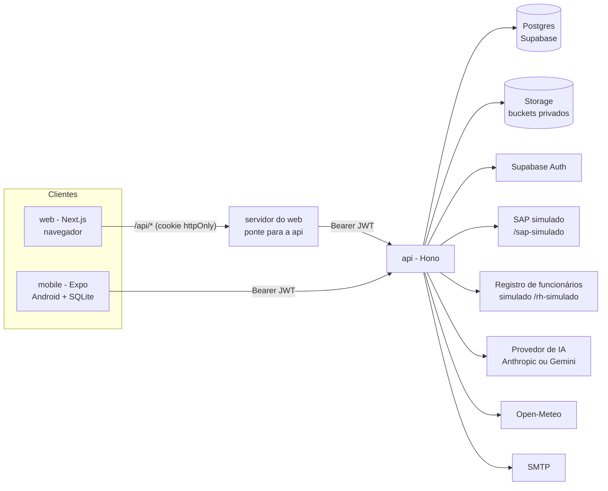
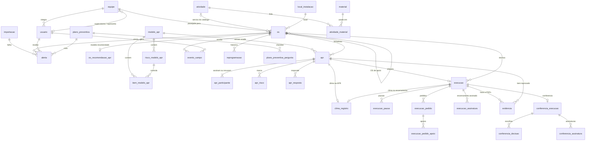
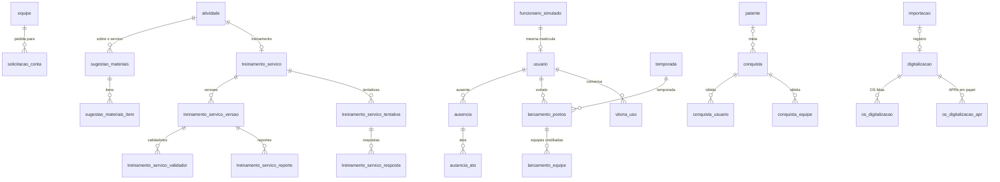
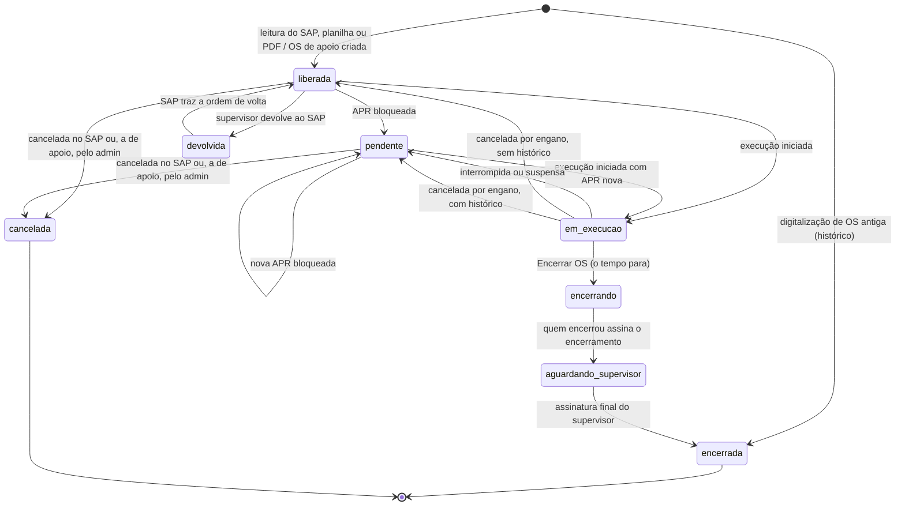
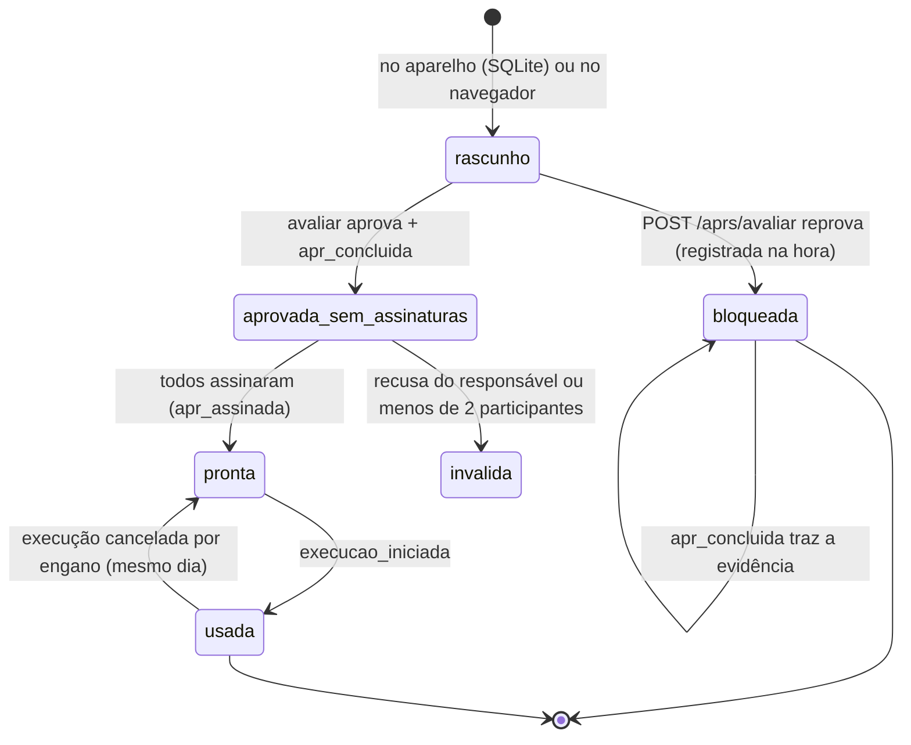
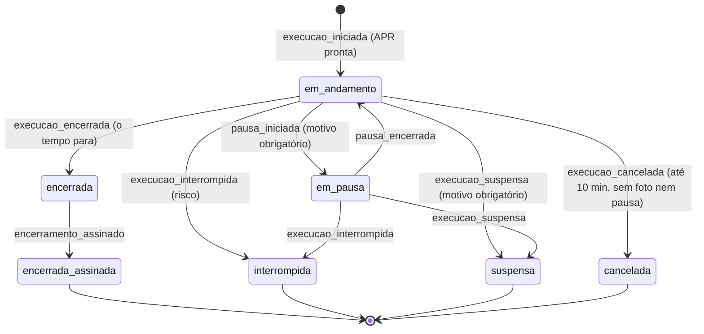
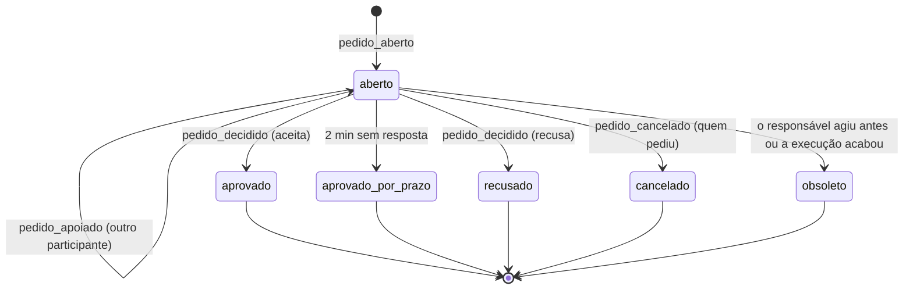
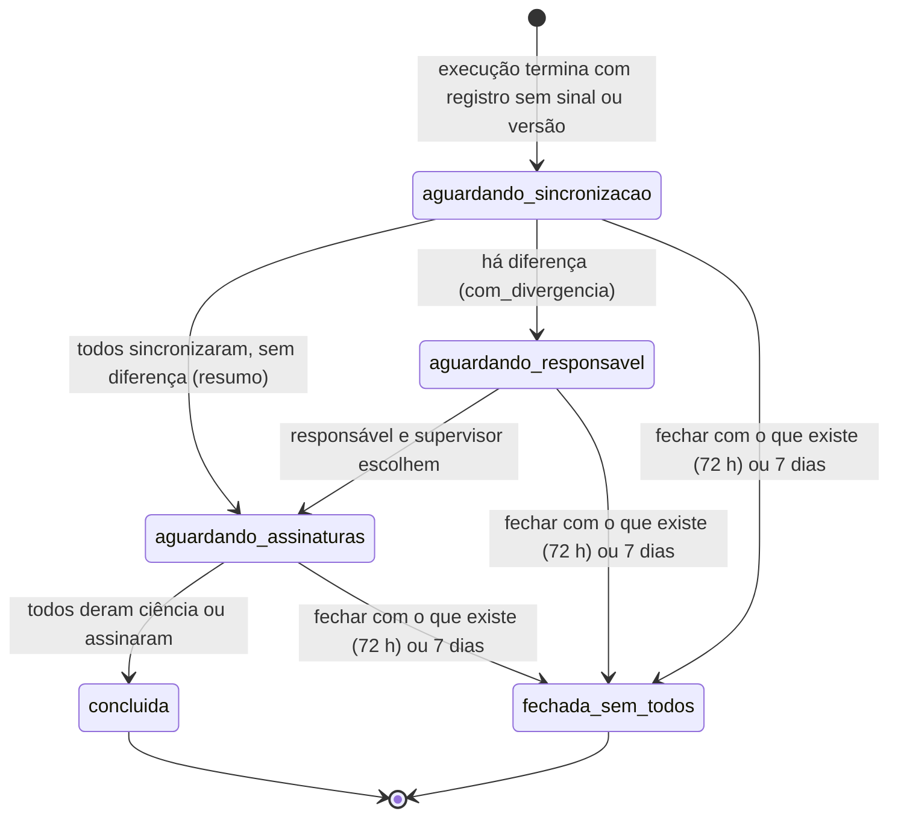
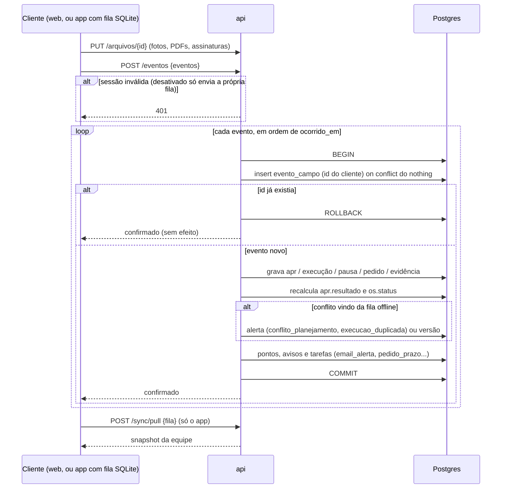

# Especificação técnica do SYNQ OS

Este documento diz **como** o SYNQ OS é construído: arquitetura, stack, decisões técnicas, modelo de dados, estados, eventos e sincronização, contratos, tarefas em segundo plano, segurança e a referência de rotas. O que o sistema faz e com que regras está nos documentos de área:

| Assunto | Documento |
|---|---|
| APR, modelos, execução, encerramento, PDF e relatório, preventivas, materiais, atribuição e devolução, painel e dashboards | [operacao-de-campo.md](operacao-de-campo.md) |
| Perfis e papéis, contas, liberação, assinatura, equipes, supervisor, representante, ausência, avisos e e-mails, validações | [pessoas-e-equipes.md](pessoas-e-equipes.md) |
| SAP e registro de funcionários simulados, entrada e saída de OS | [integracoes-simuladas.md](integracoes-simuladas.md) |
| Funções de IA, Vitória, recomendação do modelo de APR, digitalização | [ia-e-vitoria.md](ia-e-vitoria.md) |
| Pontos, patentes, conquistas, treinamentos de serviço | [gamificacao-e-treinamentos.md](gamificacao-e-treinamentos.md) |

Como rodar cada pacote está nos READMEs ([api](../api/README.md), [web](../web/README.md), [mobile](../mobile/README.md)); o que falta e o que está em aberto, em [pendencias.md](../pendencias.md).

## 1. Arquitetura

### 1.1 Visão geral

O registro central é a OS lida do SAP. Cada tentativa de executá-la é uma Execução amparada por exatamente uma APR própria, e a OS guarda o histórico de todas as APRs e execuções.

O sistema é **online**: o app Android e a web falam com a `api`, que é a única a falar com o Supabase (Postgres, Auth e Storage). Web e app servem a todos os perfis; o que cada pessoa pode fazer depende do perfil e do papel, não da plataforma (o app não tem as telas de gestão). Todo registro de campo (APR, execução, pausa, evidência, assinatura, pedido) chega à `api` como um **evento idempotente**, e esse é o único caminho de escrita de campo: online, o cliente envia o evento na hora; sem sinal, o app guarda os eventos numa fila local e os envia quando o sinal volta. O modo offline é contingência para o campo sem sinal e não muda o fluxo do sistema.



### 1.2 Pacotes do monorepo

| Pasta | Conteúdo | Implantação |
|---|---|---|
| `api` | regras de negócio, autorização, banco, eventos de campo, PDF, e-mail, tarefas em segundo plano, IA e os dois simuladores | `api/Dockerfile` (imagem única, roda o TypeScript com `tsx`) |
| `web` | Next.js para todos os perfis: área de campo (`/app/*`), painel de gestão, Campo de treino e telas dos simuladores (`/simulador/*`) | `web/Dockerfile` |
| `mobile` | app Expo para Android: telas de campo, câmera, assinatura, cópia local e fila em SQLite, envio em segundo plano | `mobile/Dockerfile` gera o APK assinado; não é publicado como serviço |
| `shared` | contratos comuns às três aplicações: tipos da api (`shared/api`), avisos e categorias de e-mail (`shared/notificacoes/avisos.ts`), funções de IA (`shared/ia/funcoes.ts`), destinos da Vitória, jogos de treinamento | — |
| raiz | `docker-compose.yml` (sobe `api` e `web`), `.env.example` | — |

### 1.3 Stack

| Camada | Tecnologia | Onde conferir |
|---|---|---|
| api | Node + TypeScript, Hono, Drizzle ORM (`pg`), zod, `jose` (JWT) | `api/package.json` |
| Banco, autenticação, arquivos | Supabase: Postgres, Auth e Storage | `api/src/servicos/auth.ts`, `armazenamento.ts` |
| PDF gerado | `pdfkit` (PDF da OS e relatório da execução) | `api/src/servicos/pdf-os.ts`, `relatorio-execucao.ts` |
| PDF lido | `pdfjs-dist` (importação do PDF da OS), `@napi-rs/canvas` (folhas em imagem) | `api/src/dominio/importacao-pdf.ts`, `servicos/pdf-imagem.ts` |
| OCR | `tesseract.js` com o idioma português, local, sem custo | `api/src/servicos/ocr.ts` |
| Planilha | `exceljs` (importação e planilha de baixa) | `api/src/dominio/importacao-planilha.ts`, `painel-exportacao.ts` |
| E-mail | `nodemailer` (SMTP) | `api/src/servicos/email.ts` |
| IA | Anthropic (Claude/Haiku) ou Gemini, escolhido por `IA_PROVEDOR` | `api/src/servicos/ia/` |
| Previsão do tempo | Open-Meteo | `api/src/servicos/clima.ts` |
| web | Next.js 16 (App Router), React 19, zod, Leaflet com mapa do OpenStreetMap | `web/package.json` |
| mobile | Expo SDK 58, React Native, `expo-sqlite`, `expo-secure-store`, `expo-background-task` | `mobile/package.json` |
| Testes da api | PGlite (Postgres em WebAssembly) e versões em memória de Auth e Storage | `api/test/ajuda.ts` |

### 1.4 Hospedagem

| Ambiente | Situação |
|---|---|
| Coolify (hospedado pelo mentor da maratona) | hospedagem **oficial** até o fim da maratona; `api` e `web` sobem pelos Dockerfiles |
| Render (https://d-a-p-r-o-m.onrender.com) | hospedagem anterior; continua de pé e pode voltar a ser usada depois |
| Banco de desenvolvimento | um projeto Supabase real e compartilhado (não é descartável); `pnpm dev` da `api`, em watch, aplica nele as migrações na hora |

O protótipo roda só com dados fictícios; a empresa precisa avalizar o armazenamento antes de um piloto com dados reais (LGPD).

## 2. Decisões-chave

Cada decisão tem o número citado no código como "Decisão-chave N".

### 2.1 Decisão-chave 1 — Um único ponto de acesso aos dados

Três aplicações e só a `api` fala com o Supabase. Nenhum cliente recebe a chave do Supabase; as tabelas ficam com RLS ligado e **sem políticas**, e os buckets são privados. Assim a autorização vive em um lugar só e web e app conhecem uma única API. A web não guarda o token no JavaScript: o navegador chama `/api/*` no próprio servidor do `web` (`web/src/app/api/[...caminho]/route.ts`), que junta o token do cookie `httpOnly` e repassa para a `api`; quem autoriza continua sendo a `api`. A ponte não deixa o navegador alcançar os contratos dos simuladores nem `POST /rh/avisos` (só a gestão dos simuladores, que exige o admin logado).

### 2.2 Decisão-chave 2 — Divisão de posse dos dados; conflito vira alerta

Quem executa é dono da execução e quem planeja é dono do planejamento, em qualquer plataforma; a sincronização nunca descarta dado de campo. Os registros de campo vêm dos eventos de quem aplica a APR e executa a OS; equipe, datas programadas, reserva e devolução são gravadas por quem planeja; o SAP, por leitura, grava os dados da ordem. Quando um evento da fila offline chega para uma OS que o planejamento mudou nesse meio-tempo (reprogramada, reservada a outra pessoa, devolvida, outra execução em curso), ele é aplicado mesmo assim e gera um `alerta` (`conflito_planejamento`, `execucao_duplicada`) — conflito vira alerta, nunca sobrescrita. Online, o mesmo conflito é recusado. O que vários participantes registram sem sinal em aparelhos diferentes vira **versão** e é resolvido pela conferência da execução ([seção 6.6](#66-conferência-da-execução)). A alternativa — replicação genérica com mesclagem campo a campo — só compensaria se dois clientes editassem a mesma coluna offline, o que esta decisão impede.

### 2.3 Decisão-chave 3 — ID gerado no cliente; status derivado no servidor

Todo registro de campo nasce com ID gerado no cliente (app ou navegador), e reenviar não tem efeito: o `evento_campo.id` é chave primária e a `api` insere com `on conflict (id) do nothing` antes de aplicar o resto. Isso torna o envio seguro contra rede instável, reenvio e duplo toque. O `status` da OS é derivado no servidor (`recalcularStatusOs`, em `api/src/dominio/status-os.ts`); nenhum cliente o grava. O contrato dos eventos é a decisão de mais difícil volta: mudá-lo depois de haver aparelhos com fila pendente exige migrar dados em celulares que não controlamos.

### 2.4 Decisão-chave 4 — Uma APR, uma OS, uma Execução

A APR vale para uma única OS e ampara uma única Execução; nenhuma Execução começa sem a APR aprovada, do dia, da própria OS, assinada por todos os participantes e ainda não usada; uma APR bloqueada é imutável. Toda nova tentativa exige uma APR nova, e as respostas nunca são pré-preenchidas nem copiadas de outra APR. O banco garante a unicidade (uma APR ampara uma execução não cancelada); a `api` garante o resto.

### 2.5 Decisão-chave 5 — A APR é validada no servidor, e o técnico não sabe o que é eliminatório

A APR é respondida por inteiro e só então validada. Cada item do modelo define `tipo`, `resposta_bloqueante` e `evidencia`, e só o admin recebe esses campos: o modelo que o técnico recebe (`GET /modelos-apr/{codigo}/versoes/{versao}` e a cópia offline) vem sem eles, e o detalhe da OS e o dashboard de APR também os escondem. Quem avalia é o servidor, em `POST /aprs/avaliar` (`api/src/dominio/avaliacao-apr.ts`), que confere tudo o que o registro confere antes de dizer o resultado, para que a recusa nunca revele o que reprova. A bloqueada é registrada na hora, pelo canal dos eventos; a evidência dos itens reprovados chega depois, no `apr_concluida` da mesma APR. O servidor recalcula o resultado a partir das respostas e da versão do modelo; o valor enviado pelo aparelho é só conferido. As regras da APR estão em [operacao-de-campo.md](operacao-de-campo.md).

### 2.6 Decisão-chave 6 — Modelo publicado é imutável; o técnico escolhe o modelo

Editar um modelo publicado cria versão nova, e toda APR aponta para a versão exata que respondeu (`apr.modelo_apr_id`); APRs antigas e PDFs continuam reproduzíveis, e uma APR offline numa versão anterior é aceita com a versão que usou. O banco recusa alterar modelo publicado, seus riscos e seus itens (gatilho). O técnico escolhe o modelo a cada APR; o sistema só recomenda. A recomendação de cada OS é calculada fora da requisição e guardada em `os_recomendacao_apr` (primeiro pelas palavras-chave, depois pela IA quando a função está ligada), para que a tela e a cópia do app nunca esperem a IA ([ia-e-vitoria.md](ia-e-vitoria.md)). A atividade da OS (`codigo_atividade`) é só o serviço do catálogo e não escolhe o modelo.

### 2.7 Decisão-chave 7 — O SAP é fonte de leitura e destino de planilha

A OS entra por leitura (o contrato da API do SAP, servido pelo simulador), planilha, PDF da OS ou digitalização; a leitura insere ou atualiza por `numero_ordem` tocando só colunas de planejamento. Nenhuma OS nasce à mão: a única criada no sistema é a OS de apoio. Reler nunca reabre uma OS encerrada nem apaga execução de campo. A saída é o PDF mais a planilha para baixa manual no SAP. O SAP e o registro de funcionários simulados são o produto: mostram o fluxo final dentro da própria `api` ([integracoes-simuladas.md](integracoes-simuladas.md)).

### 2.8 Decisão-chave 8 — Tentativa que não conclui não trava a OS

A OS fica `pendente` e qualquer pessoa da equipe a retoma com uma APR nova, sem autorização do supervisor, que é avisado e pode reprogramar ou abrir OS de apoio. A OS pendente nunca é duplicada. Durante a execução, todo participante da APR age sobre ela (execução compartilhada): o responsável encerra na hora; outro participante com sinal faz um pedido ao responsável; sem sinal, a ação vale no aparelho e a conferência resolve depois ([seção 5.4](#54-pedido-da-execução-compartilhada)).

### 2.9 Outras decisões técnicas

| Decisão | Por quê |
|---|---|
| Online primeiro; offline só no app, como contingência | o dia a dia tem sinal; a fila e a cópia local reaproveitam o mesmo `POST /eventos`, então o offline não muda telas nem contratos |
| Pull por snapshot, com `cursor` opcional no contrato | simples e suficiente para o volume (centenas de OS por mês); o `cursor` permite trocar por pull incremental sem quebrar o app |
| Evento é "offline" quando chega mais de 60 s depois de `ocorrido_em` (`ATRASO_OFFLINE_MS`, `api/src/dominio/eventos-base.ts`) | decide se o conflito é recusado (online) ou aplicado com alerta (fila); marca `evento_campo.offline` |
| `ocorrido_em` (relógio do aparelho) e `recebido_em` (servidor) guardados juntos | permite sinalizar relógio errado; o instante futuro é trazido para agora na pontuação |
| PDF gerado no servidor, por tarefa, só depois da assinatura final | o Supabase não gera PDF; gerar fora da requisição isola falhas e permite nova tentativa |
| Tarefas em segundo plano numa tabela do próprio Postgres, executadas pelo processo da `api` | o volume não justifica Redis ou fila externa; a linha é lida sem disputa e sobrevive a reinício |
| Recomendação de modelo e digitalização fora da requisição | a IA é lenta e pode cair; a tela lê o que está guardado ou calcula pelas palavras-chave na hora |
| IA só pelo módulo da `api`, com o controle por função | nenhuma chamada sai com a função desligada; trocar de provedor é configuração (`IA_PROVEDOR`) |
| Assinatura do perfil copiada em cada ato | refazer a assinatura vale para as próximas; as já feitas guardam a imagem que usaram |
| Push só para o que pede ação em campo, pelo serviço da Expo, e só no app | o aviso nunca depende dele (sino e e-mail seguem); a OS nova aparece ao atualizar a lista e, no offline, na próxima sincronização |

## 3. Plataforma da api

### 3.1 Estrutura

| Pasta | O que tem |
|---|---|
| `api/src/app.ts` | monta a aplicação Hono e registra os módulos de `src/rotas/` |
| `api/src/servidor.ts` | a subida (ver [seção 3.5](#35-subida)) |
| `api/src/config.ts` | lê e valida as variáveis de ambiente (`lerConfig`); falha na subida se faltar alguma obrigatória |
| `api/src/http/` | convenções comuns: erros, validação, paginação, resposta em snake_case, autenticação e perfis |
| `api/src/dominio/` | regras de negócio por assunto |
| `api/src/servicos/` | o que fala com o mundo de fora, atrás de interfaces (Auth, Storage, SMTP, SAP, RH, IA, clima, OCR, PDF) e o executor de tarefas |
| `api/src/db/` | schema, conexão, migrador e carga inicial (`seed/`) |
| `api/db/migrations/` | migrações SQL |
| `api/fixtures/sap/` | ordens de exemplo do SAP simulado |
| `api/test/` | testes por assunto; `ajuda.ts` monta o ambiente em PGlite |

### 3.2 Convenções HTTP

- **Autenticação:** `Authorization: Bearer <JWT do Supabase>`, conferido com o segredo HS256 (`SUPABASE_JWT_SECRET`) ou pelo JWKS do projeto. Sem token válido é `401`; perfil ou papel sem permissão é `403`.
- **Perfis e papéis:** o enum tem só `tecnico` e `admin` (`PERFIS`, `api/src/db/schema/usuarios.ts`). `exigirPerfil("supervisor")` é um papel derivado: quem `equipe.supervisor_id` aponta (qualquer usuário ativo) ou o representante no comando; `autenticar()` calcula `equipesSupervisionadas` a cada requisição.
- **JSON em snake_case**; erros `{erro: {codigo, mensagem}}` em pt-BR (`422` `validacao` para campo inválido); listas `{<nome>: [...], pagina, tamanho, total}` com `?pagina=1&tamanho=50` (máximo 200).
- **Datas e horas:** datas `AAAA-MM-DD`, instantes ISO 8601 guardados em UTC; "dia" é o de `America/Sao_Paulo`.
- **Arquivos:** `PUT /arquivos/{id}` (multipart `arquivo`, `tipo` = `foto`, `assinatura` ou `pdf`) com o id gerado no cliente; reenviar o mesmo id e conteúdo não tem efeito, conteúdo diferente é `409`. O `pdf` é conferido pelo conteúdo (`422` `tipo_de_arquivo` se não começa como PDF). A leitura é por URL assinada de curta duração (`GET /arquivos/{id}/url`), depois de checar o perfil.

### 3.3 Travas da conta

`autenticar()` (`api/src/http/autenticacao.ts`) recusa a conta conforme a situação, e cada rota libera só o que precisa com uma opção:

| Situação | Resposta nas demais rotas | Opção que libera | O que passa |
|---|---|---|---|
| Recusada ou desativada | `401` `acesso_revogado` | `permitirDesativado` | `PUT /arquivos/{id}`, `POST /eventos`, `POST /auth/sair` (para a fila offline subir) |
| Aguardando liberação | `403` `aguardando_liberacao` | `permitirPendente` | `GET /me`, troca de senha, Campo de treino, preferências de e-mail, treinamentos de serviço, Vitória |
| Senha provisória | `403` `senha_provisoria` | `permitirSenhaProvisoria` | `GET /me`, `PUT /me/treinamento`, troca de senha, sair |
| Liberada sem assinatura cadastrada | `403` `assinatura_pendente` | `permitirSemAssinatura` | `GET /me`, `PUT /me/assinatura`, os arquivos, troca de senha, sair |
| Ausente | `403` `usuario_ausente` em toda rota que altera | `permitirAusente` | leitura, sair, alertas, preferências, `POST /sync/pull`, arquivos, `POST /eventos` (só o que aconteceu antes do início) e os atos da própria ausência |

As regras de cada situação estão em [pessoas-e-equipes.md](pessoas-e-equipes.md). `autenticar()` também anota `usuario.ultima_atividade_em` (no máximo a cada 5 min, `INTERVALO_DA_ATIVIDADE_MIN`), usada pelo representante.

### 3.4 Arquivos

Buckets privados, criados pela subida quando faltam (`BUCKETS`, `api/src/servicos/armazenamento.ts`):

| Bucket | Conteúdo |
|---|---|
| `fotos` | fotos de evidência (APR e execução) |
| `assinaturas` | assinaturas dos perfis |
| `pdfs` | o PDF de cada OS concluída |
| `importacoes` | planilhas e PDFs enviados na Importação e PDFs da digitalização |
| `documentos` | PDFs anexados como evidência |
| `gamificacao` | imagens de patentes e conquistas |
| `treinamentos` | imagens dos treinamentos de serviço |

O banco guarda só o caminho (`*_path`); dentro do bucket o caminho é o id do arquivo gerado no cliente (ou o da OS, nos PDFs). Foto é comprimida no cliente (~1600 px, JPEG 70%).

### 3.5 Subida

`api/src/servidor.ts`, nesta ordem: aplica as migrações sob trava de sessão (`migrarComTrava`, `pg_advisory_lock`, em `api/src/db/conexao.ts`), carrega os dados iniciais (`carregarDadosIniciais`), carrega as ordens de exemplo do SAP simulado com a tabela vazia, preenche o extrato da gamificação a partir do histórico (só com o extrato vazio, numa transação só), garante os buckets e as imagens da carga, inicia o executor de tarefas e só então abre a porta. `GET /saude` responde depois disso; migração que falha impede a subida. Por causa da trava de sessão, a conexão com o Supabase precisa ser a direta ou o *Session pooler*, nunca o *Transaction pooler*.

### 3.6 Variáveis de ambiente

A lista completa, com padrões e validação, está em `api/src/config.ts`; o modelo para preencher, em `.env.example` (raiz). Grupos:

| Grupo | Variáveis |
|---|---|
| Banco e Supabase | `DATABASE_URL`, `SUPABASE_URL`, `SUPABASE_SERVICE_ROLE_KEY`, `SUPABASE_JWT_SECRET` (só no segredo legado HS256) |
| SAP simulado | `SAP_SIMULADO`, `SAP_API_URL`, `SAP_API_TOKEN`, `SAP_LEITURA_INTERVALO_MIN` |
| Registro de funcionários simulado | `RH_SIMULADO`, `RH_API_URL`, `RH_API_TOKEN`, `RH_AVISO_TOKEN`, `RH_AVISO_URL`, `RH_LEITURA_HORA` |
| E-mail | `SMTP_URL` (sem ele os avisos ficam só no sino), `EMAIL_REMETENTE`, `EMAIL_RESUMO_HORA`, `PAINEL_URL` (base dos links) |
| Push | `PUSH_LIGADO` (padrão `true`), `EXPO_PUSH_URL`, `EXPO_ACCESS_TOKEN` (só se a conta da Expo a exige) |
| IA | `IA_PROVEDOR`, `ANTHROPIC_API_KEY`, `GEMINI_API_KEY`, `*_MODELO_CHATBOT`, `*_MODELO_MINIGAMES`, `*_MODELO_RECOMENDACAO`, `*_MODELO_DIGITALIZACAO`, `GEMINI_MODELO_RESERVA`, limites `VITORIA_*` e `TREINAMENTO_IA_*` |
| Previsão do tempo | `CLIMA_API_URL`, `CLIMA_API_CHAVE` |
| Servidor | `PORT` |
| web | `API_URL` (só no servidor do `web`) |
| mobile | `EXPO_PUBLIC_API_URL`, fixada no build do APK |

Parte dos valores (cidade padrão, intervalo de leitura do SAP, horas da leitura do RH e do resumo, limites da IA) pode ser mudada pelo admin em `/app/configuracoes`; o valor gravado na tabela `configuracao` vence o do ambiente (`CONFIGURACOES_CHAVES`, `api/src/db/schema/clima.ts`; `aplicarConfiguracoes`, `api/src/dominio/configuracoes.ts`).

## 4. Modelo de dados

### 4.1 Arquivos do schema

O schema é descrito em TypeScript com Drizzle em `api/src/db/schema/` e é a fonte de verdade; as migrações são geradas dele. As colunas estão no próprio schema, comentadas.

| Arquivo | Tabelas | Para que serve |
|---|---|---|
| `comum.ts` | — | utilitários do schema inteiro: `instante()` (timestamptz) e `emLista()` (os `CHECK` de lista de valores) |
| `index.ts` | — | reexporta todos os arquivos; é o que o `drizzle-kit` lê |
| `plataforma.ts` | `tarefa`, `auditoria` | fila de tarefas em segundo plano; trilha de auditoria das telas de gestão (só cresce, sem chave estrangeira) |
| `usuarios.ts` | `equipe`, `usuario` | equipes (supervisor, representante, passagem de comando) e contas (perfil, liberação, assinatura, situação no registro, treino, preferências, última atividade e sincronização) |
| `modelos-apr.ts` | `modelo_apr`, `risco_modelo_apr`, `item_modelo_apr`, `orientacao_modelo_apr`, `atividade` | modelos de APR versionados, riscos e itens; orientação de cada modelo para a escolha (fora do versionamento); atividade = serviço do catálogo que a OS traz |
| `catalogo.ts` | `material`, `atividade_material` | catálogo de materiais, ferramentas e EPIs e a lista recomendada de cada serviço (só consulta) |
| `sap.ts` | `local_instalacao`, `os`, `importacao` | locais (com criticidade), a OS (dados do SAP, planejamento, reserva, devolução, assinatura final, PDF) e o histórico de cada entrada de OS |
| `digitalizacao.ts` | `digitalizacao`, `os_digitalizacao`, `os_digitalizacao_apr` | leitura de PDFs escaneados de OS antigas (estado, etapa, leitura conferida) e o que cada OS e APR em papel registrou |
| `preventivas.ts` | `plano_preventiva`, `plano_preventiva_pergunta` | ciclo de cada plano + item de manutenção (intervalo, base, antecedência, alertas já dados) e o checklist de inspeção do plano |
| `apr.ts` | `apr`, `apr_participante`, `apr_risco`, `apr_resposta` | a APR de cada tentativa, participantes com assinatura ou recusa, riscos marcados e respostas |
| `execucao.ts` | `execucao`, `execucao_pausa`, `execucao_pedido`, `execucao_pedido_apoio`, `execucao_assinatura`, `evidencia` | a execução (tempos, GPS, resultado, motivos, encerramento assinado, inspeção), pausas, pedidos da execução compartilhada e seus apoios, assinatura do encerramento e evidências (foto ou PDF) |
| `conferencia.ts` | `conferencia_execucao`, `conferencia_decisao`, `conferencia_assinatura` | conferência do que foi registrado sem sinal em aparelhos diferentes: versões, escolhas e ciência ou assinatura de cada participante |
| `eventos.ts` | `evento_campo` | todo evento de campo recebido (id do cliente, payload, relógios, se veio offline, se ficou só como versão) |
| `impedimento.ts` | `alerta`, `reprogramacao` | o sino (todos os tipos de aviso, com o alvo e o envio do e-mail) e o histórico das reprogramações |
| `gamificacao.ts` | `regra_pontuacao`, `temporada`, `lancamento_pontos`, `lancamento_equipe`, `patente`, `conquista`, `conquista_usuario`, `conquista_equipe`, `temporada_usuario`, `temporada_equipe` | valores das tarefas, temporadas, extrato de pontos, patentes, conquistas e o resultado gravado no fechamento |
| `rh.ts` | `funcionario_simulado`, `leitura_rh` | os dados do registro de funcionários simulado e o histórico das leituras do registro |
| `sap-simulado.ts` | `ordem_sap_simulada` | as ordens do SAP simulado |
| `ausencia.ts` | `ausencia`, `ausencia_ato` | ausências e a linha do tempo de cada ato assinado |
| `treinamento-servico.ts` | `treinamento_servico`, `treinamento_servico_versao`, `treinamento_servico_tentativa`, `treinamento_servico_resposta`, `treinamento_servico_reporte`, `treinamento_servico_validador` | treinamentos de serviço versionados, tentativas e respostas, erros apontados e a validação pelos supervisores |
| `sugestao-materiais.ts` | `sugestao_materiais`, `sugestao_materiais_item` | sugestões e contestações da lista de materiais de um serviço |
| `solicitacao-conta.ts` | `solicitacao_conta` | pedidos de conta feitos na tela de entrada |
| `vitoria.ts` | `vitoria_uso`, `vitoria_pergunta_sem_resposta`, `vitoria_estatistica` | uso da Vitória (limites), perguntas que ela não soube responder e estatísticas anônimas |
| `ia.ts` | `ia_funcao`, `os_recomendacao_apr` | controle da IA por função (com a autorização assinada da leitura de dados) e a recomendação de modelo guardada por OS |
| `clima.ts` | `clima_registro`, `configuracao` | a previsão do tempo vista na APR e no encerramento; os valores do sistema mudados pelo admin |

O painel e os dashboards não têm tabela própria: leem as acima. A carga inicial (modelos de APR, orientação, atividades, catálogo e dados de demonstração) fica em `api/src/db/seed/`.

### 4.2 Diagrama de entidades — operação



### 4.3 Diagrama de entidades — pessoas, apoio e conteúdo



`funcionario_simulado` e `usuario` não têm chave estrangeira entre si: a ligação é a matrícula, como seria com um registro externo.

### 4.4 Convenções do banco

- Nomes de tabelas e colunas em português, sem acento, em `snake_case` (no TypeScript, camelCase convertido por `casing: "snake_case"` no `drizzle()` e no `drizzle.config.ts`).
- Tempos em `timestamptz` (UTC); o fuso `America/Sao_Paulo` só na exibição e no cálculo de "dia".
- IDs dos registros de campo (`apr`, `execucao`, `execucao_pausa`, `execucao_pedido`, `evidencia`, `evento_campo`) **não têm default**: nascem no cliente. Os demais usam `gen_random_uuid()`. `usuario.id` é o id do Supabase Auth.
- Toda tabela com RLS ligado e sem políticas (`.enableRLS()`): só a `api` acessa.
- Listas de valores são `CHECK` gerados das constantes do schema (`OS_STATUS`, `EVENTO_TIPOS`, `TAREFA_TIPOS`…): a constante é a fonte, e acrescentar um valor exige migração.
- Arquivos ficam no Storage; o banco guarda só o caminho.

### 4.5 O que o banco garante e o que fica na api

O banco recusa o que é sempre inválido, em qualquer cliente; regras que dependem de outras linhas ou do estado da OS ficam na `api`.

| No banco | Na `api` |
|---|---|
| valores permitidos (perfil, status, resultado, tipos de evento, aviso e tarefa, motivos) | cálculo de `os.status` e de `apr.resultado` |
| unicidade: matrícula, e-mail, centro de trabalho, número da ordem, versão de modelo, resposta por item, assinatura por participante, uma leitura agendada do RH por dia | permissões por perfil e papel (supervisor, representante, ausente) |
| `origem = 'apoio'` se e somente se há `os_origem_id`; só a OS de apoio fica sem número da ordem | APR aprovada, do dia, da própria OS, assinada por todos e não usada |
| exatamente um `responsavel` por APR; no máximo uma pausa aberta por execução; uma APR ampara uma única execução não cancelada | só as medidas dos riscos marcados exigem resposta; o risco marcado é do modelo da APR |
| execução encerrada exige fim; interrompida exige fim e motivo; GPS completo ou ausente; "NA" exige observação; reprogramação e devolução exigem justificativa | evidência dos itens reprovados; publicação exige item eliminatório e resposta bloqueante nos itens de verificação |
| alvo do aviso coerente com o tipo (`alerta_alvo`); reserva e devolução completas; representante diferente do supervisor | participantes: a equipe da OS e a de quem preenche, ativos, liberados, não ausentes; ao menos 2 |
| modelo publicado, seus riscos e itens imutáveis; auditoria só cresce (gatilhos) | não há índice único de "uma execução em andamento por OS", de propósito: o offline pode gerar duas, e a conferência ou o alerta resolvem |
| `os.atualizada_em` automático (gatilho) | `orientacao_modelo_apr.codigo` aponta para um código de modelo sem chave estrangeira (o código só é único com a versão) |
| `evento_campo.id` como chave primária (idempotência) | o que é conflito de planejamento, versão ou "chegou tarde" |

### 4.6 Migrações

- Geradas pelo `drizzle-kit` a partir do schema (`pnpm db:generate --name=descricao`), aplicadas em ordem, uma vez cada, e registradas pelo migrador do Drizzle. Só para frente: não há `down`.
- **Nunca editar uma migração já gerada nem o `meta/`**: o banco de desenvolvimento é o Supabase real e compartilhado e já as aplicou. Corrigir é sempre uma migração nova.
- O que o schema não descreve (gatilhos, funções, passos de dados) vai numa migração `--custom` (`pnpm db:generate --custom --name=descricao`), com o SQL escrito à mão; passos de dados também podem ser acrescentados ao fim de uma migração recém-gerada, antes de ela ser aplicada em qualquer banco.
- A `api` aplica as pendentes na subida, sob `pg_advisory_lock` (duas instâncias subindo juntas não colidem); `pnpm dev`, em watch, aplica na hora no banco configurado.
- `pnpm db:check` confere a consistência; `pnpm db:test` aplica tudo num PGlite e roda os casos do schema e da carga.

### 4.7 Carga inicial

`carregarDadosIniciais` (`api/src/db/seed/carregar.ts`) roda a cada subida e só grava o que falta: os 8 modelos de APR de `base/apr-examples/` (lidos por `gerar-modelos-apr.mjs` para `modelos-apr.json`, que é commitado), a orientação de cada modelo (`orientacoes-modelos-apr.ts`) e as atividades. Um modelo só entra se o código não existe em nenhuma versão, e uma orientação ou atividade só se o código não existe, então o que o admin editou fica. O critério de bloqueio não vem das planilhas: a carga traz um ponto de partida provisório (`criterioProvisorio`), que o admin ajusta no editor. A carga da gamificação (tarefas, patentes e conquistas, com ids fixos) entrou por migração; as imagens, pela subida. Dados de demonstração: `pnpm demo:popular` ([api/README.md](../api/README.md)).

## 5. Máquinas de estado

### 5.1 OS

`os.status` (`OS_STATUS`, `api/src/db/schema/sap.ts`): `liberada`, `pendente`, `em_execucao`, `encerrando`, `aguardando_supervisor`, `encerrada`, `cancelada`, `devolvida`. É derivado por `recalcularStatusOs`, nesta ordem: `cancelada` e `devolvida` ficam (só o SAP traz a devolvida de volta, ao reler a ordem liberada); havendo execução encerrada, `encerrando` até quem encerrou assinar o encerramento, `aguardando_supervisor` até a assinatura final do supervisor (`os.ciencia_em`) e então `encerrada`; `em_execucao` se há execução em andamento (inclui em pausa); `pendente` se há APR bloqueada ou execução interrompida ou suspensa; `liberada` nos demais casos. A execução cancelada por engano não conta.



A assinatura final espera a conferência da execução montar (`409` `conferencia_pendente`). O PDF da OS só é gerado depois dela.

### 5.2 APR

| Elemento | Estados | Onde |
|---|---|---|
| `apr.resultado` | `aprovada` \| `bloqueada`, calculado no servidor; a bloqueada é imutável | `APR_RESULTADOS`, `api/src/db/schema/apr.ts` |
| Participante | aguardando assinatura → assinou (`assinada_em`, cópia da assinatura do perfil; `assinatura_presencial` no offline) ou recusou (`recusou_em`, `recusa_motivo`) | `apr_participante` |
| APR utilizável | aprovada, do dia de `concluida_em`, todos os que ficaram assinaram, nenhuma execução não cancelada a usa | `api/src/dominio/apr-assinaturas.ts` |



O rascunho nunca chega à `api`; "pronta", "usada" e "invalida" são situações calculadas, não colunas.

### 5.3 Execução

`execucao.resultado` (`EXECUCAO_RESULTADOS`): nulo = em andamento; `encerrada`, `interrompida`, `suspensa`, `cancelada`. A pausa é uma linha aberta em `execucao_pausa`. Na `encerrada`, `encerramento_assinado_em` nulo significa a OS `encerrando`.



Quem pode cada transição (execução compartilhada): o responsável (quem iniciou) encerra, suspende e cancela na hora; todo participante da APR que não recusou pausa, continua, interrompe por risco e suspende por motivo de saúde na hora, com aviso ao responsável; encerrar e suspender por outro motivo, feito por outro participante com sinal, vira um pedido ([seção 5.4](#54-pedido-da-execução-compartilhada)); sem sinal, a ação vale no aparelho e vai para a conferência. Só quem encerrou assina o encerramento (`encerramento_de_outro`, em `api/src/dominio/eventos-execucao.ts`). Os limites (motivos, fotos, prazos) estão em [operacao-de-campo.md](operacao-de-campo.md).

### 5.4 Pedido da execução compartilhada

`execucao_pedido.estado` (`PEDIDO_ESTADOS`, `api/src/db/schema/execucao.ts`), tipo `encerrar` ou `suspender`. O prazo é `PRAZO_DO_PEDIDO_MS` (2 minutos, `shared/api/execucao-pedidos.ts`), no relógio da `api`, cumprido pela tarefa `pedido_prazo`. A ação aprovada vale no instante do clique de quem pediu. Da fila offline não há pedido: a ação é aplicada direto (`aplicarPedidoAberto`).



### 5.5 Conferência da execução

`conferencia_execucao.estado` (`CONFERENCIA_ESTADOS`, `api/src/db/schema/conferencia.ts`), tipo `resumo` ou `com_divergencia`. Constantes em `shared/api/conferencia-execucao.ts`: tolerância de 5 min (`TOLERANCIA_MS`), fechamento com o que existe a partir de 72 h (`LIBERAR_FECHAMENTO_EM_MS`) e sozinho aos 7 dias (`LIMITE_DA_CONFERENCIA_MS`) (prazos a confirmar; ver [pendencias.md](../pendencias.md)).



### 5.6 Outros estados

| Entidade | Constante | Valores |
|---|---|---|
| `tarefa.estado` | `TAREFA_ESTADOS` (`plataforma.ts`) | `pendente`, `em_andamento`, `concluida`, `falhou` |
| `usuario.liberacao` | `LIBERACOES` (`usuarios.ts`) | `liberado`, `pendente`, `recusado` |
| `ausencia.estado` | `AUSENCIA_ESTADOS` (`ausencia.ts`) | `pedida`, `aguardando_confirmacao`, `confirmada`, `encerrada`, `recusada`, `cancelada`; `vencida` é calculada pelas datas, não gravada |
| `digitalizacao.estado` | `DIGITALIZACAO_ESTADOS` (`digitalizacao.ts`) | `lendo`, `lida`, `falhou`, `registrada` (etapas `preparando`, `ocr`, `ia`, `conferindo`) |
| `sugestao_materiais.estado` | `SUGESTAO_ESTADOS` | `pendente`, `aceita`, `recusada`, `cancelada` |
| `solicitacao_conta.estado` | `SOLICITACAO_CONTA_ESTADOS` | `pendente`, `atendida`, `descartada` |
| Versão de treinamento | `TREINAMENTO_SERVICO_VERSAO_ESTADOS` | `rascunho`, `publicada`, `substituida` |

## 6. Eventos e sincronização

### 6.1 Canal único de escrita de campo

`POST /eventos` `{eventos: [{id, tipo, os_id, payload, ocorrido_em}]}` → sempre `200`:

```
{confirmados: [id], alertas: [id], aprs: [{id, resultado}], os: [{id, status}],
 rejeitados: [{id, codigo, mensagem}], pendentes: [{id, codigo, mensagem}],
 pontos_ganhos, ganhos[]}
```

- `rejeitados`: não adianta reenviar (regra violada). `pendentes`: falta um arquivo ou um evento anterior; ficam na fila do cliente.
- Online, o cliente manda um evento por vez e usa `aprs` e `os` para mostrar o resultado na hora. A web envia direto; o app grava antes na fila SQLite e envia em seguida.
- Fotos, PDFs e assinaturas sobem por `PUT /arquivos/{id}` antes do evento que os cita.
- Os eventos são aplicados em ordem de `ocorrido_em`, um por transação (`processarEventos`, `api/src/dominio/eventos.ts`).
- `POST /aprs/avaliar` não é evento: devolve `{resultado, reprovados: [{item_id, texto, evidencia}]}` e, na bloqueada, registra a APR pelo mesmo caminho dos eventos.

### 6.2 Tipos de evento

`EVENTO_TIPOS` (`api/src/db/schema/eventos.ts`); os payloads são validados por zod em `api/src/dominio/eventos-apr.ts`, `eventos-execucao.ts` e `pedidos-execucao.ts`, com os tipos compartilhados em `shared/api/eventos.ts`.

| Tipo | O que leva / faz |
|---|---|
| `apr_concluida` | a APR completa (OS, versão do modelo, participantes com função, riscos marcados, respostas, evidências, observação geral, clima); registrada sem assinaturas; no offline, `assinatura_presencial: true` |
| `apr_assinada` | o participante assina com a assinatura do perfil |
| `apr_recusada` | direito de recusa, com motivo; o participante sai da APR |
| `execucao_iniciada` | `id`, `apr_id`, número de pessoas, início, GPS |
| `pausa_iniciada` / `pausa_encerrada` | pausa com motivo (`PAUSA_MOTIVOS`) e complemento quando exigido, GPS |
| `execucao_encerrada` | o clique em "Encerrar OS": fim e GPS; o tempo para |
| `encerramento_assinado` | descrição, fotos e PDFs, checklist de inspeção (`dados_inspecao`), clima e a assinatura de quem encerrou |
| `execucao_interrompida` | interrupção por risco: motivo, ao menos 1 foto, GPS |
| `execucao_suspensa` | motivo (`SUSPENSAO_MOTIVOS`), complemento quando exigido, GPS |
| `execucao_cancelada` | cancelar por engano |
| `pedido_aberto` / `pedido_decidido` / `pedido_cancelado` / `pedido_apoiado` | execução compartilhada ([seção 5.4](#54-pedido-da-execução-compartilhada)) |

Cada evidência é `{id, arquivo_id?, tipo?: foto | pdf, nome?, item_id?, capturada_em, latitude?, longitude?}`; latitude e longitude vêm juntas ou não vêm ("sem localização" não bloqueia).

### 6.3 Idempotência



### 6.4 Online, offline e conflito

- `evento_campo.offline` = chegou mais de 60 s depois de `ocorrido_em` (`ATRASO_OFFLINE_MS`). Online, o conflito com o que mudou no servidor é recusado; da fila, é aplicado e vira alerta, ou fica como versão.
- `evento_campo.so_versao` e `evento_campo.execucao_id`: o `execucao_iniciada` de outro participante quando a APR já amparou uma execução, e a pausa, o fim ou o início que conflitam com outro aparelho, ficam só como versão, apontando a execução de verdade; os eventos seguintes do aparelho citam o id local e chegam à execução certa (`resolverExecucaoId`).
- O `execucao_iniciada` que chega da fila antes de uma assinatura vinda de outro aparelho fica pendente em vez de recusado.
- Usuário desativado ainda envia a própria fila; depois a sessão é revogada.

### 6.5 Cópia local: `POST /sync/pull`

Só para técnico com equipe (`api/src/rotas/eventos.ts`, `montarSnapshot` em `api/src/dominio/sync.ts`). O corpo opcional `{fila: [{os_id, quantos}]}` informa o que ainda está na fila do aparelho, gravado em `usuario.ultima_sincronizacao_em` e `fila_na_sincronizacao` (a conferência espera por isso). A resposta é o snapshot completo da equipe:

| Chave | Conteúdo |
|---|---|
| `os` | OS `liberada`, `pendente` e `em_execucao` da equipe, e as do próprio técnico já executadas nos últimos 60 dias; cada uma com `escolha_do_modelo` (recomendado e o que cada modelo achou) e `checklist_inspecao` do plano |
| `aprs` | com os participantes (função, assinatura, recusa) |
| `execucoes` | com as pausas |
| `locais`, `atividades` | as atividades com `materiais` |
| `modelos_apr` | publicados e não arquivados, com `orientacao` e os itens **sem** a classificação (Decisão-chave 5) |
| `equipe`, `usuarios` | sem e-mail, com a ausência de cada um |
| `cursor` | instante do servidor; o contrato aceita `cursor` para um pull incremental futuro |

O snapshot nunca apaga do aparelho uma OS com evento local pendente.

### 6.6 Conferência da execução

Quando uma execução termina com algum registro `offline` ou `so_versao`, nasce a `conferencia_execucao` (uma por execução, `api/src/dominio/conferencia-execucao.ts`). Ela espera cada participante que usa o app sincronizar depois do fim com a fila daquela OS vazia, compara as versões (`conferencia-comparacao.ts`: tolerância de 5 min, pausas casadas por sobreposição, fotos somam), vira `resumo` ou `com_divergencia`, aplica a escolha nas tabelas da execução (o anterior fica no snapshot da conferência) e pede ciência ou assinatura. Avisos às 24 h e 48 h; o que chega depois de montar fica como "chegou tarde" e não muda o decidido. Rotas em `api/src/rotas/conferencias.ts`.

### 6.7 O app sem sinal

| Peça | Como é feito | Onde |
|---|---|---|
| Fila e cópia local | SQLite; arquivos sobem antes dos eventos | `mobile/src/offline/` (`fila.ts`, `copia.ts`, `envio.ts`, `sincronizar.ts`) |
| Login sem sinal | hash PBKDF2-HMAC-SHA256 salgado da senha no `expo-secure-store`; vale por 7 dias desde a última confirmação do servidor (`JANELA_SEM_SINAL_DIAS`) | `mobile/src/sessao/` |
| Envio com o app fechado | `expo-background-task`, intervalo mínimo de 15 min (o Android decide o real) | `mobile/src/offline/segundo-plano*.ts` |
| Sair com fila pendente | recusado | `mobile/src/sessao/` |
| Rascunho da APR | SQLite no app; navegador na web; nada vai à `api` até concluir | `mobile/src/apr/`, `web/src/state/rascunho-apr.ts` |

## 7. Contratos

### 7.1 Leitura do SAP

Contrato de leitura (o mesmo que o simulador serve em `/sap-simulado`, com `Authorization: Bearer {SAP_API_TOKEN}`; `api/src/servicos/sap.ts`):

- `GET {SAP_API_URL}/ordens?alteradas_desde&pagina&tamanho` → `{ordens: [OrdemSap], proxima_pagina?}`
- `GET {SAP_API_URL}/ordens/{numero_ordem}` → a ordem
- `OrdemSap`: `{numero_ordem, numero_nota, tipo_ordem (YBA1|YBA2), tipo_atividade, codigo_atividade, titulo, descricao, centro_trabalho, local_instalacao: {codigo, endereco, plus_code, cliente}, equipamento, prioridade, data_inicio_prog, data_fim_prog, status_sap, solicitante, criado_por, criada_em, plano_manutencao?, item_manutencao?, intervalo_ciclo?}`

A leitura agendada (tarefa `leitura_sap`, a cada `SAP_LEITURA_INTERVALO_MIN`) ou o "Ler agora" (`POST /sap/leituras`) consulta desde a última leitura sem erro e processa cada ordem em `processarOrdens` (`api/src/dominio/importacao-ordens.ts`): equipe pelo centro de trabalho, local pelo código (criado se novo), atividade pelo código (cadastrada se nova), só ordens com `LIB` em `status_sap` criam OS, e só colunas de planejamento são atualizadas. Falha de leitura não muda nenhuma OS e gera `importacao` com erro e o aviso `falha_importacao`. Regras de entrada (ignoradas, cancelamento, reprogramação, devolvida) em [integracoes-simuladas.md](integracoes-simuladas.md).

### 7.2 Planilha

`POST /importacoes` (multipart `.xlsx`) usa o mesmo processamento e o mesmo mapeamento de campos da leitura (`api/src/dominio/importacao-planilha.ts`); arquivo fora do formato é `422` com as colunas ausentes, e nada muda. O arquivo fica no bucket `importacoes`.

### 7.3 PDF da OS impresso pelo SAP

Em dois passos (`api/src/dominio/importacao-pdf.ts`, o mapeamento rótulo → campo é o ponto de ajuste se o formulário mudar):

1. `POST /importacoes/pdf/leitura` (multipart `.pdf`) → `{arquivo, paginas, paginas_sem_ordem, ordens: [{paginas, ordem, faltando, observacoes, existente?, equipe?, atividade, preventiva}]}`. Só lê o texto: cada folha vai para a OS do número no cabeçalho; nada é gravado. PDF sem texto, sem ordem, protegido ou inválido é `422` (`pdf_sem_texto`, `pdf_sem_ordem`, `pdf_protegido`, `pdf_invalido`).
2. `POST /importacoes/pdf` (multipart: o PDF e `ordens` em JSON, conferidas pela pessoa) → `{importacao_id, criadas, atualizadas, ignoradas, avisos, planos_sem_intervalo}`. A `api` relê o PDF e recusa a ordem que não está nele; o PDF nunca cancela uma OS.

### 7.4 Digitalização de OS antigas

`POST /digitalizacoes` guarda o PDF escaneado e enfileira a tarefa `digitalizacao`: as folhas viram imagem, o OCR local (Tesseract) lê o impresso e a IA de visão só o manuscrito (com a função Digitalização ligada); o sistema confere com os cadastros, e a leitura fica em `digitalizacao.leitura` até a conferência do admin. `POST /digitalizacoes/{id}/registro` cria as OS com `origem` `digitalizacao`, já encerradas, como histórico (`api/src/dominio/digitalizacao-registro.ts`). Regras em [ia-e-vitoria.md](ia-e-vitoria.md).

### 7.5 Registro de funcionários

O SYNQ OS lê, com `Authorization: Bearer {RH_API_TOKEN}`: `GET {RH_API_URL}/funcionarios/{matricula}` e `GET {RH_API_URL}/funcionarios?pagina&tamanho` → `{funcionarios[], proxima_pagina?}`; funcionário `{matricula, nome, email, cargo, centro_trabalho, setor, registro_profissional, situacao, data_admissao, data_nascimento, telefone, gestor_matricula, lotacao}`, `situacao` em `ativo`, `afastado`, `desligado`, sem CPF. O registro avisa por `POST /rh/avisos` `{matriculas[]}` com `RH_AVISO_TOKEN`; o aviso só enfileira `conferencia_rh`, que consulta o registro e age pelo que ele responde (um aviso falso não desativa ninguém). Regras em [integracoes-simuladas.md](integracoes-simuladas.md).

### 7.6 Saída para o SAP

`POST /exportacoes/sap` (admin) → `.xlsx` com 4 abas: `Encerradas` (OS `encerrada` ainda não exportadas; marca `os.exportada_sap_em`), `Sem ordem SAP` (OS de apoio), `Impedimentos` (OS `pendente`, com o motivo) e `Devolvidas` (marca `os.devolucao_exportada_em`). Colunas da aba `Encerradas`: `numero_ordem`, `data_inicio`, `hora_inicio`, `data_fim`, `hora_fim`, `tempo_liquido_min`, `pausa_min`, `numero_pessoas`, `executantes` (matrículas), `descricao_atividade`, `link_pdf`, `ciencia_supervisor`. Código em `api/src/dominio/painel-exportacao.ts`.

### 7.7 PDF da OS

`GET /os/{id}/pdf` → `application/pdf`, gerado pela tarefa `pdf_os` depois da assinatura final do supervisor e guardado no bucket `pdfs` (`os.pdf_path`). Reproduz o papel, sem nada a mais: a **APR** (cabeçalho, participantes, itens com as respostas, observações, contatos de emergência do modelo, código, versão e data do documento) e a **folha da OS do SAP** (cabeçalho, objetos técnicos, planejamento, operações com número de pessoas, início e fim, descrição da atividade, atesto com a assinatura dada na APR, responsável e assinatura final do supervisor). Montagem em `api/src/servicos/pdf-os.ts` e `pdf-*.ts`; o layout e as regras de escala estão em [operacao-de-campo.md](operacao-de-campo.md).

### 7.8 Relatório da execução

`GET /os/{id}/relatorio-execucao` → `application/pdf`, gerado na hora (`api/src/servicos/relatorio-execucao.ts`); só o supervisor da equipe e o admin (`403` para os demais, `404` fora do escopo, `409` `os_sem_execucao`). Traz o que o PDF da OS não traz: tempos total, pausado e líquido; pausas, suspensões e interrupções com motivo e localização; GPS ao lado do endereço; fotos e PDFs; checklist de inspeção; clima registrado; assinaturas da APR com a hora; e a conferência da execução, quando houve.

### 7.9 Previsão do tempo

`GET /clima?latitude&longitude&janela=expediente|proximas_horas` (todo perfil liberado) consulta o Open-Meteo pela posição do aparelho ou pela cidade padrão e nunca falha por causa do provedor: sem resposta, `disponivel: false`. `GET /clima/cidades?busca` (admin) escolhe a cidade padrão. O que a pessoa viu na APR e no encerramento é copiado em `clima_registro` (só informativo; nada é bloqueado por ele). Regras em [operacao-de-campo.md](operacao-de-campo.md).

### 7.10 IA

O módulo `api/src/servicos/ia/` fala com o provedor de `IA_PROVEDOR` (`anthropic`, o padrão e o destino com dados reais; `gemini`, plano gratuito, só na demonstração com dados fictícios), com um modelo por função. As funções (`FUNCOES_DE_IA`, `shared/ia/funcoes.ts`): `chatbot`, `minigames`, `recomendacao`, `digitalizacao`. O módulo recusa a chamada da função desligada (`ia_funcao`) antes de falar com o fornecedor; ligar a leitura de dados reais exige a assinatura do admin. Sem a chave do provedor, nada chama a IA. Regras e limites em [ia-e-vitoria.md](ia-e-vitoria.md).

## 8. Tarefas em segundo plano

### 8.1 Fila de tarefas

A tabela `tarefa` guarda o trabalho assíncrono; o executor roda no próprio processo da `api` (`iniciarTarefas`, `api/src/servicos/tarefas.ts`), numa rodada a cada 5 s, lendo as pendentes sem disputar a mesma linha e devolvendo à fila as presas. Falha: nova tentativa em 1, 5 e 15 minutos (`ESPERAS_MIN`); depois de 5 tentativas (`MAX_TENTATIVAS`) fica `falhou`. Quando `pdf_os` ou `leitura_rh` esgota as tentativas, os administradores recebem `pdf_os_falhou` ou `rh_leitura_falhou`.

| `TAREFA_TIPOS` (`api/src/db/schema/plataforma.ts`) | `referencia_id` | O que faz |
|---|---|---|
| `pdf_os` | `os.id` | gera e guarda o PDF da OS concluída |
| `email_alerta` | `alerta.id` | envia o e-mail do aviso, se o tipo tem categoria, a pessoa está ativa e não desligou a categoria |
| `push_alerta` | `alerta.id` | manda a notificação push do aviso, se o tipo toca no celular (`PUSH_DO_AVISO`), o aviso não foi lido, a pessoa está ativa e tem aparelho registrado |
| `email_resumo` | `usuario.id` | resumo diário por e-mail (a partir de `EMAIL_RESUMO_HORA`, uma vez por dia por pessoa) |
| `leitura_sap` | `importacao.id` ou nulo | leitura do SAP, agendada ou pedida |
| `leitura_rh` | `leitura_rh.id` | leitura completa do registro de funcionários (diária, a partir de `RH_LEITURA_HORA`, ou "Ler agora") |
| `conferencia_rh` | `usuario.id` | confere uma pessoa no registro depois de um aviso |
| `digitalizacao` | `digitalizacao.id` | lê as folhas de um PDF escaneado (renova a própria reserva a cada folha) |
| `pedido_prazo` | `execucao_pedido.id` | aprova o pedido da execução compartilhada que ninguém respondeu em 2 min |

### 8.2 Rotinas periódicas

Rodam no mesmo laço, sem passar pela fila, e são idempotentes (uma falha não impede as demais):

| Rotina | Frequência | Função |
|---|---|---|
| Ciclo das preventivas (alertas de próximo e vencido) | ao subir e a cada 60 min (`INTERVALO_CICLOS_MIN`); também depois de cada importação e edição do plano | `verificarCiclos`, `api/src/dominio/preventivas.ts` |
| Ausências (início, vencimento, pedidos parados) e representação das equipes | ao subir e a cada 60 min (`INTERVALO_AUSENCIAS_MIN`) | `conferirAusencias`, `atualizarSupervisaoDasEquipes` |
| Prazos das conferências da execução | a cada 60 min (`INTERVALO_CONFERENCIAS_MIN`) | `conferirConferencias` |
| Recomendação de modelo de APR das OS abertas | a cada 1 min (`INTERVALO_RECOMENDACOES_MIN`) | `analisarRecomendacoesDeApr`, `api/src/dominio/recomendacao-apr-guardada.ts` |
| Fechamento das temporadas da gamificação | a cada 60 min (`INTERVALO_TEMPORADAS_MIN`) | `fecharTemporadasVencidas`, `api/src/dominio/fechamento-temporada.ts` |
| Agendar a leitura diária do RH e o resumo diário | checados a cada minuto | `iniciarTarefas` |

## 9. Segurança

| Ponto | Como é feito |
|---|---|
| Acesso aos dados | só a `api`; RLS ligado sem políticas; buckets privados; leitura de arquivo por URL assinada de curta duração |
| Token na web | cookie `httpOnly`, repassado pela ponte `/api/*` do servidor do `web`; o JavaScript do navegador não o vê |
| Token no app | `expo-secure-store`; senha nunca guardada, só o hash PBKDF2 para o login sem sinal |
| Travas da conta | [seção 3.3](#33-travas-da-conta); a sessão é derrubada em `POST /auth/sair` (o `refresh_token` deixa de renovar) |
| Assinatura | cadastrada no perfil antes de qualquer outra ação (`403` `assinatura_pendente`); copiada em cada ato assinado (APR, encerramento, assinatura final, ausência, conferência, validação de treinamento, autorização da IA) |
| Critério da APR | escondido do técnico em todas as respostas (Decisão-chave 5) |
| Integrações | tokens de sistema separados para SAP e RH; o aviso do RH só enfileira uma conferência; a leitura do RH que desativaria mais da metade dos ativos não aplica nada |
| Auditoria | `auditoria` só cresce (gatilho), sem chave estrangeira, nunca guarda senha; eventos de campo ficam em `evento_campo` |
| IA | chamada só pela `api`, com a função ligada; dados reais só com autorização assinada; Gemini gratuito só com dados fictícios |
| Dados | só fictícios no protótipo |

## 10. Referência de rotas

Cada arquivo de `api/src/rotas/` é um módulo registrado em `api/src/app.ts`. Os contratos usados pelos clientes ficam em `shared/api/`. "Supervisor" é o papel derivado (titular ou representante no comando). Para o detalhe de cada rota, leia o arquivo e o domínio correspondente.

| Área | Arquivo | Prefixos | Quem acessa |
|---|---|---|---|
| Saúde | `saude.ts` | `GET /saude` | público |
| Sessão | `auth.ts` | `/auth/login`, `/auth/refresh`, `/auth/trocar-senha`, `/auth/sair` | login sem token; as demais, a própria conta |
| Perfil | `me.ts` | `GET /me`, `/me/assinatura`, `/me/treinamento`, `/me/emails`, `/me/ranking-anonimo`, `/me/historico`, `/me/aprs-para-assinar`, `/me/execucoes-abertas`, `/me/pedidos-abertos` | a própria conta |
| Usuários | `usuarios.ts` | `/usuarios`, `/usuarios/{id}`, `.../liberar`, `.../recusar`, `.../redefinir-senha`, `.../atualizar-do-registro` | listar: todos; criar, editar, excluir: admin e supervisor (só técnicos pendentes das suas equipes); liberar, recusar, redefinir, atualizar: admin |
| Equipes | `equipes.ts` | `/equipes`, `/equipes/{id}`, `/equipes/{id}/representante` | listar: todos; criar, editar, excluir: admin; representante: supervisor e admin |
| Pedido de conta | `solicitacoes-conta.ts` | `/solicitacoes-conta`, `/solicitacoes-conta/equipes`, `.../{id}/descartar` | pedir: sem token; listar e descartar: admin e supervisor |
| Ausência | `ausencias.ts` | `/ausencias`, `/ausencias/{id}` e os atos (`aprovar`, `recusar`, `confirmar`, `recusar-ajuste`, `cancelar`, `pedir-fim`, `responder-fim`, `prorrogar`, `encerrar`, `confirmar-retorno`) | técnico pede; supervisor decide e registra; admin vê todas |
| Validações | `validacoes.ts` | `GET /me/validacoes` | supervisor (admin recebe `403`) |
| Push | `dispositivos.ts` | `GET /me/dispositivos`, `POST /me/dispositivos`, `DELETE /me/dispositivos` | a própria conta (o ausente também registra) |
| Emergência | `emergencia.ts` | `GET /emergencia/contatos`, `GET /os/{id}/emergencias`, `POST /emergencias/{id}/atender` (o acionamento é o evento `emergencia_acionada`) | contatos: todos; atender: supervisor da equipe e admin |
| Convite na APR | `apr-convites.ts` | `GET` e `POST /os/{id}/apr-convites`, `DELETE /apr-convites/{id}`, `GET /me/apr-convites`, `POST /apr-convites/{id}/aceitar` e `.../recusar` | técnico |
| Busca | `busca.ts` | `GET /busca/exata` | todos |
| Arquivos | `arquivos.ts` | `PUT /arquivos/{id}`, `GET /arquivos/{id}/url` | todos (inclusive desativado e ausente, para a fila) |
| Auditoria | `auditoria.ts` | `GET /auditoria` | admin |
| Entrada de OS | `sap.ts` | `/sap/leituras`, `/sap/sincronizacao`, `/importacoes`, `/importacoes/pdf/leitura`, `/importacoes/pdf`, `/importacoes/resumo`, `POST /os` (só OS de apoio), `/locais` | importação e locais (edição): admin; OS de apoio: supervisor e admin; `GET /locais`: todos |
| Digitalização | `digitalizacoes.ts` | `/digitalizacoes`, `/digitalizacoes/{id}`, `.../folhas/{n}`, `.../registro`, `/digitalizacoes/modelos-apr` | admin |
| Registro de funcionários | `rh.ts` | `/rh/funcionarios/{matricula}`, `/rh/leituras`, `/rh/sincronizacao`, `/rh/avisos` | prévia: admin e supervisor; leituras: admin; avisos: só o registro, com `RH_AVISO_TOKEN` |
| SAP simulado | `sap-simulado.ts` | `/sap-simulado/ordens` (contrato), `/sap-simulado/gestao/*` | contrato: token de sistema; gestão: admin; só com `SAP_SIMULADO=true` |
| RH simulado | `rh-simulado.ts` | `/rh-simulado/funcionarios` (contrato), `/rh-simulado/gestao/*` | contrato: token de sistema; gestão: admin; só com `RH_SIMULADO=true` |
| Modelos de APR | `modelos-apr.ts` | `/modelos-apr`, `/modelos-apr/{codigo}` (`orientacao`, `uso`, `restaurar`, `versoes/...`), `/atividades` | ler: todos (sem o critério de bloqueio, salvo o admin); escrever: admin |
| Catálogo | `catalogo.ts` | `/catalogo/materiais`, `/catalogo/servicos` | ler: todos; escrever: admin |
| Sugestão de materiais | `sugestoes-materiais.ts` | `/sugestoes-materiais` (`equipes`, `resumo`, `{id}`, `aceitar`, `recusar`, `retirar`) | enviar: técnico; avaliar: supervisor da equipe responsável e admin |
| Eventos e APR | `eventos.ts` | `POST /eventos`, `POST /aprs/avaliar`, `POST /sync/pull` | técnico; `sync/pull` só técnico com equipe |
| Conferência da execução | `conferencias.ts` | `/me/conferencias`, `/conferencias/{id}` (`decidir`, `assinar`, `fechar`) | participantes e supervisão da equipe |
| Impedimento e sino | `impedimento.ts` | `/os/{id}/reprogramar`, `/os/{id}/cancelar`, `/os/{id}/responsavel`, `/os/{id}/devolver`, `/alertas` | reprogramar: supervisor e admin; cancelar (só apoio): admin; reservar e devolver: supervisor da equipe; alertas: cada um os seus, admin todos |
| Painel e dashboards | `painel.ts` | `GET /os`, `/os/{id}`, `/os/{id}/aprs`, `/os/{id}/modelos-apr`, `POST /os/{id}/ciencia`, `GET /os/mapa-calor`, `/indicadores`, `/indicadores/tempo`, `/indicadores/os`, `/indicadores/equipes`, `/indicadores/meus`, `/aprs/resumo`, `/historico`, `POST /exportacoes/sap` | OS e dashboards: cada perfil no seu escopo; assinatura final: supervisor; `/indicadores` e `/indicadores/tempo`: supervisor e admin; Meus resultados: técnico; exportação: admin |
| PDF | `pdf.ts` | `/os/{id}/pdf`, `/os/{id}/relatorio-execucao` | PDF: quem vê a OS; relatório: supervisor da equipe e admin |
| Preventivas | `preventivas.ts` | `/preventivas`, `/preventivas/{id}`, `/os/{id}/preventiva` | ler: escopo da equipe; editar: supervisor e admin |
| Gamificação | `gamificacao.ts` | `/gamificacao/*` (`eu`, `extrato`, `ranking`, `equipes`, `usuarios`, `temporadas`, `regras`, `patentes`, `conquistas`, `avisos/vistos`) | consultar: todos; `eu` e `extrato`: técnico; cadastros: admin |
| Treinamentos de serviço | `treinamentos.ts` | `/treinamentos`, `/treinamentos/{atividade}` (tentativas, ranking, reportes, rascunho, versões, validação, publicar), `/treinamentos/meus-servicos`, `/treinamentos/para-validar`, `/treinamentos/reportes`, `/treinamentos/tentativas/*` | jogar: técnico (inclusive pendente); criar: admin e supervisor de equipe que faz o serviço; validar: supervisores escolhidos; publicar como exceção: admin |
| Vitória e controle da IA | `vitoria.ts` | `/vitoria/mensagens`, `/vitoria/sobre`, `/vitoria/eventos`, `/vitoria/diagnostico`, `/vitoria/sem-resposta`, `/vitoria/ia`, `/vitoria/ia/{funcao}` | conversa: todos (inclusive pendente); diagnóstico, perguntas sem resposta e controle da IA: admin |
| Previsão do tempo | `clima.ts` | `GET /clima`, `GET /clima/cidades` | previsão: todos; cidades: admin |
| Configurações | `configuracoes.ts` | `/configuracoes/sistema`, `/configuracoes/sistema/{chave}` | admin |

As rotas que geram pontos (`POST /eventos`, `POST /os/{id}/ciencia`, `PUT /preventivas/{id}`, `PUT /me/assinatura`, `PUT /me/treinamento`, entre outras) devolvem também `pontos_ganhos` e `ganhos[]`; os pontos são calculados só no servidor, na mesma transação do que os gerou (`api/src/dominio/pontuacao.ts`, `lancamentos.ts`).
